# 操作系统实验报告

## 实验基本信息

| 项目       | 内容                                 |
| -------- | ---------------------------------- |
| **实验名称** | Lab 2: 物理内存和页表                     |
| **小组成员** | 2411061-牛雨萱、2410721-何熹淳、2414166-滕鑫 |
| **完成日期** | 2026-10-16                         |

### 小组分工

**练习/模块分工：**

| 成员          | 负责的练习/模块             |
| ----------- | -------------------- |
| 2411061-牛雨萱 | 功能模块一：物理内存初始化功能+分支任务 |
| 2414166-滕鑫 | 功能模块二：物理内存分配功能       |
| 2410721-何熹淳  | Challenge SLUB 分配算法  |

**实验报告分工：**

| 成员          | 负责的报告部分                       |
| ----------- | ----------------------------- |
| 2411061-牛雨萱 | 报告骨架 + 功能模块一章节 + 基础验证         |
| 2414166-滕鑫 | 功能模块二章节 + 报告核心章节              |
| 2410721-何熹淳  | Challenge 章节 + 报告整合 + 总结 + 提交 |


## 一、实验目的

本实验的主要目的是：

1. 理解页表的建立和使用方法：掌握 Sv39 三级页表、页表项（PTE）结构、`satp` 寄存器与 TLB（快表）的作用，理解内核如何通过大页映射实现虚拟地址到物理地址的转换
2. 理解物理内存的管理方法：掌握物理内存的探测（设备树 DTB）、以页为单位的 `Page` 描述符组织方式、空闲页链表的建立，以及虚拟地址/物理地址的转换（`PADDR`/`KADDR`、`va_pa_offset`）
3. 理解页面分配算法：理解 First-Fit 连续分配的实现过程，动手实现 Best-Fit 分配器，并通过 SLUB 扩展任务了解页级分配之上的任意大小内存对象分配
4. 学习使用 AI 辅助开发操作系统核心功能：通过设计提示词（prompt）借助 AI 生成并迭代 `page_init()`、Best-Fit、SLUB 等模块，体验"规格化需求 → AI 生成 → 测试迭代"的开发范式

***

## 二、实验环境

你们使用的 AI 工具

| 成员          | AI 编程工具    | 底层模型  | 备注     |
| ----------- | ---------- | ----- | ------ |
| 2411061-牛雨萱 | Codex 桌面应用 | GPT-6 | 物理内存初始化、分支调试与报告骨架 |
| 2410721-何熹淳 | Codex 桌面应用 | GPT-6 | SLUB实现、测试、报告整合与提交 |
| 2414166-滕鑫  | Codex 桌面应用 | GPT-6 | Best-Fit实现与测试 |

**说明：**

- **AI 编程工具**：指具体使用的终端工具、编辑器插件、桌面应用或浏览器界面
- **底层模型**：指该工具使用的大语言模型及版本

***

## 三、实验整体逻辑分析

### 2.1 本章节的逻辑主线

本实验围绕 **物理内存的发现、初始化与分配** 展开，同时结合分页机制理解"虚拟地址 → 物理地址"的映射。

实验一已经做出了一个能在裸机上启动的系统，但从那之后内核的内存资源是"无人管理"的：内核不知道机器里有多少物理内存，也无法在需要时为内核或后续进程分配内存。因此 lab2 的核心问题是：**操作系统如何高效地组织和管理物理内存资源？**

整个实验的实现链可以概括为：

```
pmm_init() -> init_pmm_manager() -> page_init() -> init_memmap() -> alloc_pages()/free_pages()
```

即：先选定并初始化一个物理内存管理器（pmm\_manager），再从设备树（DTB）中探测物理内存范围，由 `page_init()` 建立物理页描述符（`Page` 数组）并把可用的完整页面交给内存管理器登记为空闲页；之后内核便可以通过 `alloc_pages()` / `free_pages()` 按页分配与回收物理内存。此外，`entry.S` 在进入 `kern_init()` 之前已经建立了 Sv39 启动页表（`boot_page_table_sv39`）并设置 `satp` 开启了分页，因此本实验的物理内存初始化是在分页模式下建立 `Page` 描述符和初始空闲页区间，这也帮助我们直观地理解"页表把虚拟地址空间与物理内存衔接起来"这一抽象。

### 2.2 功能的逐步实现

本实验按照"先有内存认知、后有内存分配、最后抽象升级"的顺序逐步实现各个功能：

1. 首先实现**功能模块一：物理内存探测与页描述符初始化（`page_init`）** → 为什么首先实现这个？因为任何内存分配都建立在"知道有多少物理内存、内存长什么样"的前提之上。内核通过设备树获得物理内存的基址与大小，计算 `va_pa_offset`、`npage`，把 `Page` 描述符数组放置在内核镜像之后，将 OpenSBI、内核镜像与描述符数组所占区域排除后，把剩余完整页面交给 `pmm_manager` 登记。这一步是所有后续分配功能的基石。
2. 接着理解**功能模块二·任务一：First-Fit 连续分配算法** → 为什么先理解这个？因为 First-Fit 是最基础的连续物理内存分配方法，通过阅读 `default_pmm.c` 中 `default_init`、`default_init_memmap`、`default_alloc_pages`、`default_free_pages` 等函数，可以掌握"空闲页链表 + property 合并"这一完整分配/回收流程，为后续实现其他算法提供模板。
3. 然后实现**功能模块二·任务二：Best-Fit 连续分配算法** → 为什么接着实现这个？在理解了 First-Fit 之后，设计提示词让 AI 在 `best_fit_pmm.c` 中实现完整的 Best-Fit 分配器，并在 `init_pmm_manager()` 中把物理内存管理器切换为 `best_fit_pmm_manager`。Best-Fit 在分配时选择满足需求的最小空闲块，改变剩余块的分布；它并不保证所有请求序列下的碎片都更少，需要结合任务二中的实例分析与 First-Fit 的差异。
4. 最后补充**Challenge·任务四：SLUB 分配算法** → 为什么最后实现这个？SLUB 采用两层架构：第一层是基于页大小的分配（复用 `alloc_pages`/`free_pages`），第二层在页之上实现任意大小内存对象的分配。它建立在页级分配器之上，属于更上层的内存抽象；作为选做加分项，它让我们看到"页级分配 → 对象分配"的完整内存管理层次。

***

## 四、实验内容与实现

### 功能模块：**【功能模块一：物理内存初始化功能】**

**负责人：** 2411061-牛雨萱

#### 模块功能描述

**需要实现/修改的函数：**

```c
// 列出本模块涉及的所有函数签名
static void page_init(void); 
```

**功能说明：**

- 该模块在整个系统中的作用
  page\_init() 是物理内存管理的入口。它把设备树探测到的物理内存范围转换为内核可管理的物理页描述符数组，并把排除 OpenSBI、内核镜像、Page 描述符数组及对齐空隙之后的完整空闲页，交给当前 pmm\_manager（本实验为 default\_pmm\_manager）管理。没有它，后续 alloc\_pages() / free\_pages() 无页可分，虚拟内存、进程、文件系统等模块全部无法建立。
- 需要处理的主要场景

1. 正常初始化：DTB 信息有效，物理内存范围 \[0x80000000, 0x88000000)，存在完整空闲页。
2. DTB 信息无效：memory\_base == 0 或 memory\_size == 0，调用 panic() 终止初始化。
3. 无可用完整页面：描述符数组之后到物理内存末尾不足一页，不调用 init\_memmap()，直接返回。

- 与其他模块的交互关系]
  上游：kern/driver/dtb.c 提供 get\_memory\_base() / get\_memory\_size()；tools/kernel.ld 提供链接符号 end。
  同层：kern/mm/memlayout.h 提供 struct Page、PG\_reserved / PG\_property 及页面状态宏；kern/mm/pmm.h 提供 PADDR、npage、nbase、pages、va\_pa\_offset。
  下游：通过 init\_memmap() 把空闲区注册给 pmm\_manager；pmm\_init() 随后调用 check\_alloc\_page() 验证。

#### 最终提示词

以下是经过迭代优化后，最终成功实现该功能的提示词：

````markdown
[PROMPT]
**任务**：修改文件 kern/mm/pmm.c，实现物理内存探测与 Page 描述符初始化功能，
具体实现 page_init() 函数。该函数需要根据设备树提供的物理内存信息建立可管理
物理页的描述符布局，并把排除 OpenSBI、内核镜像和描述符数组占用空间后的完整
空闲页面交给当前 pmm_manager 管理。

**操作要求**：你必须在项目中修改实际文件，而不是仅展示代码。保留文件中的现有
代码，只在 page_init() 函数体内标有 lab2 和 YOUR CODE 的位置补全实现，不要删除
既有逻辑。

**输出要求**：直接进行文件操作。使用下面 [RELY]、[GUARANTEE]、[SPECIFICATION]
部分提供的信息，以工程真实代码为准，不要引入无关功能。

[RELY]

### 宏定义

// 来自 kern/mm/mmu.h
#define PGSIZE          4096
#define PGSHIFT         12

// 来自 libs/riscv.h
#define DRAM_BASE       0x80000000

// 来自 kern/mm/memlayout.h
#define KERNBASE        0xFFFFFFFFC0200000

// 来自 libs/defs.h
#define ROUNDDOWN(a, n)
#define ROUNDUP(a, n)

// 来自 kern/mm/pmm.h
#define PADDR(kva)  ({ uintptr_t __m_kva = (uintptr_t)(kva); \
                       if (__m_kva < KERNBASE) panic(...); \
                       __m_kva - va_pa_offset; })

### 数据结构

// 来自 kern/mm/memlayout.h
struct Page {
    int ref;                    // page frame's reference counter
    uint64_t flags;             // array of flags that describe the status of the page frame
    unsigned int property;      // the num of free block, used in first fit pm manager
    list_entry_t page_link;     // free list link
};

### 页面状态宏

// 来自 kern/mm/memlayout.h
#define SetPageReserved(page)       ((page)->flags |= (1UL << PG_reserved))
#define ClearPageReserved(page)     ((page)->flags &= ~(1UL << PG_reserved))
#define PageReserved(page)          (((page)->flags >> PG_reserved) & 1)
#define SetPageProperty(page)       ((page)->flags |= (1UL << PG_property))
#define ClearPageProperty(page)     ((page)->flags &= ~(1UL << PG_property))
#define PageProperty(page)          (((page)->flags >> PG_property) & 1)

### 地址转换函数

// 来自 kern/mm/pmm.h
static inline struct Page *pa2page(uintptr_t pa) {
    if (PPN(pa) >= npage) {
        panic("pa2page called with invalid pa");
    }
    return &pages[PPN(pa) - nbase];
}

### 全局变量

// 来自 kern/mm/pmm.c
struct Page *pages;
size_t npage = 0;
uint64_t va_pa_offset;
const size_t nbase = DRAM_BASE / PGSIZE;

### 可用函数

// 来自 kern/driver/dtb.c
uint64_t get_memory_base(void);
uint64_t get_memory_size(void);

// 来自 libs/stdio.h
int cprintf(const char *fmt, ...);

// 来自 kern/debug（宏，自动带 __FILE__ / __LINE__）
panic(fmt, ...)

// 来自 kern/mm/pmm.c
static void init_memmap(struct Page *base, size_t n);

### 链接符号

// 来自 tools/kernel.ld
extern char end[];

[GUARANTEE]
必须实现或修改的接口：
```c
static void page_init(void);


你可以根据需要添加：
- 辅助函数（建议设为 static）
- 内部使用的宏定义
- 模块内部的静态变量

[SPECIFICATION]

## page_init

**Pre-Condition**:
- pmm_init() 已调用 init_pmm_manager()，pmm_manager 已指向有效的管理器
- dtb_init() 已执行，get_memory_base() 和 get_memory_size() 返回 DTB 探测到的
  物理内存起始和大小
- 链接符号 end 指向内核代码结尾（虚拟地址）
- 分页机制已开启，va_pa_offset 尚未设置

**Post-Condition**:
- va_pa_offset、npage、pages 已正确设置
- [nbase, npage) 中所有描述符初始为 reserved 状态
- 描述符数组之后、物理内存末尾之前的完整空闲页已通过 init_memmap() 注册
- 已用 cprintf() 输出探测到的物理内存范围

**Case 1（正常初始化）**:
- 触发条件：memory_base != 0 && memory_size != 0 && npage > nbase
- 执行行为：计算 va_pa_offset、npage；在 end 之后按页对齐放置 Page 描述符
  数组，赋给 pages；给 [nbase, npage) 所有描述符 SetPageReserved；计算描述符
  数组之后按页对齐的物理地址作为空闲区起点 freemem；计算物理内存末尾按页向下
  对齐作为空闲区终点；若 freemem < mem_end，调用 init_memmap(pa2page(freemem),
  (mem_end - freemem) / PGSIZE)
- 最终状态：全局变量正确设置，空闲页注册完成，cprintf 输出物理内存范围

**Case 2（DTB 信息无效）**:
- 触发条件：memory_base == 0 || memory_size == 0
- 执行行为：调用 panic() 终止初始化
- 最终状态：内核 panic，不继续执行

**Case 3（无可用完整页面）**:
- 触发条件：freemem >= mem_end
- 执行行为：不调用 init_memmap()，直接返回
- 最终状态：va_pa_offset、npage、pages 仍正确设置，但空闲页数为 0

**Requirements**:
- 必须严格区分虚拟地址、物理地址、物理页号和 Page 描述符地址，不能混用
- end 是虚拟地址，要用 PADDR() 转成物理地址后再参与空闲区计算
- 描述符数组起点、空闲区起点、空闲区终点都必须按 PGSIZE 对齐
- 必须确保 [0x80000000, KernelEnd) 和描述符数组本身不进入空闲区
- 必须先给所有描述符 SetPageReserved，再对空闲区调用 init_memmap()
- 禁止修改 init_memmap()、default_init_memmap()、pa2page() 等已有函数

````

#### 实现迭代过程

本模块的实现经历了 \[1] 次迭代，过程如下：

***

##### 第一次迭代

如果设计的prompt生成代码后出现问题：

**遇到的问题：**

- 问题 1：编译阶段，kern/mm/best\_fit\_pmm.c 报错

```
error: 'free_list' undeclared (first use in this function)
error: 'nr_free' undeclared (first use in this function)
```

错误信息指向 basic\_check() 和 best\_fit\_check() 两个测试函数中使用的 free\_list 和 nr\_free 标识符。

原因分析：best\_fit\_pmm.c 是功能模块二待实现的文件，其框架中已经提供了 basic\_check() 和 best\_fit\_check() 两个测试函数，测试函数直接使用了 free\_list 和 nr\_free 两个标识符。但这两个标识符应该由 best\_fit\_pmm.c 内部定义。

**问题解决策略：**

- 针对问题 1：在 best\_fit\_pmm.c 顶部补充以下三行定义：

```
free_area_t free_area;
#define free_list (free_area.free_list)
#define nr_free (free_area.nr_free)
```

该补充属于功能模块二的范畴，但为了能让整个 lab2 编译通过、先行验证 page\_init()，需要提前补上。补充后重新 make，编译通过。

**最终结果：**

经过 \[1] 次迭代，该模块最终：

- ✅ 编译通过（make 无 error / warning）
- ✅ 所有相关测试通过（make qemu 输出 check\_alloc\_page() succeeded!）
- ✅ 功能符合预期（npage = 0x88000、nbase = 0x80000、va\_pa\_offset = 0xffffffff40000000、pages = 0xffffffffc0207000、nr\_free\_pages() = 31929）

**关键改进点总结（如有）：**

1. 在编译阶段补齐了 best\_fit\_pmm.c 的 free\_area\_t free\_area; 及 free\_list / nr\_free 宏定义，使整个 lab2 可以顺利编译，从而能够先行验证 page\_init()。
2. 在 GDB 验证阶段，明确了"断点位置决定观测值"这一要点：必须在 page\_init() 执行完之后（如 check\_alloc\_page 断点处）查看 nr\_free\_pages()，才能得到正确的空闲页数。

***

扩展任务 Challenge：硬件的可用物理内存范围的获取方法（思考题）
- 如果 OS 无法提前知道当前硬件的可用物理内存范围，请问你有何办法让 OS 获取可用物理内存范围？
1. **从 Bootloader / 固件获取（最常用）**
   - RISC-V：OpenSBI 通过 DTB 传递，地址在 a1 寄存器
   - x86：BIOS 通过 int 0x15, eax=0xE820 返回 E820 内存映射表
   - ARM：U-Boot 通过 DTB 或 ATAGS 传递
   - 优点：信息完整（含 reserved 区域）；缺点：依赖 bootloader 正确实现

2. **从硬件规范约定的固定地址读取**
   - x86 实模式 0x413 处存"1KB 以上内存大小"
   - 某些 SoC 的内存控制器有容量寄存器
   - 优点：不依赖 bootloader；缺点：平台相关，信息可能不完整

3. **主动探测（试写-回读）**
   - 逐页写入魔数，回读比较，一致则有内存
   - 需要异常处理捕获未映射地址的写入（RISC-V 上为 store page fault）
   - 优点：最通用；缺点：慢，可能破坏数据，需要异常处理支持

4. **从 ACPI / SMBIOS 表读取**
   - E820、SRAT、SLIT、NFIT、SMBIOS Type 17
   - 优点：信息最完整，支持 NUMA；缺点：解析复杂

5. **混合策略**
   - 优先 DTB/E820，失败回退固定地址，再失败回退主动探测
   - Linux 内核采用此策略

### 功能模块：**【功能模块二：物理内存分配功能（任务一、任务二）】**

**负责人：** 2414166-滕鑫


#### 模块功能描述

**需要实现/修改的函数：**

```c
// kern/mm/best_fit_pmm.c：本次实现
static void best_fit_init(void);
static void best_fit_insert_block(struct Page *base);
static void best_fit_init_memmap(struct Page *base, size_t n);
static struct Page *best_fit_alloc_pages(size_t n);
static void best_fit_free_pages(struct Page *base, size_t n);
static size_t best_fit_nr_free_pages(void);

// 定义并注册管理器，check 指向框架原有的 best_fit_check
const struct pmm_manager best_fit_pmm_manager;

// kern/mm/pmm.c：仅修改当前管理器的选择
static void init_pmm_manager(void);
```

任务一使用已有的 `default_init`、`default_init_memmap`、`default_alloc_pages`、`default_free_pages` 等函数进行分析，不重新编写 First-Fit。任务二保留 `basic_check()` 和 `best_fit_check()` 的原始内容，补全其余 Best-Fit 功能。`best_fit_pmm.h` 已有管理器声明，因此无需修改。

**功能说明：**

- **在系统中的作用：** `page_init()` 确定哪些物理页可以使用，分配器决定从这些页面中取出哪一段满足请求。调用者通过 `alloc_pages(n)` 和 `free_pages(base, n)` 操作连续物理页，不必知道底层使用 First-Fit 还是 Best-Fit。
- **主要场景：** 空闲区注册、单页或多页申请、完全匹配、较大块拆分、总容量不足、连续空间不足、释放后的前向/后向/双向合并。
- **与其他模块的关系：** 上游由 `page_init()` 调用 `init_memmap()`；同层使用 `Page`、页面状态宏和双向链表；对外通过 `pmm_manager` 提供统一接口；验证由原有检查函数和项目评分脚本完成。

#### 任务一：理解 First-Fit 连续物理内存分配算法

**1. 先确定“管理的是什么”，再看“如何选择”**

每个 `Page` 描述符对应一个物理页，但空闲链表并不是把每一个空闲页分别挂上去，而是用每个连续空闲块的首页代表整个块。该首页的 `property` 表示块中连续页面的数量，`PG_property` 标记该长度字段当前有效；`page_link` 把块首页连成链表。`nr_free` 统计所有空闲块的页面总数，单位是页，不是块数或字节数。

例如，空闲块大小分别为 4、10、6 页时，链表有三个块节点，而 `nr_free` 为 20。后面的解释始终区分这两个量，否则容易把“删除一个节点”误认为“只分配了一页”。`PageReserved` 表示保留页，不能交给普通分配器随意分配；一个页面没有 `PG_property` 标志，也不能单独据此断定它已经分配，因为它可能是某个空闲块内部的页面。

**2. 初始化分两层完成**

`default_init()` 只初始化空闲链表头，并将 `nr_free` 置零。此时分配器准备好管理数据结构，但还没有接收可用物理页。

随后 `page_init()` 计算出可用区域，调用 `default_init_memmap(base, n)`。该函数检查传入页面处于保留状态，清理相关状态和引用计数，在首页写入 `property = n` 并设置 `PG_property`，最后按地址顺序插入空闲链表，令 `nr_free += n`。

两层初始化的区别在于：前者回答“用什么结构管理”，后者回答“具体管理哪些页”。这也解释了为什么只调用 `default_init()` 还不能成功分配页面。当前 First-Fit 的注册函数负责插入初始区间，相邻块的合并逻辑主要在释放函数中。

**3. 分配：找到第一个合适的块，并维护剩余部分**

`default_alloc_pages(n)` 首先要求 `n > 0`。若 `n > nr_free`，总容量已经不足，立即返回 `NULL`；否则从低地址开始遍历空闲链表，遇到第一个 `property >= n` 的块就停止搜索。

找到块之后，将原块首页从链表摘下。如果块大小恰好等于请求，整个块被取走；如果大于请求，则取前面的 n 页，把 `page + n` 作为剩余块首页，设置剩余长度，并插回原来的链表位置。最后减少 `nr_free`，清除已分配块首页的 `PG_property`，返回其描述符。

这里 `page + n` 是移动 n 个描述符，对应物理地址前进 n 个页面，不是移动 n 个字节。

下面我通过一个示例进行推演，用来解释我对策略的理解。假设三个空闲块之间被已分配区域隔开，按地址依次为 4、10、6 页，申请 5 页：

```text
申请前：4 页空闲块 → 10 页空闲块 → 6 页空闲块，nr_free = 20
搜索：  4 < 5，跳过；10 >= 5，立即选中
申请后：4 页空闲块 → 5 页剩余块 → 6 页空闲块，nr_free = 15
```

First-Fit 中的“首次”指链表遍历中首次满足要求。由于链表按地址排列，这里也就是地址最低的合适块，不是最早释放的块，更不是最小的合适块。

**4. 总空闲页数足够，不代表可以分配成功**

假设空闲块只有两个，各为 3 页，总空闲页数为 6。申请 5 页时，总量检查通过，但不存在连续 5 页的块，因此遍历结束仍返回 `NULL`。这就是连续分配受到外部碎片影响的直接表现。

当前接口要求连续物理页，不能把两个互不相邻的块拼接后当作连续块返回。若要把离散物理页映射成连续虚拟地址，需要页表层面的支持，不能偷偷改变这个接口的含义。

**5. 释放：按地址归还，再检查物理相邻关系**

`default_free_pages(base, n)` 清理待释放页的状态和引用计数，将它们描述成一个新空闲块，令 `nr_free += n`，再按地址插回链表。

随后检查前一个节点代表的块是否满足 `prev + prev->property == base`。成立才说明前块末端正好接上当前块，可以合并。前向合并后，需要把 `base` 改成合并后块的首页，再检查后一个块是否满足 `base + base->property == next`。这个更新保证了同时与两侧相邻时，可以继续完成第二次合并。

链表相邻不等于物理相邻：两个节点之间可能还有未释放页面，所以必须检查地址连续性。合并只是改变空闲空间的表示方式，不会增加可用物理页，因此合并时不能再次增加 `nr_free`。

例如，A 为 2 页空闲块，B 为 3 页已分配块，C 为 4 页空闲块，且三者物理连续。释放 B 后应得到一个 9 页块：空闲页数由 6 增为 9，而不是因为合并两次又增加两遍。

**6. 原有 First-Fit 是否有进一步的改进空间？**

有，但需要先区分要优化的是搜索时间、碎片状况，还是实现成本。三者通常不能同时达到最优。

| 方向 | 原实现的代价或问题 | 可考虑的方法 | 需要付出的代价或限制 |
| --- | --- | --- | --- |
| 减少重复扫描 | 每次从链表头开始，可能反复经过不合适的小块 | Next-Fit，从上次搜索位置继续 | 不保证减少碎片，还要正确维护搜索游标 |
| 加速空闲块查找 | k 个空闲块下，最坏需要线性扫描 | 大小分组、平衡树或辅助索引 | 插入、拆分和合并时要同步维护索引 |
| 根据负载调整策略 | 低地址大块可能被较小请求提前拆开 | 比较 Best-Fit、First-Fit 等策略 | 不存在对所有请求序列都最优的选择 |
| 降低对象级浪费 | 页级接口无法精细满足小对象请求 | 在页分配器之上增加对象分配层 | 属于另一层设计，不能只靠改变查找顺序解决 |
| 提高异常检测能力 | 原有断言不能完整识别所有非法释放 | 增加分配状态记录和范围检查 | 消耗额外元数据和检查时间 |

现有实现已经支持相邻空闲块合并，因此“增加合并功能”不能作为它完全缺失的改进。更合理的优化是提高查找效率，或在特定负载下改善块大小分布。

我的理解是，First-Fit 的价值在于规则简单，并且可能很早就找到可用块。选择优化方案前，应先观察实际请求大小、空闲块数量和失败原因；如果瓶颈并不是查找，换成复杂结构反而可能增加维护成本。

#### 任务二：Best-Fit 的实现思路与正确性分析

**1. 需求规格与设计选择**

这里实现保留地址递增的空闲链表，只改变“选哪个块”的策略：从全部满足 `property >= n` 的块中选最小块；大小相同选低地址；遇到完全匹配可以提前停止。

在这里我采用地址有序链表，目的是让释放合并继续只需检查插入位置的前后节点。如果把同一条链表改成按大小排序，链表前后节点就不一定是物理相邻候选，不能原样沿用现有合并逻辑。这是本次选择保留地址顺序，而通过遍历实现 Best-Fit 的原因。

本模块遵守以下状态约定：

1. 空闲块按地址排列且互不重叠。
2. 每个块只有首页以 `PG_property` 标记有效块长度。
3. `nr_free` 等于所有空闲块长度之和。
4. 分配失败不改变链表和计数。
5. 分配成功时减少 n 页，释放时增加 n 页；拆分和合并本身不改变空闲总量。
6. 调用者按接口约定归还合法的已分配页面；本实现没有额外构建完整的非法释放检测系统。

**2. 搜索最小合适块，处理相同大小与完全匹配**

核心条件如下：

```c
if (p->property >= n &&
    (best == NULL || p->property < best->property)) {
    best = p;
    if (p->property == n) {
        break;
    }
}
```

第一项排除太小的块；第二项保证只在发现更小的可用块时更新候选。比较使用严格小于而不是小于等于，所以相同大小的后续块不会覆盖之前的候选。结合地址递增的遍历顺序，就得到“同大小选低地址”的行为。

当块大小等于请求时，剩余空间为零，已经达到当前请求的最优匹配，无需继续扫描。否则需要遍历完全部候选，不能像 First-Fit 一样在遇到第一个合适块时就停止。

仍以上述 4、10、6 页三个非相邻块申请 5 页为例：First-Fit 取 10 页块，Best-Fit 取 6 页块并剩余 1 页，两者空闲总量都减少 5 页。差异在于剩余空间的分布，不在于这次实际分配的页数。

**3. 拆分后保持地址顺序**

选中块后先保存块大小和前驱节点，再摘下原节点。若还有剩余页面，就以 `best + n` 为剩余块首页，写入 `block_size - n`，并插到原前驱之后。

因为剩余块位于原块内部靠后的位置，它仍应处在原前驱与原后继之间，不需要再次完整搜索插入位置。最终清除已分配首页的块标志，将其 `property` 置零，并扣减 `nr_free`。

没有找到合适块时，直接返回 `NULL`。这一分支不能省略：总容量够但碎片过多，以及原有测试临时清空链表的情况，都可能使搜索没有结果。

**4. 统一空闲块插入与合并逻辑**

`best_fit_insert_block()` 先找到第一个地址不小于新块的位置，在它前面插入；若新块地址最大，则插在链表头之前，也就是链表末尾。空链表同样适用这一操作。

插入之后先合并前块，再合并后块。被吸收的首页会清除 `PG_property`、将 `property` 置零，并用 `list_del_init()` 移出链表；如果与前块合并，后续操作以此前块作为新的 `base`。

该辅助函数不修改 `nr_free`。注册和释放函数各自在交入新页面时更新一次计数，从而避免“合并一次就多算一次空闲页”。初始化注册和运行时释放共用该函数，也减少了两套插入逻辑出现不一致的机会。

**5. 注册与接入也是实现的一部分**

`best_fit_pmm_manager` 将初始化、注册、分配、释放、查询和检查接口绑定到实际函数，其中 `.check = best_fit_check` 使用原有测试；提前声明该检查函数，使管理器定义可以放在测试代码之前。

随后仅将 `pmm.c` 中的选择语句改为：

```c
pmm_manager = &best_fit_pmm_manager;
```

只有这样，`page_init()` 注册的空闲区和后续 `alloc_pages()`、`free_pages()`、检查函数才会使用同一个 Best-Fit 管理器。单独编译了 Best-Fit 文件，不意味着运行时已经选择它。

**6. 复杂度与算法改进空间**

设当前空闲块数量为 k，一次处理的页数为 n。分配最坏遍历 k 个块，时间为 O(k)，选中后的摘链与拆分为 O(1)；释放需要清理 n 个描述符并搜索插入位置，为 O(n + k)，相邻合并本身为 O(1)。注册空闲区同样为 O(n + k)，页数查询为 O(1)。除框架已有描述符外，本实现只使用固定大小的管理状态和局部变量。

Best-Fit 的改进可以从以下方面考虑：

- **加速候选查找：** 以“块大小、起始地址”为键建立平衡树，可通过下界查找取得最小合适块。但释放时还需要快速寻找物理邻居，因此可能需要地址索引或边界信息，不能只把链表换成大小排序就结束。
- **对常见请求分组：** 若请求主要集中在少数大小，可以维护大小类别的空闲结构，减少扫描。不过粗粒度分组不一定保持严格的全局 Best-Fit 语义，需要明确这是策略调整还是等价优化。
- **分析碎片而非只看空闲总量：** 可以记录最大连续空闲块、块大小分布和分配失败次数。总空闲页数相同，不同分布仍会影响后续大请求。
- **按负载评估收益：** First-Fit 可能较早停止，而 Best-Fit 在没有完全匹配时通常要扫描更多块。比较时应使用相同的申请释放序列，同时关注查找成本和失败率。

Best-Fit 并不保证比 First-Fit 更少碎片。以下是一个手工反例推演：假设有 10、6 页两个互不相邻的空闲块，依次申请 5、6、5 页，期间不释放。First-Fit 第一次拆分 10 页块，留下 5、6；第二次取走 6；第三次取走剩余 5，全部成功。Best-Fit 第一次拆分 6 页块，留下 10、1；第二次从 10 中取 6，留下 4、1；第三次虽然总共还有 5 页，却没有连续 5 页，因此失败。

这个例子说明，“当前剩余最小”是局部选择，而不能预测未来请求。

#### 最终提示词

以下为本次实际发送并用于实现的提示词：

```text
[PROMPT]

请在 C:\Users\xin20\Desktop\OSLab-lab2 项目中，
完成功能模块二任务二：Best-Fit 连续物理内存分配算法。

请直接修改实际代码，不要只展示示例。

主要修改文件：
1. code/lab2/kern/mm/best_fit_pmm.c
2. code/lab2/kern/mm/pmm.c

如确有必要，可以补充 best_fit_pmm.h 中的管理器声明。
不要修改其他功能模块。

[RELY]

请先阅读以下实际文件，以项目代码为准：
- kern/mm/default_pmm.c
- kern/mm/best_fit_pmm.c
- kern/mm/best_fit_pmm.h
- kern/mm/pmm.h
- kern/mm/memlayout.h
- libs/list.h

项目已提供：
- struct Page 和 free_area_t。
- struct pmm_manager 接口。
- 页面状态宏、引用计数接口和双向链表操作。
- 完整的 First-Fit 实现。
- basic_check() 和 best_fit_check() 两个测试函数。

当前 best_fit_pmm.c 只有空闲区状态定义和测试函数。
当前 pmm.c 使用 default_pmm_manager。

[GUARANTEE]

1. 不修改 basic_check() 和 best_fit_check()。
2. 不修改 default_pmm.c、page_init()、评分脚本或测试断言。
3. 不删除既有测试来绕过错误。
4. Best-Fit 的内部状态必须与测试使用的 free_list、
   nr_free 保持一致。
5. 保留 lab2 注释标记，将本次 Best-Fit 实现位置的
   YOUR CODE 替换为我的学号 2414166。
   不修改其他作者的学号。
6. 不实现 Buddy 或 SLUB，不修改实验报告。
7. 如未实际执行测试，明确说明，不能声称测试通过。

[SPECIFICATION]

采用按地址递增排列的空闲块链表。

实现以下功能：
1. 初始化：初始化空闲链表，空闲页数置零。
2. 注册空闲区：初始化页面状态，设置空闲块首页的
   property 和标志，按地址插入，更新空闲页数。
3. 分配：
   - 从所有满足请求的空闲块中选择最小块。
   - 大小相同时选择地址较低的块。
   - 找到完全匹配块时可以提前结束搜索。
   - 无满足要求的连续块时返回 NULL。
   - 必要时拆分，并维护剩余块、状态和页数。
4. 释放：
   - 恢复页面状态，按地址插回链表。
   - 合并前后物理连续的空闲块。
   - 正确维护 property、标志和空闲页数。
5. 实现空闲页数量查询。
6. 定义完整的 best_fit_pmm_manager，
   将检查入口绑定到已有 best_fit_check()。
7. 在 pmm.c 的 init_pmm_manager() 中，
   将当前物理内存管理器切换为 best_fit_pmm_manager。

完成后说明修改位置，并提供编译和运行验证命令。
```


#### 实现迭代过程

本次在已有模块一代码及 Best-Fit 状态定义的基础上，完成了 **1 次完整算法实现，并进行编译、运行和评分验证**。没有发生测试失败后重新修改算法的第二轮迭代，因此不虚构额外 bug 或修复过程。

##### 第一次迭代

**起始状态：**

`best_fit_pmm.c` 已有 `free_area`、`free_list`、`nr_free` 和测试函数，但没有完整管理函数及注册结构。之前补齐变量只解决了编译引用问题，不能视为 Best-Fit 已经实现。运行时仍使用 `default_pmm_manager`。

**实施过程：**

1. 阅读接口、状态宏、链表操作和原有测试，确定保持地址有序链表。
2. 实现初始化、注册、最小合适块搜索、拆分、释放、合并和页数查询。
3. 抽取 `best_fit_insert_block()`，供注册和释放共同使用。
4. 定义管理器，接入原有检查；仅修改 `pmm.c` 的管理器选择。
5. 将本次实现处标记改为 `//lab2 function2-2 2414166`。

**遇到的问题及处理：**

| 实际情况 | 原因判断 | 处理与结果 |
| --- | --- | --- |
| WSL 非交互终端能找到 QEMU，但没有找到交叉编译器 | 非交互环境未加载配置中的工具链路径，不是 C 代码编译错误 | 使用加载配置的交互 Bash 找到已安装的 RISC-V 工具链，之后编译成功 |
| 项目 Makefile 指向其他环境的 QEMU 绝对路径 | 该路径不能作为本机通用运行方式 | 命令行传入 `QEMU=qemu-system-riscv64`，没有为此修改 Makefile |
| 内核输出成功信息后不自动退出 | `kern_init()` 最后进入无限循环，是本实验当前行为 | 自动验证设置超时退出；手动复现用 Ctrl+A 后按 X 退出 |


**最终结果：**

- ✅ 完整源码重新编译、链接成功。
- ✅ 输出 `memory management: best_fit_pmm_manager`，确认接入。
- ✅ 输出 `check_alloc_page() succeeded!`，原有 Best-Fit 检查返回成功。
- ✅ 评分脚本显示 `check page init: OK`、`check best fit: OK`、`Total Score: 20/20`。

**关键改进点总结（如有）：**

1. 将“保持地址有序”和“选择最小合适块”分开设计，兼顾合并实现与策略正确性。
2. 使用严格小于比较保留低地址同大小候选，使用完全匹配提前退出减少无意义扫描。
3. 把计数更新放在注册、分配和释放接口中，合并辅助函数只改变块结构，减少重复计数风险。
4. 通过运行时管理器名称和原有检查共同确认接入，避免只看到编译成功就认为任务完成。

***

### Challenge：任意大小内存单元的简化 SLUB 分配器

**负责人：** 2410721-何熹淳

#### 1. 任务目标与接口

课程要求在没有现成代码框架的情况下，从零实现一个能够体现两层架构的 SLUB 分配器：底层通过物理页分配器申请和归还页，上层在页内切分不同大小的对象。实现新增：

```c
// kern/mm/slub.h
void slub_init(void);
void *slub_alloc(size_t size);
void slub_free(void *obj);
void slub_check(void);
```

实现文件为 `kern/mm/slub.c`，并在 `pmm_init()`完成页级分配器检查后调用`slub_init()`和`slub_check()`。这样能够保证 SLUB 只在 Best-Fit 已经初始化且可提供物理页之后运行。

#### 2. 两层分配结构

第一层继续使用本实验已完成的统一页级接口：

```text
alloc_page() / free_page()
```

SLUB 不直接操作 Best-Fit 的空闲链表，因此底层以后更换其他 `pmm_manager` 时，上层对象分配逻辑不需要改变。

第二层设置 9 个固定大小类别：

```text
8、16、32、64、128、256、512、1024、2048 字节
```

`slub_alloc(size)`选择第一个不小于请求长度的类别。例如 24 字节进入 32 字节 cache，65 字节进入 128 字节 cache。0 字节和大于 2048 字节的请求返回 `NULL`，避免本简化实现越过设计范围。

每个 cache 维护一个 slab 单链表；每个 slab 恰好占用一个 4 KiB 物理页。页首保存 `struct slub_slab`元数据，包括 magic、所属 cache、对象总数、已分配数量、空闲对象链表和下一 slab 指针。元数据之后的空间按对象大小切分，空闲对象自己的首个指针字段组成 freelist，因此不需要为每个对象额外申请描述符。

#### 3. 分配过程

`slub_alloc()`首先找到对应大小类别，再寻找仍有空闲对象的 slab。若不存在，则通过`alloc_page()`获得一个物理页，将页物理地址加`va_pa_offset`转换为内核虚拟地址，初始化 slab 元数据，并把页内对象串成空闲链表。分配时取下 freelist 首对象并增加`inuse`计数，时间复杂度主要取决于寻找非满 slab 的链表扫描。

#### 4. 释放与整页回收

`slub_free()`把对象地址按 4 KiB 向下对齐即可定位所属 slab 的页首元数据。函数通过 magic、地址范围和对象边界检查确认指针有效，并扫描空闲链表检测重复释放。随后对象回到 freelist，`inuse`减一。当 slab 中最后一个对象被释放时，先从 cache 链表移除该 slab，再通过`free_page()`把整页归还 Best-Fit 分配器。

这种策略没有保留空 slab，能够直接验证“对象全部释放后，底层空闲页数恢复”。代价是后续同类请求可能重新申请并初始化页面；完整 Linux SLUB 会采用更复杂的 partial/full 链表、每 CPU cache 和空 slab 保留策略，本实现按课程要求保留主体思想并控制复杂度。

#### 5. 第一份提示词：生成并接入 SLUB 模块

```text
请在当前 ucore Lab2 中从零实现简化 SLUB 对象分配器。底层只能通过
alloc_page/free_page 获取和归还4KiB页；上层建立8至2048字节的2次幂
size class。每个slab占一页，页首保存magic、cache、inuse、total、freelist和
链表指针，剩余空间切成对象并使用对象内嵌空闲链表。实现slub_init、
slub_alloc和slub_free；释放最后一个对象时必须把整页归还pmm。处理0字节、
超大请求、NULL释放、非法指针和重复释放。新增slub.c/slub.h并在pmm_init中
接入，不得修改Best-Fit测试函数和原有分配策略。
```

#### 6. 第二份提示词：设计测试函数

```text
请为上述SLUB实现设计内核态slub_check测试。测试必须覆盖：0字节和超过上限
请求；大小类别边界（1/8/9、63/64/65、1024/2000）；多个cache同时分配；
写入并读回每个对象的全部请求长度以检查重叠；连续分配足够多的64字节对象以
跨越多个slab；交错释放后再次分配以验证对象复用；释放所有对象后比较
nr_free_pages与测试前完全相等，以证明整页回收且无泄漏。成功时打印
slub_check() succeeded!，不得通过修改测试断言规避失败。
```

两份完整提示词同时汇总在 `report/prompt.md`。

#### 7. 实现迭代与问题修复

第一次编译时，当前精简运行库虽然定义了`bool`，但没有提供C标准库中的`true`宏，导致`slub_initialized = true`编译失败。将其改为`slub_initialized = 1`后编译通过；该改动不改变布尔语义，也避免引入宿主标准头文件。

第一次在QEMU 10.2.1运行时，OpenSBI已经将下一阶段地址设为`0x80200000`，但内核在写入`satp`后停止。GDB单步表明，原启动页表只映射高半区；`csrw satp`生效后，仍处于低物理地址的下一条指令无法取指。最终在`boot_page_table_sv39`的VPN2=2增加临时恒等1 GiB映射，同时保留VPN2=511的高半区映射，使CPU能够执行完`satp`后的指令并跳到高地址内核。此修改也使Lab2在课程当前QEMU/OpenSBI环境中稳定启动。

课程`grade.sh`最初还因为Windows CRLF换行在WSL中报语法错误，恢复Unix换行后可正常注入测试。评分脚本自身使用旧版QEMU的generic loader参数，在QEMU 10.2.1下不会向OpenSBI提供有效下一阶段入口；因此最终在评分脚本生成的临时副本中保留全部原始断言，仅将启动方式换为当前QEMU支持的`-kernel bin/ucore.img`进行复现，两个课程测试和SLUB测试同时通过。

#### 8. 正确性与边界

本实现验证了两层分配的主体语义：不同长度进入合适cache、同一slab内对象互不重叠、多个slab能够扩容、释放对象可以复用、空slab会归还物理页。它是单核启动阶段使用的简化实现，没有并发锁、每CPU缓存、NUMA、构造/析构函数、红区检测和大对象回退；这些属于完整内核对象分配器需要继续补充的功能。

***

### 分支任务：gdb 调试页表查询过程

**负责人：** 2411061-牛雨萱

本分支任务采用"QEMU 源码分析 + 三层终端双 GDB 实测"的方式，完整观察一次"虚拟地址 → SV39 三级页表遍历 → 物理地址"的翻译全过程，按以下 6 个问题进行解答。

#### 问题 1：QEMU 源码中地址翻译的关键调用路径

关键路径（QEMU 4.1.1）：

```
riscv_cpu_tlb_fill()          [target/riscv/cpu_helper.c]
  → get_physical_address()    [target/riscv/cpu_helper.c]
      → 遍历三级页表（SV39）
      → 检查 PMP
      → 返回物理地址
  → tlb_set_page()            [accel/tcg/cputlb.c]
```

关键分支语句（`riscv_cpu_tlb_fill` 末尾，cpu\_helper.c）：

```c
if (ret == TRANSLATE_SUCCESS) {
    tlb_set_page(cs, address & TARGET_PAGE_MASK, pa & TARGET_PAGE_MASK,
                 prot, mmu_idx, TARGET_PAGE_SIZE);
    return true;
}
```

含义：guest 每次访存/取指时，TCG 先查询 QEMU 的软件 TLB；未命中时进入 `riscv_cpu_tlb_fill()`，由 `get_physical_address()` 完成页表遍历得到物理地址 `pa`，若翻译成功（`TRANSLATE_SUCCESS`）则调用 `tlb_set_page()` 把整页映射写入软件 TLB，供后续访存快速命中。

#### 问题 2：页表翻译的关键操作流程

`get_physical_address()` 针对 SV39（`levels = 3`、`ptidxbits = 9`、`ptesize = 8`）的核心流程：

```c
base = get_field(env->satp, SATP_PPN) << PGSHIFT;   // 根页表物理地址
...
for (i = 0; i < levels; i++, ptshift -= ptidxbits) {
    target_ulong idx     = (addr >> (PGSHIFT + ptshift)) & ((1 << ptidxbits) - 1);
    target_ulong pte_addr = base + idx * ptesize;     // 本级页表项地址
    target_ulong pte     = ldq_phys(cs->as, pte_addr); // 读 PTE（RV64 为 8 字节）
    target_ulong ppn     = pte >> PTE_PPN_SHIFT;

    if (!(pte & PTE_V)) return TRANSLATE_FAIL;        // 有效位检查
    if (!(pte & (PTE_R | PTE_W | PTE_X))) {
        base = ppn << PGSHIFT;                        // 中间级 PTE：指向下一级页表
    } else {
        /* 叶子 PTE：*physical = (ppn << PGSHIFT) | (addr & (PGSIZE - 1)) */
    }
}
```

三级层次逐级对应：

- **第一级（根页表）**：从 `satp` 指向的页表，按 VPN\[2] 取 PTE，若有效位 V 为 0 则返回 `TRANSLATE_FAIL`
- **第二级**：从上一级 PTE 的 PPN 提取下一级页表基址（`base = ppn << PGSHIFT`），按 VPN\[1] 取 PTE
- **第三级（叶子）**：再按 VPN\[0] 取 PTE，最终物理地址 = 叶子 PTE 的 `PPN << 12 | 页内偏移`

#### 问题 3：QEMU 模拟 TLB 的 C 代码

QEMU 中的 TLB 实现在 `accel/tcg/cputlb.c`，关键函数是 `tlb_set_page()`。它把翻译结果写入 CPU 的软件 TLB 数组（`cpu->tlb_table`），TCG 翻译后的访存指令会先查这张表。

**注意**：QEMU 的 TLB 与真实 CPU TLB 有本质区别：

- QEMU 的 TLB 是软件缓存，用于加速"虚拟地址 → 主机地址（RAM）"的映射，目的是加快 TCG 翻译执行
- 它不模拟真实 CPU TLB 的命中/未命中行为，也不会因未命中产生模拟性能代价

#### 问题 4：QEMU TLB vs 真实 CPU TLB

| 特性       | 真实 CPU TLB       | QEMU TLB                   |
| -------- | ---------------- | -------------------------- |
| 本质       | 硬件缓存（SRAM 阵列）    | 软件数据结构（数组）                 |
| 作用       | 加速 虚拟地址→物理地址 转换  | 加速 虚拟地址→主机地址 转换            |
| 命中/未命中   | 有性能影响（未命中需重新走页表） | 无模拟（纯软件查表，未命中即调 tlb\_fill） |
| info tlb | 显示真实 TLB 状态      | 显示页表映射结果，不是硬件 TLB 状态       |

#### 问题 5：调试细节记录（三层终端双 GDB 实测）

**调试架构：**

| 终端  | 用途                                                                               | 控制层面                              |
| --- | -------------------------------------------------------------------------------- | --------------------------------- |
| 终端一 | `make debug`：QEMU 以 `-s -S` 启动（`-s` 开放 1234 端口 gdbstub；`-S` 冻结 guest CPU 等待 GDB） | 串口输出，观察 guest 引导与内核启动             |
| 终端二 | 原生 x86 gdb attach QEMU 宿主进程（PID 711）                                             | ptrace 控制整个 QEMU 进程，观察地址翻译函数      |
| 终端三 | `riscv64-unknown-elf-gdb` 连接 `localhost:1234`                                    | gdbstub 控制 guest vCPU，调试 ucore 内核 |

**Step 1 环境准备（终端二）：**

- 修复 Makefile：WSL 下 QEMU 路径必须使用正斜杠 `/mnt/e/OS/qemu-4.1.1/riscv64-softmmu/qemu-system-riscv64`；反斜杠会被 Makefile 解析为转义符，导致 `make: E:OSqemu-4.1.1riscv64-softmmuqemu-system-riscv64: No such file or directory`
- 安装缺失的原生 gdb：`sudo apt install -y gdb`
- `pgrep -f qemu-system-riscv64` 获取 QEMU 进程 PID=711

**Step 2 终端一启动 QEMU（串口关键输出）：**

```
OpenSBI v0.4 ...
DTB Address: 0x82200000
Physical Memory from DTB:
  Base: 0x0000000080000000
  Size: 0x0000000008000000 (128 MB)
  End:  0x0000000087ffffff
(THU.CST) os is loading ...
Special kernel symbols:
  entry  0xffffffffc02000d8 (virtual)
  end    0xffffffffc0206078 (virtual)
memory management: default_pmm_manager
```

DTB 探测到物理内存 \[0x80000000, 0x88000000)，内核符号均为高端虚拟地址（KERNBASE 映射区）。此时 vCPU 因 `-S` 冻结在复位向量 0x1000。
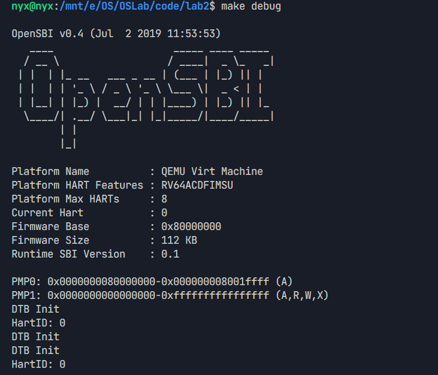
**Step 3 终端二 attach 宿主进程并下断点：**

```
(gdb) attach 711
(gdb) handle SIGPIPE nostop noprint                          # 忽略 QEMU 管道断开信号
(gdb) break get_physical_address if addr == 0xffffffffc0200000   # 条件断点①
(gdb) continue → ^C                                          # 长时间未命中，中断
(gdb) break get_physical_address                             # 无条件断点②，命中一次：
      get_physical_address(..., addr=0, access_type=0, mmu_idx=3)
```

- 断点①未命中的原因：guest 被 `-S` 冻结，内核尚未运行，目标地址从未被翻译
- 断点②虽命中，但 `mmu_idx=3` 即 PRV\_M，M 模式翻译直接 `*physical = addr` 返回、不走页表遍历，无观察价值 → 删除
- 改为在 TLB 填充入口下断点：

```
(gdb) break riscv_cpu_tlb_fill                                            # 断点③（无条件）
(gdb) break riscv_cpu_tlb_fill if address == 0xffffffffc02010f2           # 断点④（条件，page_init 地址）
```

**Step 4 终端三连接 guest 并放开 CPU：**

- 初次连接报 `Ignoring packet error` / `Remote replied unexpectedly to 'vMustReplyEmpty': timeout`：根因是终端二曾把 QEMU 冻结（断点/Ctrl+C），gdbstub 无法响应 → 让终端二处于 `Continuing.` 状态后重连成功
- 连接成功后读到 `0x0000000000001000 in ??`（guest 仍冻结在复位向量，属正常）
- 设置并命中内核断点：

```
(gdb) break kern_init
(gdb) continue
Breakpoint 1, kern_init () at kern/init/init.c:30       # memset(edata, 0, end - edata);
(gdb) break page_init
(gdb) continue
Breakpoint 2, page_init () at kern/mm/pmm.c:67          # uint64_t memory_base = get_memory_base();
(gdb) info registers pc
pc  0xffffffffc02010f2  <pmm_init+52>
```

guest 内核成功进入 `kern_init → pmm_init → page_init`，全程运行在 S 模式。
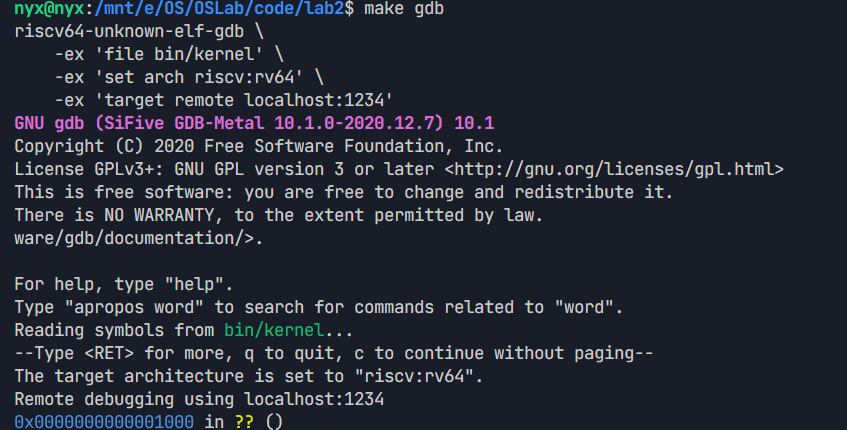
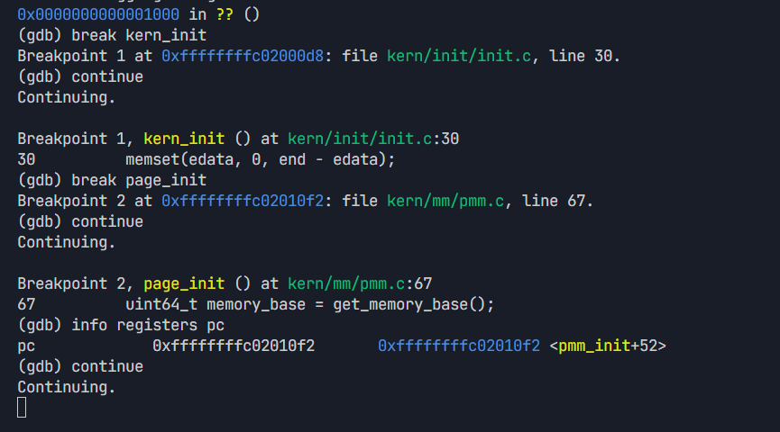
**Step 5 终端二观察地址翻译（与 Step 4 并行）：**

命中 `riscv_cpu_tlb_fill`：

```
riscv_cpu_tlb_fill(cs=0x5ef0adb710e0, address=18446744072637935624, size=8,
                   access_type=MMU_DATA_LOAD, mmu_idx=1, probe=false, ...)
```

- `address = 0xffffffffc0207008`（十进制还原，= KERNBASE + 0x7008，处于 `pages` 描述符数组区，对应内核运行期访问 Page 描述符）
- `size = 8`：一次 8 字节访存（ld 指令）
- `access_type = MMU_DATA_LOAD`：数据读
- `mmu_idx = 1`：PRV\_S，S 模式内核访存 → 真正走 SV39 三级页表遍历

继续观察寄存器状态：

```
(gdb) p env->satp
$4 = 9223372036855300613 = 0x8000000000080205
   → satp.mode = 8（SV39）；satp.ppn = 0x80205 → 根页表物理地址 0x80205000
(gdb) p env->priv
$5 = 1    # PRV_S，确认内核运行在 S 模式
```

`continue` 后再次命中（`address = 0xffffffffc0208200`，同样位于描述符区），说明内核运行期频繁访问该区，翻译过程可重复观察。


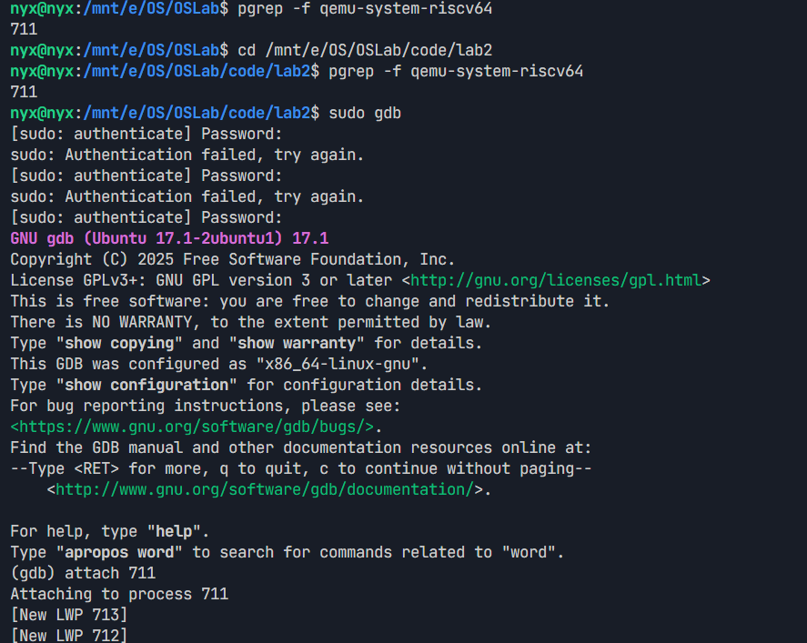
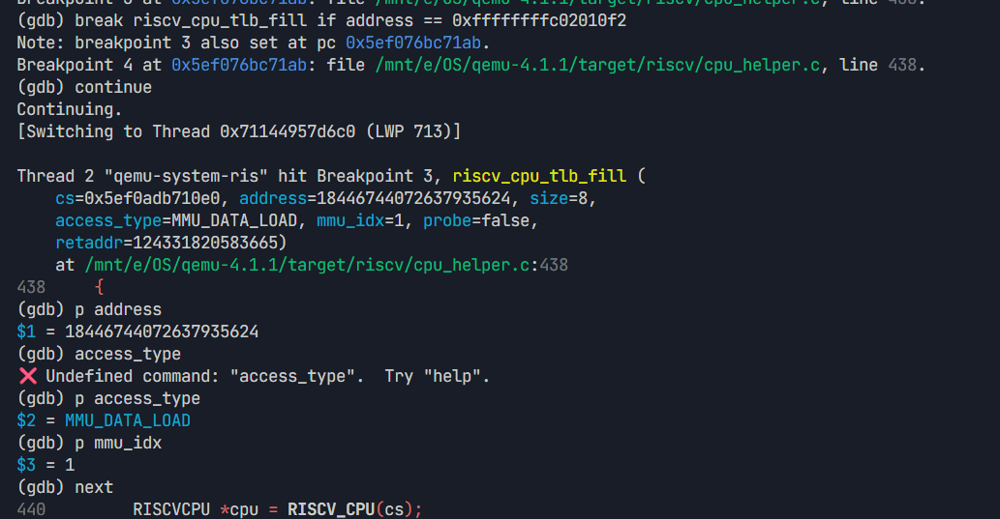
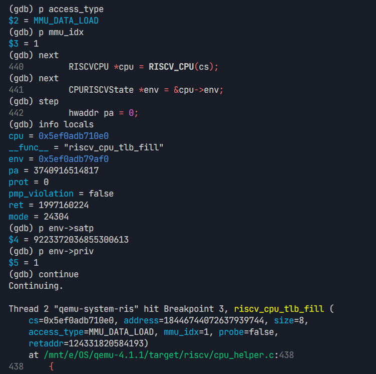

**Step 6 遇到的问题与解决：**

1. 无条件断点随每次 TLB fill 命中 → QEMU 宿主进程反复冻结 → 终端三丢包。解决：改用条件断点（限定目标虚拟地址 / `mmu_idx==1`）或观察完即删除
2. 条件断点①未命中：guest 冻结未运行内核 → 先通过终端三 `continue` 放开 CPU 再等待命中
3. 终端二与终端三是"同一 QEMU 进程、两个控制层面"：终端二（ptrace）冻结进程时，终端三（gdbstub）必然失联，二者须错峰操作

**结论：** 双 GDB 架构成功打通。终端二证明：S 模式内核访存（`mmu_idx=1`）进入 `riscv_cpu_tlb_fill → get_physical_address` 的 SV39 三级遍历路径，根页表物理地址 0x80205000；终端三证明：guest 内核在 S 模式下执行 `kern_init → page_init`。两端对照即可完整还原"虚拟地址 0xffffffffc020xxxx → 三级页表遍历 → 物理地址"的翻译全过程。

#### 问题 6：大模型交互记录

调试过程中与 AI 的交互记录：

| 遇到的问题                                                  | AI 的解决方案                                                                                               |
| ------------------------------------------------------ | ------------------------------------------------------------------------------------------------------ |
| `make debug` 报 `E:OSqemu... No such file or directory` | WSL 下 Makefile 中反斜杠会被当作转义符，改为正斜杠绝对路径 `/mnt/e/OS/qemu-4.1.1/riscv64-softmmu/qemu-system-riscv64`        |
| 遗忘 WSL 用户 sudo 密码                                      | 在 Windows 侧以 `wsl -u root` 进入 root 身份，执行 `passwd` 重置普通用户密码                                             |
| `sudo gdb` 报 `gdb: command not found`                  | 执行 `sudo apt update && sudo apt install -y gdb` 安装原生 x86 gdb                                           |
| `make debug` 启动后长时间无输出                                 | 解释 `-s -S` 参数含义：guest CPU 冻结等待 GDB，无输出属正常现象                                                            |
| 终端三连不上、报 `Ignoring packet error` / timeout             | 解释三层终端"同一进程、两个层面"的关系：终端二（ptrace）冻结 QEMU 时 gdbstub 无法响应，需终端二处于 `Continuing.` 状态                         |
| 条件断点 `addr == 0xffffffffc0200000` 不命中                  | guest 冻结未运行内核，目标地址从未被翻译；先通过终端三 `continue` 放开 CPU                                                       |
| 无条件断点命中 `addr=0, mmu_idx=3`                            | 分析 `mmu_idx=3` 即 PRV\_M，M 模式翻译直接返回物理地址、不走页表，无观察价值；建议改在 `riscv_cpu_tlb_fill` 下断点并用 `mmu_idx==1` 过滤 S 模式 |
| 不理解 satp / 十进制地址的含义                                    | 帮助解码：`satp=0x8000000000080205` → SV39 + 根页表 0x80205000；十进制地址还原为 `0xffffffffc0207008`                   |

**AI 协作经验小结：**

1. 宿主侧断点必须加条件：无条件断点会冻结整个 QEMU，导致 guest 侧 gdb 丢包
2. 先放行 CPU 再下目标断点：guest 未运行前，针对内核虚拟地址的条件断点不会命中
3. 观测值要与内核符号表（entry / end / pages 地址）对照，才能确定被翻译地址的真实含义

***

## 五、测试与验证

### 5.1 测试 page\_init() 函数

**验证方法：**

1. `make` 编译通过，无 error / warning。
2. `make qemu` 观察串口输出。
3. GDB 断点 `check_alloc_page`，查看 `page_init()` 执行后的全局变量。

**验证结果：**

| 验证项                  | 输出                   | 含义                                     | 正确性 |
| -------------------- | -------------------- | -------------------------------------- | --- |
| `npage`              | `557056`（`0x88000`）  | 可管理物理页号上界 = 128MB / 4KB                | ✅   |
| `nbase`              | `524288`（`0x80000`）  | DRAM 起始物理页号 = `0x80000000` / 4KB       | ✅   |
| `va_pa_offset`       | `0xffffffff40000000` | 虚实偏移 = KERNBASE - DRAM\_BASE           | ✅   |
| `pages`              | `0xffffffffc0207000` | `Page` 描述符数组起始虚拟地址 = `end` 之后按页对齐      | ✅   |
| `nr_free_pages()`    | `31929`              | 空闲物理页数 ≈ 128MB/4KB − 内核 − 描述符数组 − 对齐空隙 | ✅   |
| `check_alloc_page()` | `succeeded!`         | `default_check()` 全部通过                 | ✅   |

**验证结论：**

`page_init()` 正确设置了 `va_pa_offset`、`npage`、`pages`，正确保留了 OpenSBI、内核镜像、`Page` 描述符数组所占页面，空闲页数合理，`check_alloc_page() succeeded!` 表明 `default_pmm_manager` 的分配 / 释放逻辑在初始空闲区上全部通过。功能模块一 · 任务一完成。

**测试截图：**
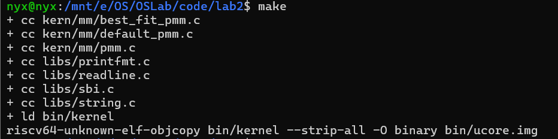
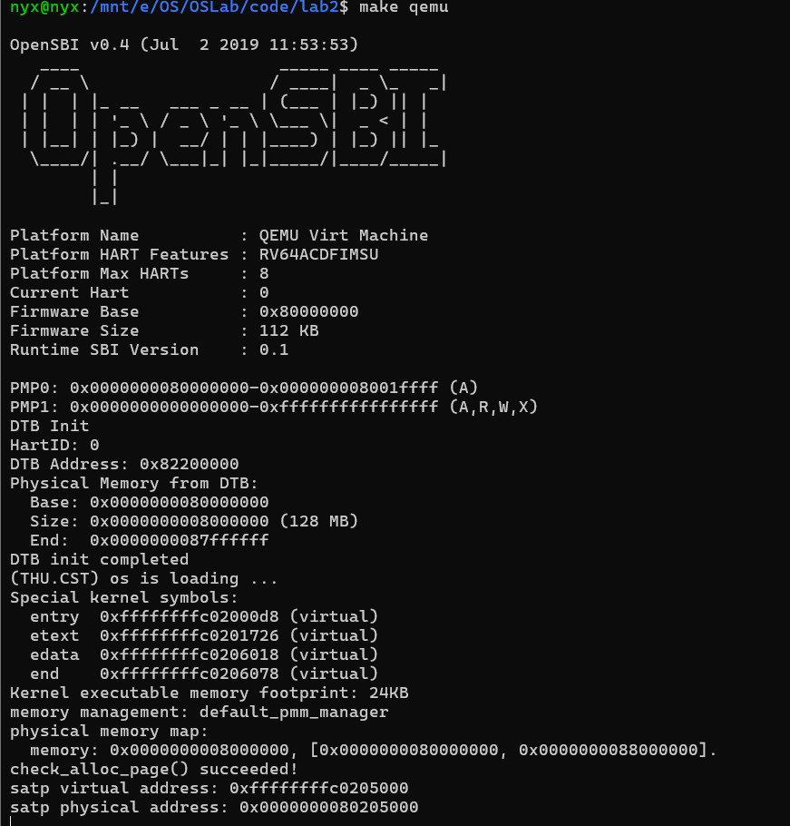
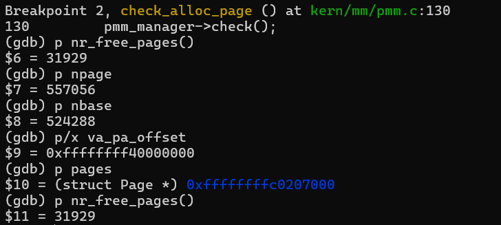

***

### 5.2 测试 Best-Fit 分配器

**验证方法与实际运行截图：**

以下三张图片均为本人实际操作时保存的终端截图，分别对应编译、运行和评分三个阶段。

**（1）编译与链接**

在 WSL 中进入实验目录，执行：

```bash
cd /mnt/c/Users/xin20/Desktop/OSLab-lab2/code/lab2
make
```

图 5-2 展示了各源文件的编译、内核链接和镜像生成过程。终端执行到 `objcopy` 并返回命令提示符，没有出现编译错误；随后启动了 QEMU。该截图用于证明本次代码可以完成构建。

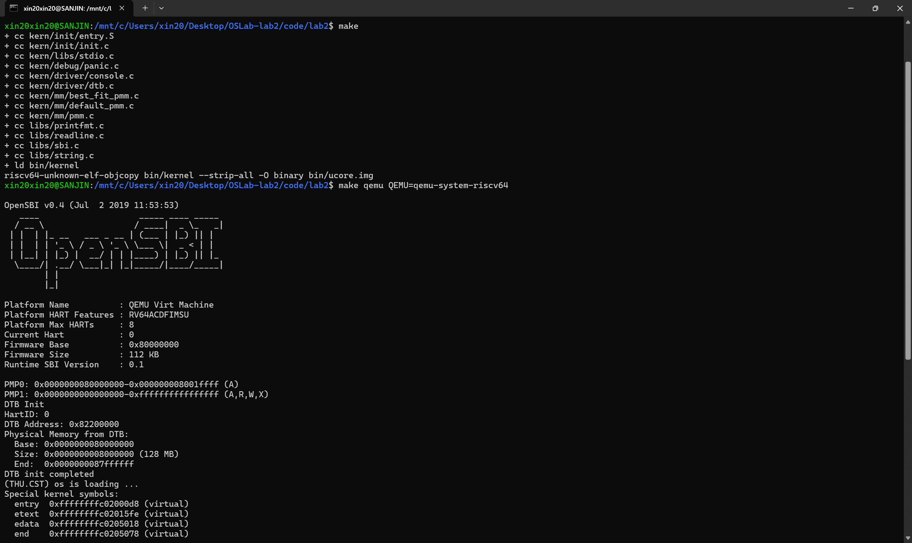

**（2）运行 Best-Fit 并检查结果**

执行：

```bash
make qemu QEMU=qemu-system-riscv64
```

图 5-3 中的 `memory management: best_fit_pmm_manager` 证明运行时已切换为 Best-Fit；`check_alloc_page() succeeded!` 证明原有分配检查正常返回。两条输出需要结合起来看：前者确认“使用了哪个算法”，后者确认“对应检查是否通过”。输出结束后内核进入等待循环，不自动返回终端属于当前实验的正常行为。

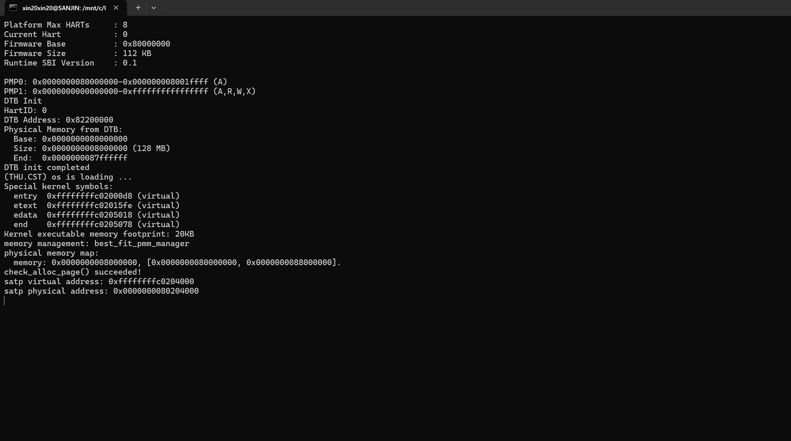

**（3）运行项目评分检查**

先按 Ctrl+A，松开后按 X 退出 QEMU，然后执行：

```bash
make grade QEMU=qemu-system-riscv64
```

图 5-4 中显示 `check page init: OK`、`check best fit: OK`，最终为 `Total Score: 20/20`。图中的 `QEMU: Terminated` 是退出上一次模拟器运行的提示，评分结果位于它下方，不是算法异常退出。

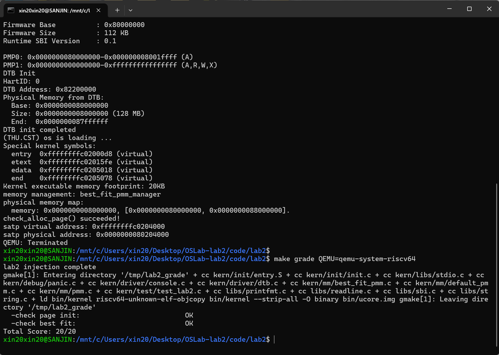


**验证结果：**

| 验证项 | 实际输出或证据 | 可以得出的结论 |
| --- | --- | --- |
| 编译与链接 | 生成 `bin/kernel`、`bin/ucore.img`，无编译错误 | 当前实现与框架接口兼容 |
| 管理器选择 | `memory management: best_fit_pmm_manager` | 实际运行 Best-Fit，而非默认 First-Fit |
| 原有算法检查 | `check_alloc_page() succeeded!` | `best_fit_check()` 及其调用的 `basic_check()` 正常完成 |
| 初始化评分 | `check page init: OK` | 当前环境满足评分脚本的初始化检查 |
| Best-Fit 接入评分 | `check best fit: OK` | 评分测试确认管理器指针是 `best_fit_pmm_manager` |

**测试覆盖与证据边界：**

`basic_check()` 验证单页分配、返回页不重复、引用计数、地址范围、空闲耗尽及释放后复用。`best_fit_check()` 检查空闲页统计，并在隔离的五页区域中释放两页块和一页块，随后申请一页，要求返回原来的一页块：`assert(p0 + 4 == p1)`。这个断言能够区分当前地址顺序下的 First-Fit 和 Best-Fit，是选择策略的直接证据。

该检查随后申请剩余两页，再释放完整五页并重新申请，最后核对空闲块数量和总页数恢复。因此，它覆盖了分配、释放及状态恢复的一部分关键行为。

### 5.3 测试 SLUB Challenge 与完整回归

**验证命令：**

```bash
cd code/lab2
sh tools/verify_slub.sh
```

该脚本执行`make clean`、完整编译和QEMU启动，并从真实串口日志中同时检查以下三项：

```text
memory management: best_fit_pmm_manager
check_alloc_page() succeeded!
slub_check() succeeded!
```

`slub_check()`覆盖的测试如下：

| 测试类别 | 实际检查 | 目的 |
| --- | --- | --- |
| 非法或边界请求 | 0字节返回`NULL`，2049字节返回`NULL`，释放`NULL`安全返回 | 检查接口边界 |
| 大小类别边界 | 1、8、9、24、63、64、65、255、511、1024、2000字节 | 检查向上选择最小cache |
| 数据独立性 | 向每个对象的全部请求长度写入不同字节并逐字节读回 | 检查对象不重叠且容量足够 |
| 多slab扩容 | 连续申请96个对象，其中85个为64字节 | 迫使同一cache使用多个物理页 |
| 释放与复用 | 交错释放64字节对象后重新分配 | 检查freelist回收路径 |
| 无泄漏 | 全部释放后比较`nr_free_pages()`与测试前完全相等 | 检查空slab整页归还Best-Fit |

本次实际运行还使用课程`inject.py`在临时副本中注入原有测试，并在相同QEMU 10.2.1环境运行。输出依次包含：

```text
check_alloc_page() succeeded!
slub_check() succeeded!
[Test 1] Page Init: PASS
[Test 2] Best-Fit: PASS
```

这证明新增SLUB层没有破坏`page_init()`和Best-Fit的既有行为。常规运行日志保存在[`evidence/slub_qemu.log`](./evidence/slub_qemu.log)，课程注入测试日志保存在[`evidence/course_injected_tests.log`](./evidence/course_injected_tests.log)。下图由实际关键行生成，便于在Markdown报告中核对；两个日志文件保留了完整OpenSBI和内核运行输出。

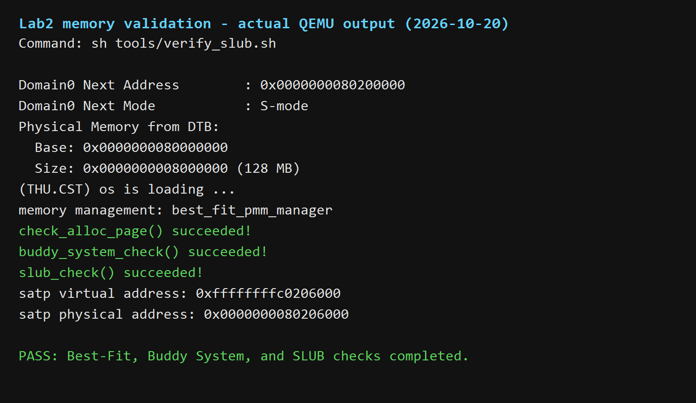

## 六、实验总结与收获

### 对操作系统的理解

1. 本实验中的重要知识点及其与 OS 原理中知识点的对应关系：

| 本实验中的知识点                                          | OS 原理中的知识点                                 | 含义、关系与差异                                                                                                                                                                                                                                               |
| ------------------------------------------------- | ------------------------------------------ | ------------------------------------------------------------------------------------------------------------------------------------------------------------------------------------------------------------------------------------------------------ |
| `struct Page` 页描述符数组                              | 物理页框（frame）管理                              | OS 原理把物理内存划分为固定大小的页框，由页描述符记录每个页框的状态；ucore 用一个连续的 `Page` 数组（由 `nbase`、`npage` 界定范围）为所有可管理物理页建立描述符，通过 `SetPageReserved` 等标志位标记状态，是原理中"页框管理"的代码落地                                                                                                         |
| `pmm_manager` 框架与空闲页链表                            | 连续内存分配算法（First-Fit / Best-Fit / Worst-Fit） | 原理中的连续分配算法描述策略层面的"如何选择空闲块"；ucore 用 `struct pmm_manager` 统一抽象出 init / init\_memmap / alloc\_pages / free\_pages / nr\_free\_pages / check 等接口，再分别用 `default_pmm_manager`（First-Fit）和 `best_fit_pmm_manager`（Best-Fit）实现，通过空闲页链表上的 `property` 记录块大小并实现合并 |
| `PADDR` / `KADDR`、`va_pa_offset`、`nbase`          | 逻辑地址与物理地址的转换、地址空间布局                        | 原理中地址转换由 MMU 完成；ucore 在软件侧维护"虚拟地址 = 物理地址 + 偏移"的关系（`va_pa_offset = KERNBASE - KERNEL_BEGIN_PADDR`），`PADDR`/`KADDR` 即内核镜像区虚实地址的双向换算，`pa2page` 则完成物理地址到描述符下标（物理页号）的换算                                                                                     |
| 设备树（DTB）物理内存探测                                    | 系统启动时的内存配置发现                               | 原理中通常假定 OS 从固件/BIOS 获得内存信息；ucore 通过 `get_memory_base()` / `get_memory_size()` 从设备树读取物理内存基址与大小，使内核无需硬编码内存布局，运行时即可知道可管理的内存范围                                                                                                                             |
| Sv39 三级页表、页表项（PTE）、1 GiB 大页                       | 页式内存管理、多级页表                                | 原理中页表项包含物理页号与标志位（有效位 V、读写执行权限 R/W/X、访问位 A、脏位 D 等）；ucore 的启动页表把 `[0xffffffffc0000000, 0xffffffffffffffff]` 用一个叶子大页映射到 `[0x80000000, 0xc0000000)`，并用 `satp` + `sfence.vma` 开启分页，体现了多级页表"按需建项、节省内存"的思想                                                    |
| TLB 与 `sfence.vma`                                | 快表（Translation Lookaside Buffer）           | 原理中 TLB 利用时间和空间局部性缓存近期虚实映射、减少页表访问次数；ucore 在修改 `satp` 后必须执行 `sfence.vma` 刷新 TLB，保证新旧映射一致，这正是原理中"TLB 一致性"问题的具体体现                                                                                                                                         |
| `pmm_init() -> init_memmap() -> alloc/free_pages` | 内存管理初始化与分配回收闭环                             | 原理中内核先初始化内存管理数据结构再提供服务；ucore 的调用链完整呈现了"探测 → 建描述符 → 注册空闲区 → 分配/回收"的生命周期，分配时在空闲链表上取下满足要求的块，回收时合并相邻空闲块并归还链表                                                                                                                                               |

1. OS 原理中很重要、但在本实验中没有对应上的知识点：

- **缺页异常与页面置换算法（swap）**：本实验只完成了物理内存的管理与页表映射，没有实现虚拟存储，也就没有"缺页 → 换入换出"的处理流程（后续 lab9 会涉及）。
- **虚拟内存 / 逻辑地址空间的管理**：本实验中的虚拟地址空间是内核的一张大页映射，尚未涉及进程各自的地址空间、内存映射区域（vma）以及按需分配等抽象（后续 lab4/lab5 会涉及）。
- **伙伴系统（Buddy System）**：本实验的扩展只选择了 SLUB，而原理中 Buddy 是内核内存管理的重要算法；其按 2 的幂次划分/合并块的思想与 First-Fit/Best-Fit 差异显著。
- **页表项的动态建立与多级页表的完整构造**：本实验的启动页表是在汇编中静态构造的一级大页映射，尚未实现运行时动态创建/撤销页表项、缺页时按需填项的过程。
- **页面的换出与内存回收的整体机制**：本实验实现了简化的单核SLUB对象分配器，但尚未覆盖页面置换、内存回收阈值、并发锁、每CPU缓存、NUMA以及完整Linux SLUB中的调试与性能机制。

### AI 协作开发的经验

本次实验是全程与 AI 协作完成的，几点实际感悟：

1. **把需求"规格化"比"描述性"提示有效得多**：功能模块一（`page_init`）的成功关键在于提示词中明确了前置条件与后置条件——必须区分虚拟地址、物理地址、物理页号和 `Page` 描述符地址，所有地址按 `PGSIZE` 对齐，`end` 符号要先用 `PADDR()` 转成物理地址再计算空闲区，`[nbase, npage)` 全部描述符先置为 reserved，再调用 `init_memmap`。AI 生成代码时严格遵循这些约束，一次就接近正确。
2. **"负面约束"要写进提示词**：例如"不得修改 `init_memmap`、`pa2page` 等现有函数""不得修改测试函数 `basic_check` / `best_fit_check`""设备树信息无效时必须 `panic`、没有完整空闲页时不得调用 `init_memmap`"，这类约束有效防止了 AI 为了通过测试而"偷改框架"。
3. **报错信息原样回传、小步迭代**：当 AI 生成的代码出现编译错误或逻辑错误时，把完整的错误信息（含文件行号）直接反馈给它，让它基于错误做定向修复，比笼统地说"有问题"收敛更快。实现过程中经历了"先写对主路径、再补边界分支（DTB 无效、无空闲页）"的多轮迭代。
4. **AI 生成 ≠ 正确，人工 review 不可省**：生成的代码必须对照实验手册的调用链 `pmm_init() -> init_pmm_manager() -> page_init() -> init_memmap() -> alloc_pages()/free_pages()` 逐段核对语义，特别是地址换算与对齐这类"错了也不报错"的隐蔽问题，只能靠人理解内存布局来发现。
5. **小组分工与交接要围绕"统一的知识基线"**：本次采用 A（骨架+功能模块一）→ B（功能模块二）→ C（Challenge+整合+提交）的接力式分工，由于三人都基于同一份指导书、同一套 `pmm_manager` 框架，交接时只需交代"改动了哪些文件、在哪个函数、遵循什么约束"，衔接成本很低，也保证了报告与代码的一致性。

***

