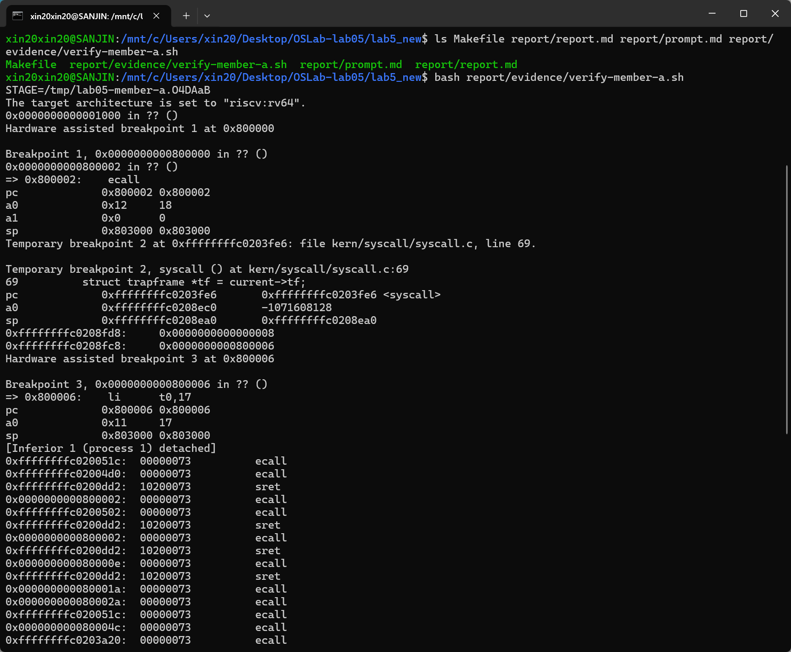
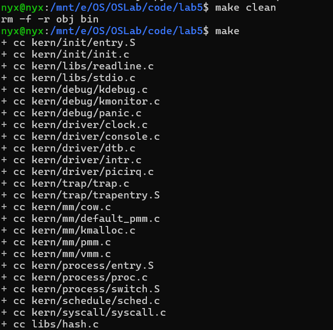
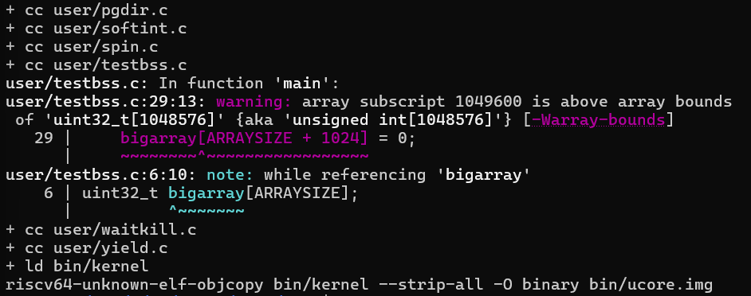
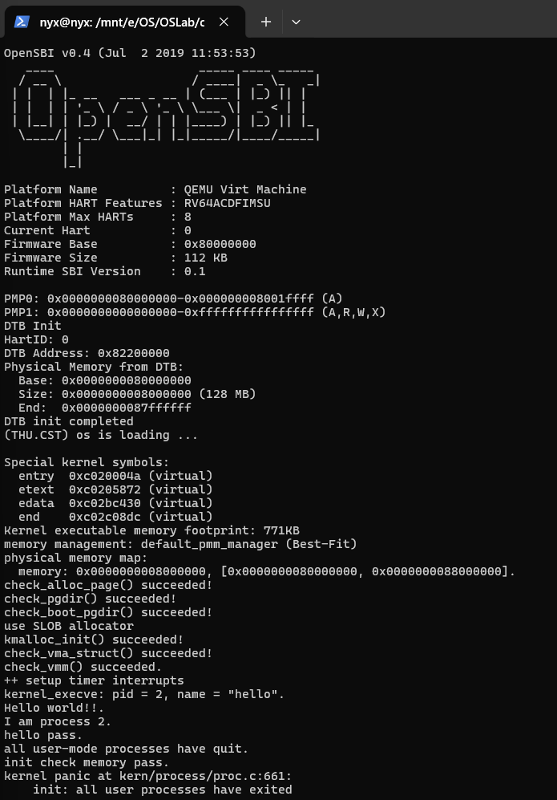
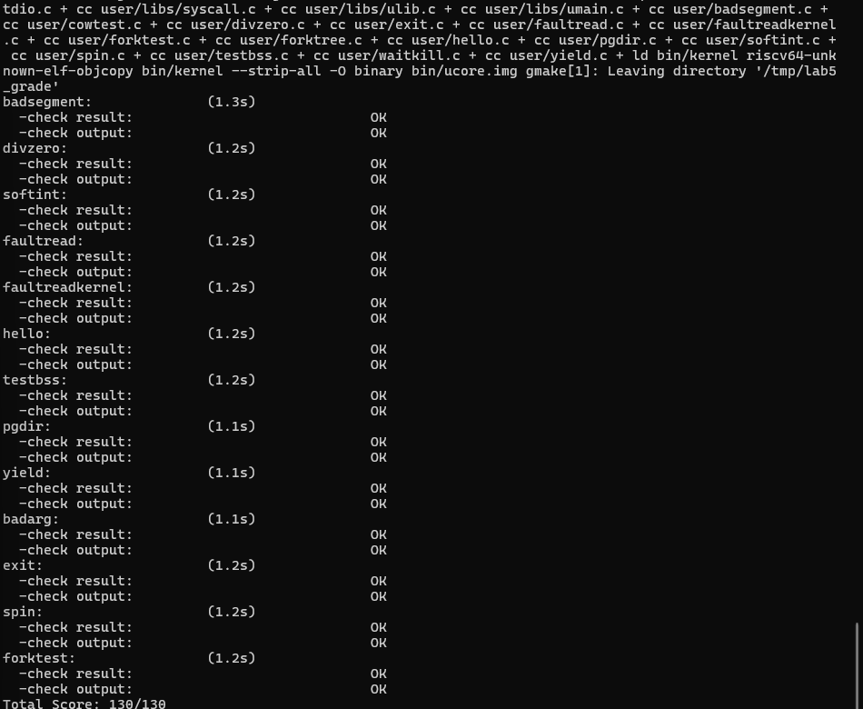
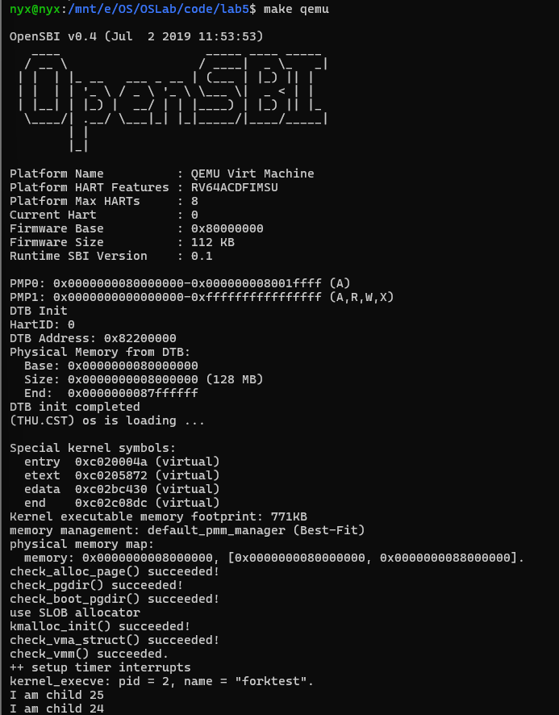
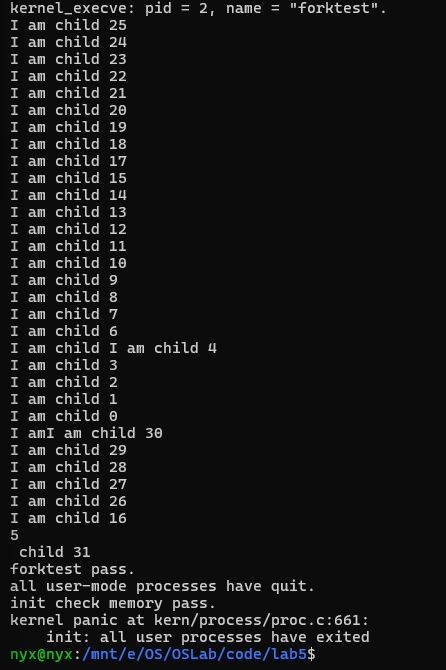

# 操作系统实验报告

## 实验基本信息

| 项目       | 内容                                 |
| -------- | ---------------------------------- |
| **实验名称** | Lab 5：用户程序                         |
| **小组成员** | 2411061-牛雨萱、2410721-何熹淳、2414166-滕鑫 |
| **记录日期** | 2026-11-25                         |
| **报告状态** | 已完成。                               |

### 小组分工

**练习/模块分工：**

| 成员          | 负责的练习/模块                                          | 当前状态                               |
| ----------- | ------------------------------------------------- | ---------------------------------- |
| 2414166-滕鑫  | 功能模块一、Lab2/Lab3/Lab4 的相关前置整合、双重 GDB、COW Challenge | 模块一与双重 GDB 已有独立证据，本轮 COW 接入及状态检查通过 |
| 2410721-何熹淳 | 模块二含 do\_wait、模块四；报告汇总                            | 主体代码已有，本轮补齐必要集成修复与核验               |
| 2411061-牛雨萱 | 模块三普通 fork 基线、整合验收                                | 四个标记区域已补齐，保留 COW 独立构建分支            |

**实验报告分工：**

| 成员          | 负责的报告部分                                  |
| ----------- | ---------------------------------------- |
| 2414166-滕鑫  | 整体框架、前置整合、模块一规格与实现、双重 GDB、COW 设计和独立测试    |
| 2410721-何熹淳 | 装载、wait/exit/yield/kill 说明及报告汇总，本轮据实核验补齐 |
| 2411061-牛雨萱 | fork 复制、基线与 COW 接口、分工审查、集成修复和验收记录        |

***

## 一、实验目的

1. 理解 ucore 如何创建、装载并运行第一个用户进程。
2. 掌握异常入口、系统调用分发和返回用户态的执行过程。
3. 理解 fork、exec、wait、exit 和相关进程控制的协作。
4. 通过双重 GDB 观察特权级切换与 QEMU 指令翻译，并通过 Challenge 理解写时复制。

***

## 二、实验环境

| 项目    | 本次实际环境                                    |
| ----- | ----------------------------------------- |
| 宿主环境  | Windows、Ubuntu WSL                        |
| 交叉编译器 | riscv64-unknown-elf-gcc，SiFive GCC 10.2.0 |
| 模拟器   | QEMU 4.1.1，virt 平台，宿主侧使用带调试信息的构建          |
| 固件与内存 | OpenSBI v0.4，128 MiB，单 hart               |
| 实验代码  | 仓库根目录下的 `code/lab5/`                      |

**AI 工具使用情况：**

| 成员          | AI 编程工具 | 备注                                 |
| ----------- | ------- | ---------------------------------- |
| 2414166-滕鑫  | Codex   | 代码实现、前置代码迁移、QEMU 双重 GDB 与 COW 独立验证 |
| 2410721-何熹淳 | Codex   | 本轮仅核验其已有代码，不追溯虚构生成对话               |
| 2411061-牛雨萱 | Codex   | 本轮代码核验、模块三、集成测试、规格与报告补全            |

***

## 三、实验整体逻辑分析

### 3.1 本章节的逻辑主线

Lab04 启动并调度内核线程，Lab05 先补齐异常入口与返回，再由 `init_main` 启动 `user_main`，将构建进镜像的 ELF 段映射到进程地址空间。第一次进入 U 态和后续系统调用返回共用 `__trapret`。用户进程运行后，`fork` 复制现场和地址空间，`exit` 释放自身用户空间并进入僵尸态，父进程通过 `wait` 取得退出码并回收剩余资源。`yield` 和 `kill` 分别驱动重新调度和退出。Challenge 让私有 `fork` 的可写页推迟复制到首次写入。

用户进程的主线如下。

```text
proc_init → init_main → user_main → kernel_execve → load_icode → sret
          → 用户程序 → ecall → syscall → fork / exec / wait / exit → sret
```

预加载分两步。构建时独立用户 ELF 被作为二进制附加到内核镜像，启动后镜像已经在物理内存。进程运行前，`load_icode` 才根据 ELF 段创建用户映射与栈。通用操作系统通常运行文件系统中的可执行文件，并可按需建立映射。本实验把程序嵌入镜像，因而当前阶段即可测试进程机制。

### 3.2 功能的逐步实现

1. 迁移 Lab2 的物理内存管理、Lab3 的 Trap、Lab4 的页表与进程调度前置逻辑。
2. 建立 U 态系统调用入口，恢复寄存器并返回正确的特权级。
3. 创建首个用户进程，加载 ELF 并经异常返回进入用户态。
4. 完成进程复制以及等待、退出、让出 CPU 和终止进程。
5. 运行课程评分和独立调试，接入 COW 并回归普通 fork。

***

## 四、实验内容与实现

### 前置工作：Lab2/Lab3/Lab4 代码整合

**负责人：** 2414166-滕鑫。

以下文件路径均相对于 `code/lab5/`：

| 文件                                         | 改动                                                                |
| ------------------------------------------ | ----------------------------------------------------------------- |
| `kern/mm/pmm.c`                            | 迁移物理页初始化和页映射操作，补充分配失败回滚，保留 TLB fence 的编译器屏障                       |
| `kern/mm/default_pmm.c`                    | 迁移 Best-Fit 分配器，适配 Lab05 的 `free_area` 和 `default_pmm_manager` 声明 |
| `kern/trap/trapentry.S`                    | 补全 Trap 到 C 函数的入口，扩展 `RESTORE_ALL`，保留 `forkrets`                  |
| `kern/trap/trap.c`                         | 重设时钟事件并分发用户系统调用和写缺页异常                                             |
| `../../report/evidence/verify-member-a.sh` | 在临时副本构建调试内核，保留 QEMU 与两侧 GDB 的验证记录                                 |

`page_init()` 保留原有 2411061 标记，Best-Fit 和页表操作保留 2414166 标记。Lab05 的模块一改动标为 `lab5 function1 2414166`。

### 功能模块：**【功能模块一：用户态系统调用功能（设计提示词借助 AI 完成）】**

**负责人：** 2414166-滕鑫。

#### 模块功能描述

需要在 `code/lab5/kern/trap/` 和 `code/lab5/kern/syscall/syscall.c` 中补全：

```c
static void exception_handler(struct trapframe *tf);
void syscall(void);
static int sys_exit(uint64_t arg[]);
static int sys_fork(uint64_t arg[]);
static int sys_wait(uint64_t arg[]);
static int sys_exec(uint64_t arg[]);
static int sys_yield(uint64_t arg[]);
static int sys_kill(uint64_t arg[]);
static int sys_getpid(uint64_t arg[]);
static int sys_putc(uint64_t arg[]);
static int sys_pgdir(uint64_t arg[]);
```

同时完成汇编入口与 `RESTORE_ALL`，并让 `sys_pgdir` 调用 `print_pgdir()`。系统调用入口负责分发，进程操作由对应模块的 `do_*` 实现。

#### Spec 的设计

规定 TrapFrame 的先决状态、系统调用编号及参数位置、成功与失败时的返回值，以及 U 态和 S 态的栈恢复规则。用户 `ecall` 的返回地址必须前移，COW 写缺页成功后则重试原指令。

#### 最终提示词

完整规范提示词统一维护于 [prompt.md](prompt.md)，其中模块一逐项列出接口及 Pre/Post、Case、Requirements，避免报告中维护不同版本。

#### 实现思路与正确性分析

- `SAVE_ALL` 用 `sscratch` 区分用户栈与内核栈，保存通用寄存器与 CSR，`__alltraps` 把现场地址交给 C。处理期间 `sscratch=0`。恢复时按保存的 `SPP` 决定下次用户 Trap 所需的内核栈地址。先恢复 CSR 及其余寄存器，最后恢复 `sp` 后执行 `sret`。
- `exception_handler` 对用户 `ecall` 将返回地址前移 4 字节。分发从 trapframe 读完整 64 位调用号，检查范围及空槽后再查表。用户封装将参数放入 `a1` 至 `a5`，处理结果写回保存的 `a0`。进入 C 函数后实时寄存器可以被编译器用于传参，实际用户参数要看 trapframe。
- `sys_exit/fork/wait/exec/yield/kill` 通过 `do_*` 交给进程模块。等待的非空退出码指针须可写，执行新 ELF 前须校验名称和 ELF 缓冲区。 `sys_getpid` 读取 PID，`sys_putc` 向内核控制台输出，`sys_pgdir` 显示当前用户页的虚拟地址和权限。
- `interrupt_handler` 重新设置下一次时钟事件并标记重新调度。对不可恢复的用户异常终止当前进程，内核异常则打印现场并停机。页表与 Best-Fit 前置代码从已有 Lab04 实现迁移。

#### 实现迭代过程

先依据模板确认寄存器、栈布局和模块边界，再为每个接口写前置条件、后置条件和错误案例。以下是本轮真实排查摘要。

| 情景                                                                         | 验证与处理                                                      |
| -------------------------------------------------------------------------- | ---------------------------------------------------------- |
| 模板用户调用封装读了未传入的可变参数，还用 64 位 store 写入 32 位返回变量                               | 对照调用约定改成固定参数和显式寄存器约束，由 C 转换返回值                             |
| 初次迁移 Lab04 页管理代码时，正则误抓了 `get_pte` 内的旧标记，导致定义重叠。Lab05 头文件还声明了外部 `free_area` | 用首轮交叉编译的重定义和可见性诊断定位，分别迁移映射函数与回滚逻辑，按 Lab05 声明定义 `free_area` |
| 用户 COW 测试找不到 `assert.h`                                                    | 对照课程已有测试，改用 `ulib.h` 内的用户态断言，再重新编译                         |
| 默认 QEMU 能运行但无法按源码下断点                                                       | 先测符号，再在本机定位带符号的同版本构建，完成实际双重 GDB                            |

### 功能模块：**【功能模块二：创建加载第一个用户进程】**

**负责人：** 2410721-何熹淳。

#### 模块功能描述与实现思路

已有 alloc\_proc、kernel\_thread、init\_main、user\_main、kernel\_execve、do\_execve、load\_icode 和 do\_wait。load\_icode 校验 ELF 头和段范围，建立 VMA、页表和用户栈，复制文件数据并清零段剩余部分，最后设置用户 sp、epc 和返回 U 态的 status。用户镜像在链接时随内核预载，并非运行时从文件系统读取。kernel\_execve 直接复用 forkrets/\_\_trapret；手册允许这种较清晰的首次进入方式，不必强行通过 ebreak 进入。

do\_execve 在销毁旧映像前保存用户传入的名称和 ELF 数据，再释放最后引用的旧 mm，装载新映像。do\_wait 区分指定子代、任意子代、僵尸和需睡眠等待的情形；最终回收内核栈与 PCB。普通 exit 自身不能回收当前仍在使用的栈。

#### Spec、提示词与核验结果

完整四段式提示词见 [prompt.md](prompt.md) 成员 B。现有实现不是空白，但核验前尚未证明完整可运行：do\_wait 的 C99 标签后直接接声明导致编译错误；user\_main 固定 hello 导致课程程序选择失效；init\_main 返回后会尝试退出被保护的 init。

### 功能模块：**【功能模块三：复制用户进程】**

**负责人：** 2411061-牛雨萱。

#### 模块功能描述

在 proc.c 的两处 function3、vmm.c/pmm.c 各一处 function3 标记内实现 do\_fork、copy\_mm、dup\_mmap、copy\_range，并补齐缺失的 copy\_thread。

#### Spec 与最终提示词

完整四段式文本见 [prompt.md](prompt.md) 成员 C。前置条件包括源现场、有效页表、普通用户范围、目标未发布；后置条件包括父返回 PID、子返回零、独立内核栈与正确 mm 所有权。正常、共享 mm、空洞和资源不足按独立 Case 描述，不以函数调用步骤代替需求。

#### 实现思路与正确性分析

- do\_fork 仅在 PCB、栈及 mm 成功准备后，才在临界区分配 PID、挂哈希和父子链、唤醒线程；失败先释放栈再释放 PCB。
- copy\_thread 把现场复制到新内核栈，令子 a0=0，保留父的用户返回 PC 和显式用户 sp；无显式 sp 的内核线程使用合法新栈，并以 forkret 建立首次执行链。
- copy\_mm 对无用户 mm 的内核线程不复制用户空间；CLONE\_VM 共享同一 mm 并增加 mm\_count；普通 fork 分配新 mm/根表，在源 mm 锁下复制，失败销毁部分映像。
- dup\_mmap 先登记对应 VMA，保留区间和权限，使失败清理覆盖已复制页面。默认调用 copy\_range 深复制；显式 LAB5\_COW 构建才委托 A 的 cow\_copy\_range。
- copy\_range 复制每个有效源页的完整内容与映射权限，跳过空洞；普通路径使用新物理页。新页尚未映射时失败由本函数释放，已映射部分由调用者按 VMA 清理。share 参数显式为真时共享页引用，但系统调用普通 fork 默认不走该路径。

#### 实现迭代过程

本模块及其集成验收按实际问题分为三轮迭代。以下将提示词需要明确的约束与实际修复对应列出；最终提示词见 [prompt.md](prompt.md)，失败日志与截图见 5.3。

##### 第一次迭代：补齐普通 fork 链路与运行依赖

**遇到的问题：**

- 起始四处 function3 标记均为空，且缺少 `copy_thread`，无法建立子进程独立内核栈和首次运行现场。
- 首轮构建暴露 `do_wait` 的标签后声明不符合当前 C99 编译要求；修复后，链接又暴露 Lab4 的 `schedule`、`switch_to` 尚未迁入。这些是集成依赖问题，不能只补四个函数就认为模块可运行。

**问题解决策略：**

- 在提示词的 `[RELY]` 中明确 PCB、页表、VMA、调度及现场恢复接口；在 `[SPECIFICATION]` 中分别规定父返回子 PID、子返回零、私有复制与 `CLONE_VM` 共享语义，以及失败时回收未发布资源。
- 实现 `do_fork`、`copy_mm`、`dup_mmap`、`copy_range` 和 `copy_thread`，先准备资源，再发布和唤醒子进程。
- 补齐调度与寄存器切换依赖，修正标签语法；标记外改动添加学号及中文注释，并在下方清单说明。

**本轮结果：** 编译和链接障碍解除，默认用户程序能够启动；尚未以此认定完整验收通过。首轮失败保留于 [build-first-attempt.log](evidence/member-c/build-first-attempt.log)。

---

##### 第二次迭代：修复评分接口与退出资源回收

**遇到的问题：**

- 课程测试从其他编译单元调用 `exception_handler`，与原函数的 `static` 可见性冲突，导致评分链接失败；评分脚本还存在 CRLF 换行兼容问题。
- 首轮完整评分为 **123/130**：`forktest` 的 32 个子代及等待已经执行完成，但收尾空闲页数断言未通过。因此“子进程能运行”仍不足以说明资源生命周期正确。
- 核验发现 SLOB 保留完整空闲堆页；同时，`exit_range` 不能只因某个 VMA 对应局部为空就回收整张仍可能服务其他 VMA 的中间目录。

**问题解决策略：**

- 在提示词的 `[RELY]` 中明确课程测试需要的可链接接口；修正函数可见性并将脚本换行为 LF，保留原评分断言。
- 在 `[SPECIFICATION]` 中补充退出后映射、物理页引用、页表和 PCB 均应正确回收的条件；前后资源比较采用一致的堆缓存状态。
- 增加显式 `kmalloc_trim` 归还完整空闲堆页，修正页表回收边界，并在 init 等待所有后代后检查子列表、进程数和空闲页数。

**本轮结果：** 修复后完整评分达到 **130/130**。保留 [评分链接失败记录](evidence/member-c/grade-link-failure.log)、[123 分记录](evidence/member-c/grade-123.log) 和 [资源断言失败记录](evidence/member-c/forktest-memory-failure.log)，不以删除断言代替修复。

---

##### 第三次迭代：验证页级语义与最终集成

**需要进一步确认的问题：**

- 仅靠用户输出不能区分真正的物理页深复制和共享映射，需要独立验证普通 fork 的页级隔离。
- COW 为成员 A 的扩展任务，需要明确与 C 的普通 fork 基线之间的构建边界，避免默认行为被无条件替换。
- 最终集成还需防止新用户栈暴露旧页内容，以及旧用户映像释放后装载失败仍返回旧 PC。

**问题解决策略：**

- 在提示词中明确默认深复制，只有显式 `LAB5_COW` 构建才调用 COW 复制接口；通过 `LAB5_COPY_SELFTEST` 控制补充页级自检。
- 补充检查物理页独立性、权限、空洞跳过与资源清理；扩展构建另验证 COW 共享、写时分裂及单引用恢复。自检不进入普通构建的默认执行路径。
- 对用户栈清零、装载失败退出等集成边界作必要修正，再运行原有完整评分；后续根据人工截图补充 `make`、`make qemu`、`forktest` 和 `make grade` 验收证据。

**最终结果：**

- 编译、链接通过，默认 hello 和普通 `forktest` 运行通过。
- 原有完整评分 **130/130**，用户进程退出后的资源检查通过。
- 普通复制与 COW 的补充验证记录分别见 5.3.3 和 5.5；页级补充记录早于最终装载边界加固，最终加固后另已重新运行完整评分。

**关键改进点总结：**

1. `[RELY]` 列出真实依赖，避免只生成局部函数而遗漏调度和恢复链路。
2. `[SPECIFICATION]` 同时约束成功路径、失败回滚和最终资源回收。
3. 将普通 fork 与 COW 的验收分开，以物理页断言和课程评分分别支持相应结论。

### 功能模块：**【功能模块四：其余系统调用】**

**负责人：** 2410721-何熹淳。

已有 do\_exit、do\_yield、do\_kill。do\_exit 切回内核根表，减少共享 mm 的持有者计数，最后引用释放时销毁映像；将当前线程置为僵尸，保存退出码、唤醒父代、转交孤儿并调度离开。do\_yield 设置重调度标志，由用户 Trap 返回路径实施调度。do\_kill 标记 PF\_EXITING，必要时唤醒可中断等待，目标在统一用户返回检查中安全退出。保护 idle/init，拒绝无效目标。

本轮没有改 do\_exit/yield/kill 主体；do\_wait 回写改用 A 的 copy\_to\_user，避免 COW 分支睡眠后内核写回绕过私有化。所有接口规格按 Lab0.5 模板列在 prompt.md，测试不得以改断言代替修复。

### 标记外必要改动清单（2411061）

| 位置                                            | 必要原因与改动                                                                              |
| --------------------------------------------- | ------------------------------------------------------------------------------------ |
| schedule/sched.c、process/switch.S 的 Lab4 迁移位置 | 原本为空，链接缺失 schedule；迁入轮转调度和14寄存器切换，属于依赖补齐                                             |
| proc.c:do\_wait                               | C99 标签后加空语句修编译；负 PID 返回框架要求的 BAD\_PROC；回写使用 copy\_to\_user 兼容 COW                    |
| proc.c:user\_main                             | 接通 TEST/TESTSTART/TESTSIZE 的原有程序选择，默认仍为 hello，否则所有评分只能运行同一程序                         |
| proc.c:init\_main                             | init 不能普通退出；等待回收后检查子列表、进程数与空闲页，再进入监控器                                                |
| proc.c:load\_icode/do\_execve                 | 新用户栈清零，避免暴露旧物理页内容；旧用户映像已释放后装载失败必须退出，不能返回旧用户PC                                        |
| mm/kmalloc.c、kmalloc.h                        | 增加显式 kmalloc\_trim，回收空闲块中的完整页；压力创建后缓存留存不能被当作用户泄漏，也不能删断言绕过                            |
| mm/pmm.c:exit\_range                          | 扫描整张中间目录确认无有效子项后才释放，避免跨 VMA 的页表被误弃或泄漏                                                |
| trap/trap.c:exception\_handler                | 课程测试从其他编译单元调用，移除 static 保留可链接接口，处理逻辑不变                                               |
| default\_pmm.c:name                           | 导出接口名为 default\_pmm\_manager，显示为 default\_pmm\_manager (Best-Fit)，满足原框架标识并如实保留实际算法说明 |
| tools/grade.sh、根目录 .gitattributes             | 只将 CRLF 规范为 LF，使 sh 可解析，并固定 shell 脚本后续检出为 LF；未改测试用例和评分模式                             |

### 扩展练习：Challenge——写时复制（COW）

**负责人：** 2414166-滕鑫。

#### 1. 页面共享与状态转换

`cow_copy_range` 在单 hart 的中断保护区中为子映射增加引用，原来可写的页先在子页表建立只读 COW 映射，再将父页表降权并使旧 TLB 条目失效。标记使用 Sv39 的软件保留位。原来只读的页可以共享，保持只读且没有 COW 标记。

| 当前状态          | 事件                  | 后续状态                       |
| ------------- | ------------------- | -------------------------- |
| 私有可写          | 私有 fork             | 父、子只读 COW，物理页引用增加          |
| 真正只读          | fork 或写入            | fork 后仍只读。写入拒绝             |
| 只读 COW，引用大于 1 | 有权限的写缺页或内核写回        | 写入方获得独立可写页。旧页仍供其他进程使用      |
| 只读 COW，引用为 1  | 有权限的写缺页或内核写回        | 原映射恢复写权限，保留原物理页            |
| 共享映射          | exit、exec 或失败的子进程清理 | 放弃一个映射引用。最后一个引用释放后归还物理页    |
| 只读 COW        | 分配失败                | 原映射继续保持只读，返回错误。用户故障由退出路径处理 |

#### 2. 写缺页处理与权限保护

`cow_resolve_write` 要求 VMA 允许写、PTE 是有效用户映射且有 COW 标记。陷阱修复后不修改 `epc`，使原写指令重试。 `copy_to_user` 和等待退出码预检也检查受影响的每一页。经典 Dirty COW 体现了写授权、页身份和映射变化不同步的风险。本实现限定于单 hart，通过原 VMA 权限和 PTE 标记双重检查，并把引用计数及映射变更放在同一受保护路径。多 hart 还需要页表同步和跨核 TLB 失效。本实验以正常功能和只读保护回归为验证范围。

#### 3. 私有 fork 接入与失败清理

接入位置在 `dup_mmap` 中为新地址空间建立对应 VMA 后的私有复制分支，默认保留深复制，显式 `LAB5_COW` 构建才启用 COW。基础分支保留 `copy_range`，Challenge 分支改用 `cow_copy_range(to->pgdir, from->pgdir, start, end)`。若中途失败，调用方按已有 VMA 销毁未发布子进程的地址空间。父映射已降权的页可在下次写入时通过单引用路径恢复。 `CLONE_VM` 在共享整个 `mm` 的路径保持原语义，`do_wait` 写回退出码时使用 `copy_to_user`。


### 扩展练习 2：用户程序的预加载时机及与常用系统的区别

负责人：2411061-牛雨萱

**题目：** 说明该用户程序是何时被预先加载到内存中的？与我们常用操作系统的加载有何区别，原因是什么？

**回答：** 用户程序在构建阶段先被编译、链接成 ELF 文件，`Makefile` 的内核链接规则通过 `--format=binary $(USER_BINS)` 将这些 ELF 文件的原始字节嵌入内核。构建阶段只是生成包含用户程序的镜像文件；真正进入模拟机物理内存发生在 QEMU 启动并装载该内核镜像时。因此，在内核执行到用户程序创建流程之前，用户 ELF 的字节就已经随内核镜像驻留 RAM。

这里要区分“ELF 文件字节已在内存”和“用户进程已装载完成”：运行到 `user_main → kernel_execve → do_execve → load_icode` 时，内核才选择对应内嵌 ELF，解析程序段，建立用户 VMA 和页表、分配物理页、复制段内容、清零 BSS 及用户栈，并设置首次进入用户态的现场。预加载并没有省去用户地址空间的创建和权限设置。

常用 Linux 等系统通常在执行程序时，根据文件系统中的可执行文件建立进程映像，并广泛采用按需分页；可执行文件的各页可能在访问时才实际调入，也可能已存在于页缓存中，并不要求在系统启动时把所有用户程序嵌入内核。本实验则把测试程序随内核提前放入 RAM，程序选择和内核镜像构建相互关联，不能像完整系统那样直接从文件系统加载任意新程序。

原因是本阶段尚未实现完整的文件系统及从磁盘读取可执行文件的路径。采用内嵌预加载方式，可以先绕开存储 I/O，让实验集中验证用户地址空间、ELF 装载、特权级切换和进程生命周期。

***

## 五、测试与验证

### 5.1 模块一独立验证的方法和结果

从仓库根目录在 WSL 中配置工具链和带符号的 QEMU 后运行脚本。脚本把课程源码复制到临时目录，为独立验证补充最小进程环境。

| 检查                        | 实际结果                     |
| ------------------------- | ------------------------ |
| Best-Fit、页表、SLOB、VMA 自检   | 通过                       |
| 用户态 getpid 和 putc         | 通过                       |
| 未实现或越界的调用号                | 返回 `-E_INVAL`            |
| ecall 到 sret 和用户栈恢复       | 双重 GDB 观测通过              |
| COW 分裂、原只读页保护和解除映射        | 独立断言通过                   |
| 完整 Lab05 构建、COW 用户程序与课程评分 | 原独立记录当时未覆盖；本轮结果见 5.3/5.5 |

实际输出包含：

```text
HOST_ECALL pc=0x800002 priv=0 exception=8
HOST_SRET pc=0xffffffffc0200dd2 sepc=0x800006 priv=1
MEMBER A SMOKE PASS
退出码：0
```

证据：[客户机 GDB 日志](evidence/member-a-guest-gdb.log)、[宿主 GDB 与 QEMU 日志](evidence/member-a-host-gdb.log)、[验证脚本](evidence/verify-member-a.sh)。

#### 5.1.1 验证命令与启动环境

```bash
export PATH="/opt/riscv/riscv64-unknown-elf-toolchain-10.2.0-2020.12.8-x86_64-linux-ubuntu14/bin:$PATH"
export QEMU_DEBUG=/opt/riscv/qemu-4.1.1/riscv64-softmmu/qemu-system-riscv64
bash report/evidence/verify-member-a.sh
```

QEMU 运行在 virt 平台，使用 OpenSBI v0.4 和 128 MiB 内存。脚本开头会打印临时目录，便于核对原始输出。

#### 5.1.2 系统调用功能、前置依赖与双重 GDB 验证

在临时内核中，宿主 GDB 启动带调试信息的 QEMU 4.1.1 并保留两个条件断点。客户机 GDB 从 U 态 `getpid` 追到内核 `syscall`，再在下一条用户指令处停住。临时内核仅用于隔离验证模块一和 COW，不作为组员模块或课程评分结果。原始记录见 [客户机 GDB](evidence/member-a-guest-gdb.log)、[宿主 GDB](evidence/member-a-host-gdb.log)，可用 [验证脚本](evidence/verify-member-a.sh) 复查。

| 观测点                | 实际值                                               |
| ------------------ | ------------------------------------------------- |
| 用户 `ecall` 前       | PC `0x800002`，`a0=18`（`SYS_getpid`），`sp=0x803000` |
| 宿主进入异常 helper      | `priv=0`，真实 `ecall` 的异常号为 8                       |
| 内核 `syscall`       | 切换到内核栈，保存的 `cause=8`，框架已将 `epc` 更新为 `0x800006`    |
| 宿主进入 `helper_sret` | `priv=1`，`sepc=0x800006`                          |
| 返回用户态              | PC `0x800006`，`a0=17`（测试 PID），`sp=0x803000`       |



图 5-1　客户机 GDB 记录了 `getpid` 执行 `ecall`、进入内核 `syscall`，并返回到下一条用户指令的过程。

QEMU 的 `trans_ecall` 在翻译块中生成异常 helper 并结束翻译块，实际执行时 `helper_raise_exception` 设置异常编号并退出 CPU 执行循环。随后 `riscv_cpu_do_interrupt` 按原特权级确定 ecall 原因，再按委托位更新 `scause`、`sepc`、`sstatus`，选择 S 态入口。返回时 `trans_sret` 生成 helper 调用，`helper_sret` 检查特权、读取 `sepc`、按照 `SPP/SPIE` 恢复模式与中断状态，并把返回地址交回后续执行。宿主回溯里的 `code_gen_buffer` 是实际执行的 TCG 产物。Lab02 的双重 GDB 更关注访存时触发的 TLB 查询和页表遍历；这两次都需要区分翻译块产生的代码与执行中调用的软件 helper。

实际排查中，`/usr/local/bin` 的 QEMU 可启动但没有符号。检查 `nm` 后，在本机保留的 QEMU 4.1.1 构建目录找到了带调试信息的可执行文件，改由宿主 GDB 启动它。宿主断点在同一 PC 还先抓到一次编号 65538 的调试事件。根据源码和随后出现的编号 8，使用后者与客户机的 `scause` 对齐。正常调试已装入的课程用户 ELF 时，可在客户机 GDB 执行 `add-symbol-file obj/__user_exit.out`。这次的临时指令片段由夹具放在已知虚拟地址，因此直接按 PC 下断点。

#### 5.1.3 独立验证完成结果

独立 QEMU 冒烟覆盖了实际用户写缺页、共享页分裂、旧页内容隔离、单引用恢复原页权限、原只读页拒绝升级、解除映射后引用减少。正常用户态测试 `user/cowtest.c` 还覆盖子进程先写、父进程先写以及 `waitpid` 回写，本轮已接入并运行，见 5.5。


图 5-2　宿主 GDB 捕获了 `HOST_ECALL`（异常号 8）和 `HOST_SRET`。独立测试输出 `MEMBER A SMOKE PASS`，脚本退出码为 0。

### 5.2 功能模块二：首个用户进程创建及装载验证

通过原有 make/qemu 入口启动默认 hello。实际日志出现用户态输出 `Hello world!!. / I am process 2. / hello pass.`，随后父线程等待回收并通过资源检查。完整评分覆盖了 ELF 载入、BSS、非法用户访问、父子等待及退出。启动日志见 [boot.log](evidence/member-c/boot.log)；其中管理器名称属于标识适配前记录，后续评分显示 default\_pmm\_manager (Best-Fit)。

程序 ELF 是在构建时由 `--format=binary` 链接进内核镜像，QEMU 装载内核时其字节已在 RAM；load\_icode 运行时才解析段并建立目标用户页表。与通用系统从文件系统执行、按需调页不同，本实验尚无对应文件系统，所以预载用于绕开磁盘读文件环节。课堂记录中的首次“返回用户态”强调伪造现场复用返回机制；当前实现采用手册允许的直接 forkrets 路径。

### 5.3 功能模块三与完整集成验收

#### 5.3.1 编译、启动及真实失败记录



图 5-3　执行 `make clean`、`make`，编译内核各模块。



图 5-4　`testbss` 的故意越界语句产生警告，但构建继续完成链接及 `bin/ucore.img` 生成；警告解释见 5.3.4。



图 5-5　默认 hello 进入用户态，输出 `hello pass.`；所有用户进程退出后，`init check memory pass.` 表明收尾资源断言通过。最后的 `init: all user processes have exited` 是当前实现主动结束 init 的提示，见 5.3.4。

```bash
cd /mnt/e/OS/OSLab/code/lab5
export PATH="/mnt/e/OS/riscv64-unknown-elf-toolchain-10.2.0-2020.12.8-x86_64-linux-ubuntu14/bin:/usr/local/bin:/usr/bin:/bin"
make -j2
make qemu
make grade
```

自动采集启动输出时使用 `timeout 8s make qemu` 给持续运行的模拟器设置上限；进程进入 monitor 或被 timeout 终止，不等于 SBI 正常关机。

| 实际迭代                           | 证据/结论                                                                                         |
| ------------------------------ | --------------------------------------------------------------------------------------------- |
| 首轮 C99 编译报 do\_wait 标签后声明      | [build-first-attempt.log](evidence/member-c/build-first-attempt.log)，修标签语法                    |
| 完整链接缺少 schedule                | 补齐 Lab4 依赖后链接通过，最终 [build.log](evidence/member-c/build.log)                                   |
| 评分脚本不能按 sh 解析                  | [grade-first.log](evidence/member-c/grade-first.log)，仅 CRLF→LF                                |
| 课程测试外部引用 exception\_handler 失败 | [grade-link-failure.log](evidence/member-c/grade-link-failure.log)，导出原函数                      |
| 首轮完整评分 123/130                 | [grade-123.log](evidence/member-c/grade-123.log)                                              |
| forktest 的32个子代均完成，收尾页数断言失败    | [forktest-memory-failure.log](evidence/member-c/forktest-memory-failure.log)，补充堆空闲页归还、修页表回收边界 |
| 修复后原有完整评分                      | [grade.log](evidence/member-c/grade.log)，130/130                                              |

#### 5.3.2 原有课程评分结果

```text
forktest:                (1.2s)
  -check result:                             OK
  -check output:                             OK
Total Score: 130/130
```



图 5-6　本次 `make grade` 的实际截图：13 个用例的 result/output 检查均为 OK，包括 `testbss`，总分为 `130/130`。这是课程评分范围内的通过证据，不表示已经穷举所有异常与并发情况。

#### 5.3.3 普通 fork 基线的页级与用户级验证

普通用户级压力测试使用框架提供的入口：

```bash
make clean
make build-forktest
make qemu
```



图 5-7　`make qemu` 启动后，`kernel_execve` 装载 `forktest`，开始执行子进程。



图 5-8　子进程输出后出现 `forktest pass.`、`all user-mode processes have quit.` 和 `init check memory pass.`，验证普通 fork 创建及退出回收路径。并发进程共享控制台，字符输出可能交错；不要求子进程编号按顺序出现。

以下另为已有的页级补充验证记录，不将上述普通 `forktest` 截图当作页级断言的证据：

```bash
make clean
make -j2 build-cowtest DEFS+=-DLAB5_COPY_SELFTEST
make qemu
```

实际输出：

```text
[C selfcheck] eager copy physical independence/permissions PASS
[C selfcheck] sparse range and cleanup PASS
cow isolation pass.
all user-mode processes have quit.
init check memory pass.
```

这次用户程序还验证父/子返回分支、两种先写顺序、waitpid 退出码传递。证据：[eager-build.log](evidence/member-c/eager-build.log)、[eager-boot.log](evidence/member-c/eager-boot.log)。自检只在显式宏构建中执行；正常基线不增加自检输出。

#### 5.3.4 命令行提示与适用边界

- `kmalloc.c` 的 `-Wint-conversion` 已修复：在 `__slob_free_pages` 中将 `kva2page(kva)` 改为 `kva2page((void *)kva)`，明确把整数形式的内核虚拟地址转换为接口要求的指针，并添加 `2411061` 中文注释。这是 LAB5 标记外的必要类型修正，未改变释放页的地址或数量。修复后使用实验原有 `make` 重新编译、链接成功，日志见 [type-fix-build.log](evidence/member-c/type-fix-build.log)；此次仅重新构建，前述完整评分为此前运行结果。
- `testbss.c:29` 的 `-Warray-bounds` 源自课程测试有意制造非法访问：`bigarray` 有 `1048576` 个元素，有效下标为 `0` 至 `1048575`，而测试写入下标 `1049600`。源码在此之前明确输出 `Now doing a wild write off the end...`；`tools/grade.sh` 对该用例也检查这一输出及 `testbss may pass.`。因此这是编译器对故意非法操作的预期诊断，不是正常业务代码中可以忽略的越界缺陷。`make grade` 会重新编译该用户程序，故同一警告还会出现；本次截图显示构建成功，且 `testbss` 的 result/output 均为 OK、总分 `130/130`，说明它未妨碍课程评分要求的验收。保留该测试，不改成合法下标、不扩大数组，也不全局关闭警告；这些做法会改变测试目的或隐藏其他问题。该结论仅针对本测试和当前实验工具链，不能据此认为任意 C 越界访问都安全。
- `init: all user processes have exited` 的 panic 是资源断言通过后明确进入监控器的收尾方式；不是某用户异常未恢复造成的内核崩溃，也不是用户进程仍无法退出。
- 当前只有单 hart 语义，内核线程及共享 mm 路径的并发扩展、通用 ELF 硬化不在本轮穷举范围。

### 5.4 功能模块四：进程控制验证

exit 用例覆盖父等待子、子退出后返回指定退出码、重复 wait 拒绝；spin 覆盖杀死运行中的子进程再等待；badarg 覆盖非法 PID 与不可写退出码地址；课程内核测试覆盖 do\_yield 标志和无效 do\_kill/do\_wait。COW 用户用例另外验证父在共享写页上接收 waitpid 退出码时仍保持私有化。

普通 exit 先释放用户 mm 并成为僵尸，父 wait 再释放栈/PCB；所有用户后代回收后 init 断言 cptr 为空、nr\_process 回到基线。trim 前后都按相同的“堆完整空闲页已归还”条件比较 nr\_free\_pages，保留了真实资源断言。

### 5.5 Challenge 端到端验证与 Dirty COW 分析

```bash
make clean
make -j2 build-cowtest DEFS+=-DLAB5_COW DEFS+=-DLAB5_COPY_SELFTEST
make qemu
```

实际输出：

```text
[C selfcheck] COW share/split/single-reference PASS
[C selfcheck] readonly authorization fault injection rejected PASS
[C selfcheck] sparse range and cleanup PASS
cow isolation pass.
all user-mode processes have quit.
init check memory pass.
```

证据：[cow-build.log](evidence/member-c/cow-build.log)、[cow-boot.log](evidence/member-c/cow-boot.log)。页级断言检查共享同一物理页且 ref=2、首次写后目标独立、旧页 ref=1、单引用恢复仍使用原物理页；真正只读页没有自动获得 COW 写授权。用户程序检查父先写和子先写及内核等待回写，最终资源检查通过。

**受控故障模拟与修复说明：** [Dirty COW 官方事件站点](https://dirtycow.ninja/) 描述的是 Linux 私有只读映射在 COW 处理中的竞争导致的越权写。本实验没有 madvise、get\_user\_pages、/proc/self/mem 和对应 Linux 并发路径，不能声称复现 CVE-2016-5195 的原始利用。这里模拟同类授权错误：在未发布的只读测试映像中故意置写位和软件位，断言出现“PTE 可写而 VMA 不允许写”的错误状态，随后恢复；再只注入伪造的 COW 标记，实际调用安全处理函数，要求其依据 VMA 拒绝升级并保持映射和引用不变。错误状态仅存在于 detached 测试页表，没有真实用户执行它。

修复原则是逻辑写授权与 PTE 软件标记双重校验、在单 hart 临界区内更新映射/引用、同步 TLB，并要求内核 copy\_to\_user 同样触发分裂。这个实验验证的是授权故障注入和修复回归，不是 Linux 竞争漏洞的等价复现；多 hart 或引入页固定/文件映射后仍需重新设计锁和身份检查。

***

## 六、实验总结与收获

### 对操作系统的理解

| 实验知识点                       | 对应 OS 原理            | 联系与差异                                                                       |
| --------------------------- | ------------------- | --------------------------------------------------------------------------- |
| `ecall`、TrapFrame 和 `sret`  | 系统调用、特权级隔离          | 硬件先保存部分 CSR，双栈和通用寄存器由软件维护。课程 ABI 的调用号在 `a0`，常见 Linux RISC-V ABI 则在 `a7`。    |
| `fork`、`exec`、`exit`、`wait` | 进程与资源生命周期           | 退出者可释放用户映像，待父进程收取退出码后再回收内核栈和 PCB。普通复制、共享mm、退出及父wait回收分别由明确所有权路径协作，本轮课程用例通过。 |
| COW、页引用和 TLB 失效             | 虚拟内存保护、延迟复制和翻译缓存一致性 | VMA 表示逻辑权限，PTE 表示硬件当前权限，降权后需使旧翻译失效。                                         |
| 普通 fork 的逐页深复制              | 进程隔离                | 父子虚拟地址可相同，私有数据物理页不同；与 COW 延迟复制分开验收                                          |
| SLOB缓存与物理空闲页                | 分层资源回收              | 释放对象不一定立即归还物理页，比较资源基线须统一缓存条件                                                |

OS 原理中重要但本实验未覆盖的内容包括按需调页、页面置换、多核页表同步及远端 TLB 失效、文件系统中的可执行文件加载，以及通用权限和信号模型。

### AI 协作开发的经验

1. 先对照工程函数声明、TrapFrame 布局和用户调用约定写规格，再生成实现。
2. 用交叉编译诊断迁移时的声明和头文件冲突，按真实接口修正后复编。
3. 同时记录客户机寄存器和宿主 QEMU helper，区分调试事件、真实 ecall 与 sret。
4. 独立验证和完整评分分别记录，保留复现命令、实际结果和未覆盖范围。
5. 分工必须使用同一最终版本；系统调用包装与 do\_\* 内核语义不能因名字相似而混为同一任务。
6. 先保留普通fork基线，再用显式构建开关接入COW；同一用户隔离输出必须辅以物理页/PTE断言区分机制。
7. 先保留失败日志再修复；不能为得到预期字符串删除资源断言、修改评分权重或虚构独立模块已全组完成。
