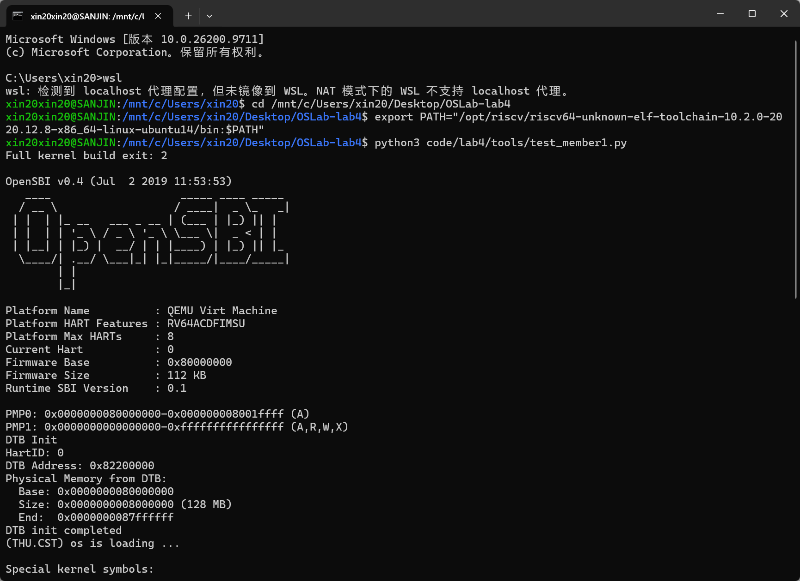
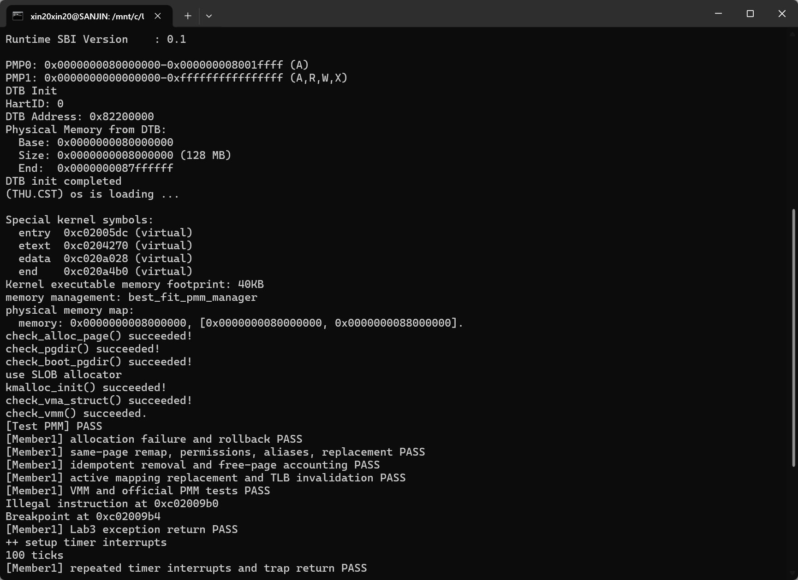
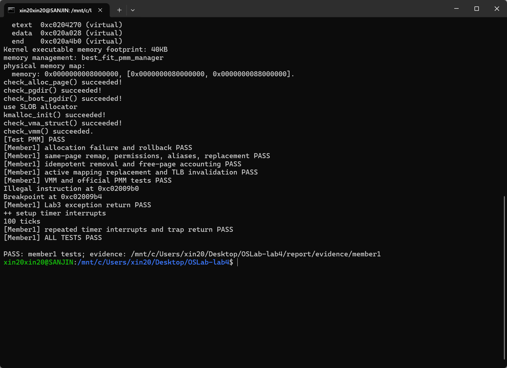
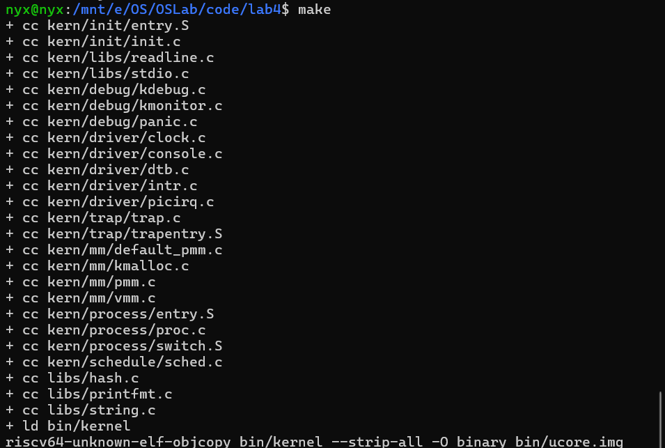
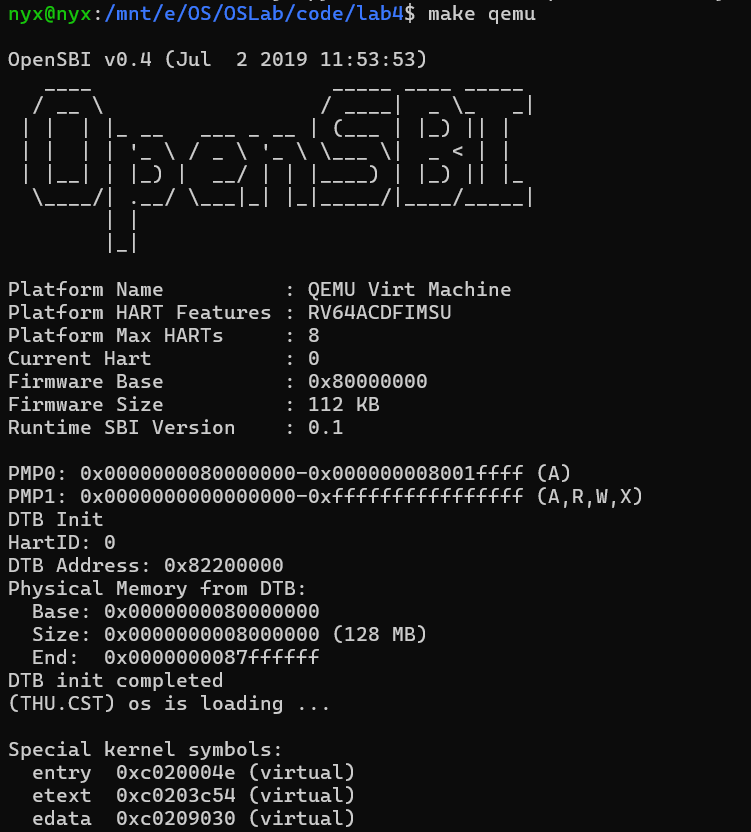
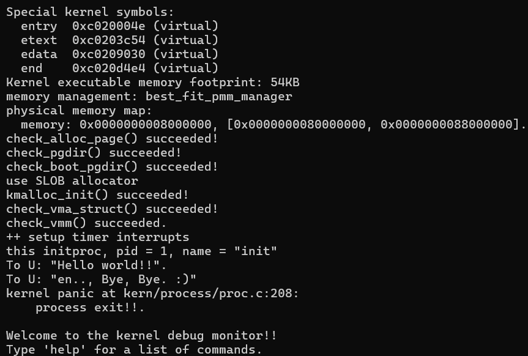
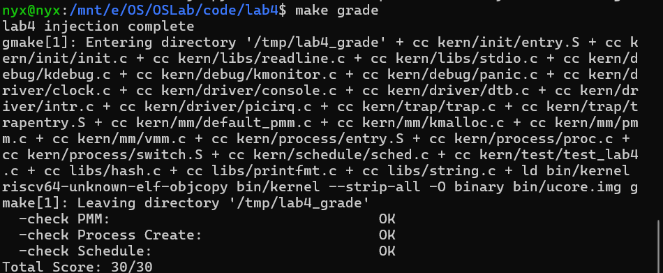

# 操作系统实验报告

## 实验基本信息

| 项目 | 内容 |
| --- | --- |
| **实验名称** | Lab 4：进程管理 |
| **小组成员** | 2411061-牛雨萱、2410721-何熹淳、2414166-滕鑫 |
| **记录日期** | 2026-11-12 |
| **报告状态** | 三个模块与两项 Challenge 已实现；完整构建、原有评分 30/30、补充集成验证通过 |

### 小组分工

**练习/模块分工：**

| 成员 | 负责的练习/模块 | 当前状态 |
| --- | --- | --- |
| 2414166-滕鑫 | 功能模块一：虚拟内存页操作功能；Lab2/Lab3 前置代码整合；Challenge 2 | 已实现，独立验证通过 |
| 2410721-何熹淳 | 功能模块二：进程创建及初始化功能 | 六个函数已有；本轮修正首次运行栈与状态后动态验证通过 |
| 2411061-牛雨萱 | 功能模块三：进程调度；Challenge 1；合并后的运行调试 | 已实现，原有评分与补充验证通过 |

**实验报告分工：**

| 成员 | 负责的报告部分 |
| --- | --- |
| 2414166-滕鑫 | 报告骨架、前置代码整合、功能模块一、spec/prompt、问题处理、独立测试、Challenge 2 和相关原理总结 |
| 2410721-何熹淳 | 进程创建及初始化模块的实现、spec/prompt、调试过程和验证结果 |
| 2411061-牛雨萱 | 进程调度模块、Challenge 1、spec/prompt、调试过程和完整集成验收 |

***

## 一、实验目的

1. 了解虚拟内存管理的基本结构，掌握虚拟内存的组织与管理方式。
2. 了解内核线程创建、执行的管理过程。
3. 了解内核线程的切换和基本调度过程。
4. 在现有多级页表框架上维护映射，正确处理物理页引用计数和 TLB 状态。

***

## 二、实验环境

| 项目 | 本次实际环境 |
| --- | --- |
| 宿主环境 | Windows，Ubuntu WSL |
| 交叉编译器 | riscv64-unknown-elf-gcc，SiFive GCC 10.2.0 |
| 模拟器 | QEMU 4.1.1，virt 平台 |
| 构建工具 | GNU Make 4.4.1 |
| 固件与内存 | OpenSBI v0.4，128 MB 内存，单个运行 hart |
| 实验代码 | 仓库根目录下的 `code/lab4/` |

**AI 工具使用情况：**

| 成员 | AI 编程工具 | 备注 |
| --- | --- | --- |
| 2414166-滕鑫 | Codex | 模块一实现、Challenge2、依赖整合、独立测试和报告整理 |
| 2410721-何熹淳 | Codex | 进程创建模块实现与编译检查 |
| 2411061-牛雨萱 | Codex | 模块三、Challenge 1、首次运行集成修复及完整验收 |

***

## 三、实验整体逻辑分析

### 3.1 本章节的逻辑主线

Lab2 提供物理内存管理和基础页表，Lab3 提供 Trap 保存、处理和返回能力。Lab4 按照“虚拟内存页操作 → 进程创建与初始化 → 进程调度”展开：先建立映射维护能力，再组织线程运行现场，最后通过调度和上下文切换将线程交给 CPU。

```text
kern_init → pmm_init → pic_init / idt_init → vmm_init
          → proc_init → cpu_idle → schedule → proc_run → switch_to
```

本实验的虚拟内存采用预映射方式，内核线程共享内核地址空间。

### 3.2 功能的逐步实现

1. **准备 Lab2/Lab3 依赖。** 迁移物理内存初始化、Best-Fit、启动映射修正、Trap 入口与恢复及中断异常处理。
2. **维护页映射。** 实现 `page_insert()`、`page_remove()`，同步 PTE、引用计数和 TLB，处理内存不足回滚。
3. **建立虚拟内存描述框架。** 使用已提供的 `mm_struct`、`vma_struct` 及其管理函数，现有 VMA 自检已通过。
4. **创建和初始化内核线程。** 建立 PCB、分配内核栈和 PID，设置首次运行现场并登记线程。
5. **调度与执行。** 轮转选择可运行线程，在关中断区域切换 current、Sv39 页表和寄存器上下文。
6. **联合验收。** 完整编译链接、课程三项评分 30/30；回归成员一独立测试，并补充首次运行现场、失败清理、idle 回退、轮转和中断状态测试。

***

## 四、实验内容与实现

### 前置工作：Lab2/Lab3 代码整合

**负责人：** 2414166-滕鑫。

以下文件路径均相对于 `code/lab4/`：

| 文件 | 改动 |
| --- | --- |
| `kern/mm/pmm.c` | 迁移 `page_init()`；实现页映射操作；补充页表分配失败回滚；完善局部 TLB fence 的编译器屏障 |
| `kern/mm/pmm.h` | 为全局 TLB fence 添加 `memory` clobber |
| `kern/mm/default_pmm.c` | 迁移 Lab3 的 Best-Fit 分配器，适配 Lab4 的 `default_pmm_manager` 接口，保留初始框架测试 |
| `kern/init/entry.S` | 迁移开启分页时的恒等映射、栈顶地址低位修正 |
| `kern/trap/trapentry.S` | 补全 Lab3 的 `RESTORE_ALL` 和 Trap 到 C 函数入口，保留 Lab4 的 `forkrets` |
| `kern/trap/trap.c` | 迁移 Lab3 中断、异常处理，去除 Lab3 专用自动关机逻辑 |
| `tools/test_member1.py`、`tools/test_member1.c` | 在临时副本中构建独立测试内核，记录构建与 QEMU 结果 |

前置迁移保留 `page_init()` 原作者 2411061、中断处理原作者 2410721、异常处理原作者 2411061 的标注；Best-Fit 和 Trap 恢复沿用本人 2414166 的实现。Lab4 新增模块标注为 `//LAB4 function1 2414166 滕鑫`。

### 功能模块：**【功能模块一：虚拟内存页操作功能（设计提示词借助 AI 完成）】**

**负责人：** 2414166-滕鑫。

#### 模块功能描述

需要在 `code/lab4/kern/mm/pmm.c` 中实现：

```c
int page_insert(pde_t *pgdir, struct Page *page, uintptr_t la, uint32_t perm);
void page_remove(pde_t *pgdir, uintptr_t la);
```

`page_insert()` 负责建立或更新映射，`page_remove()` 负责删除映射，使指定线性地址对应正确物理页，并保持“页表项内容、物理页引用计数、TLB 状态”三者同步。

#### Spec 的设计

输入遵循框架既有约定：`pgdir` 为合法的 Sv39 根页表内核地址，`page` 为已分配物理页，操作针对 4 KiB 页映射；非页对齐的 `la` 按其所在页定位页表项。调用者提供 `perm`，实现不擅自添加读写执行权限。框架测试中 `perm=0` 等条目用于软件层面的页表检查。

`page_insert(pgdir, page, la, perm)`：

1. 使用 `get_pte(pgdir, la, 1)` 查找或创建页表路径，失败返回 `-E_NO_MEM`。
2. 新映射成功时，目标页增加一次映射引用。
3. 同一地址重复映射同一物理页时，引用计数保持不变，允许更新权限，物理页不能被误释放。
4. 替换其他物理页时，减少旧页引用，引用降到零才释放旧页。
5. 使用 `pte_create(page2ppn(page), perm)` 写入新项，令对应 TLB 失效，返回 0。

`page_remove(pgdir, la)`：

1. 只查找，不分配页表；缺少中间页表或有效项时直接返回。
2. 有映射时清除页表项，使 TLB 失效，减少物理页引用，降到零才释放。
3. 重复删除不再减少引用，也不重复释放。
4. 不自动回收空的中间页表；其生命周期仍由框架或地址空间销毁逻辑负责。

共同不变量是“页表项内容、物理页引用计数、TLB 状态”同步。当前实现遵循课程单 hart 内核使用方式，不提供多核页表锁和远端 TLB shootdown。

#### 最终提示词

以下是按 Lab3 四段式模板整理的本次实现规格与提示词，反映实际使用的约束，不作为逐字对话记录。汇总同时见 [prompt.md](prompt.md)。

```text
[PROMPT]
完成 Lab4 功能模块一：虚拟内存页操作功能，以及 Lab2/Lab3 前置代码整合。
负责人为 2414166 滕鑫，新增实现保留 LAB4 function1 标注。

[RELY]
现有 pmm.c、pmm.h、mmu.h、Page、get_pte、pte_create、page2ppn、
pte2page、引用计数、页分配和 TLB 接口；小组已经完成的 Lab3 代码；
WSL 的 RISC-V 工具链、QEMU 和课程 tools/test_lab4.c 中的 PMM 检查。

[GUARANTEE]
不修改成员二、三、正式 kern_init 入口或课程测试断言。
保留迁移代码的原作者注释，适配 Lab4 接口，不整文件覆盖旧框架。
同页重映射不释放页面、不增加净引用；无映射删除不分配页表。
失败返回 -E_NO_MEM，不泄漏本次已分配的中间页表页。
记录实际代码检查、构建和测试结果，区分独立验证与完整实验验收。

[SPECIFICATION]
page_insert 使用 get_pte(create=1)，区分新建、同页重映射、异页替换，
写入调用者要求的权限，保持 PTE、引用计数、TLB 同步。
page_remove 使用 get_pte(create=0)，无映射幂等返回，有映射则清除、
失效 TLB、减少引用，仅在引用降至零时释放物理页。
get_pte 下层分配失败时只回滚本次新建的上层页表，保留已有父表。
迁移 page_init、Best-Fit、启动修正、Trap 入口与恢复及事件处理；
不迁移 Lab3 测试专用的自动关机行为。
在临时副本验证课程 PMM 检查、分配失败、引用计数、幂等删除、
实际访存/TLB 更新、异常返回和连续时钟中断，保存构建与运行日志。
```

#### 实现思路与正确性分析

插入操作先获得 PTE，再为新页增加引用。已有映射若就是该页，抵消刚增加的引用；若是另一页，则调用 `page_remove()` 释放旧映射。最后写入新 PTE。这样避免“先删后增”在原引用为 1 时将同一物理页释放给分配器。

删除操作先保存旧物理页指针，清零 PTE 并执行地址级 `sfence.vma`，再减少引用和释放页面，避免释放后继续保留旧翻译。`memory` clobber 约束编译器不要把页表写入移过 fence；硬件 fence 与编译器屏障承担不同职责。

框架的 `get_pte()` 在第一次页表分配成功、第二次失败时原本会保留第一次分配。为满足失败时保持干净状态的要求，增加 `new_table`：只记录本次新分配的上层页表；下层失败时清除本次新建的父项、刷新 TLB、清零引用并释放该页。已有的父表不会被误回收。

#### 实现迭代过程

实现过程为：核对接口与框架检查 → 按区域迁移 Lab2/Lab3 → 实现映射维护 → 补充分配失败回滚 → 构建完整内核确认集成边界 → 在临时内核运行独立检查。

本次代码检查及构建中实际确认的问题如下：

| 问题 | 处理及验证 |
| --- | --- |
| 初始 `default_pmm.c` 引用了不存在的 `best_fit_pmm.h`，且分配函数和 manager 实例缺失 | 迁移已有 Best-Fit，使用存在的 `default_pmm.h`，导出 `default_pmm_manager`；保留框架 `basic_check`、`best_fit_check`，自检通过 |
| 初始 `page_init()`、Trap 恢复与事件处理为空 | 从 Lab3 按区域迁移，保留 Lab4 新增代码；页分配、自检、异常和连续中断验证通过 |
| 开启分页时缺少过渡恒等映射，栈顶加载缺少低位 | 迁移前次实验已验证的两项启动修正；QEMU 实际进入内核完成全部独立检查 |
| `get_pte()` 的部分分配失败路径没有回收新上层页表 | 增加有条件回滚；分别注入零次、一次分配额度，确认空闲页数、根项、目标页引用不变 |
| Lab3 有测试专用的定时关机代码 | 不迁移关机阈值，保留时钟重设、计数、周期输出，避免干扰 Lab4 线程运行 |
| 成员一独立开发阶段完整 `make` 链接失败 | 当时日志显示缺少 `proc_init`、`cpu_idle`，记录该阶段边界，以临时入口验证成员一；本轮整合后完整链接通过 |


### 功能模块：**【功能模块二：进程创建及初始化功能（设计提示词借助 AI 完成）】**

**负责人：** 2410721-何熹淳。

#### 模块功能描述

要求实现 `code/lab4/kern/process/proc.c` 中的 `alloc_proc()`、`proc_init()`、`kernel_thread()`、`do_fork()`、`copy_thread()`、`copy_mm()`，完成 PCB 初始化、内核栈与 PID 分配、链表挂接、线程唤醒和首次运行现场设置，创建 `idleproc` 和 `initproc`。本阶段 `copy_mm()` 不做真正的用户地址空间复制。

#### Spec、最终提示词与实现思路

`alloc_proc` 使用 `kmalloc` 分配 PCB，清零字段，设 `PROC_UNINIT`、未分配 PID 和内核页表，初始化两个链表节点。`proc_init` 初始化全局链表和 PID 哈希表，建立 PID 0 的 `idleproc`，让 `current` 指向它，再调用 `kernel_thread` 创建 PID 1 的 `initproc`。

`kernel_thread` 构造内核线程首次运行的 TrapFrame：`s0` 为函数，`s1` 为参数，`epc` 为 `kernel_thread_entry`。`do_fork` 检查进程数、分配 PCB 和内核栈、处理地址空间、设置线程现场，然后在中断保护区中分配 PID 并挂入链表和哈希表。成功后状态变为 `PROC_RUNNABLE`，失败则按相反顺序释放已分配资源。`copy_mm` 仅支持当前实验的内核线程，`mm=NULL`，不声称完成用户地址空间复制。

`copy_thread` 将 TrapFrame 放在新内核栈顶，把子线程的 `a0` 设为 0，并使 `context.ra=forkret`、`context.sp=tf`。后续模块三的 `switch_to` 首次切入后会进入 `forkret → forkrets → kernel_thread_entry`。完整规格见 `prompt.md`。

#### 实现迭代过程

成员二此前核对了 `SSTATUS_SPP`：内核线程必须保留 S 态返回标志，不能在 `copy_thread` 中无条件清除，并完成目标文件编译。本轮首先核验其六个函数均已存在，但发现仍有两项首次运行缺陷：

1. `kernel_thread()` 的临时现场清零后 `sp=0`，`copy_thread()` 在 stack=0 时未补内核栈。修正为 `tf->gpr.sp = esp != 0 ? esp : (uintptr_t)proc->tf`，保证 `sret` 后函数和中断处理使用有效栈。
2. 线程模板直接保留当前 `SIE`。修正为设置 SPP/SPIE 并清除 SIE，避免 RESTORE_ALL 尚未恢复完现场时提前开中断；由 sret 恢复 SPIE 到 SIE。

`do_fork` 保留原来的直接就绪状态赋值。最终原有 Process Create 测试、首次进入 initproc、多个线程往返切换和 copy_mm 失败清理均已实际通过。

### 功能模块：**【功能模块三：进程调度（设计提示词借助 AI 完成）】**

**负责人：** 2411061-牛雨萱。

#### 模块功能描述

要求实现 `proc.c` 中的 `cpu_idle()`、`proc_run()`，`kern/schedule/sched.c` 中的 `schedule()`，以及 `kern/process/switch.S` 中的 `switch_to()`。完成空闲循环、选择下一个可运行线程、切换当前线程和页表、保存与恢复寄存器上下文，找不到可运行线程时退回 `idleproc`。

#### Spec、最终提示词与实现思路

**前置条件：** idleproc、current 和进程链表已初始化；线程的 pgdir 为有效物理根地址，context/TrapFrame 与结构体布局一致；当前环境为单 hart、RV64/Sv39。

**后置条件：** 选中线程为 RUNNABLE 或 idle；被切换线程的 ra/sp/s0～s11 保存，目标线程的对应寄存器恢复；current、页表和实际执行现场一致；已运行过的线程返回调度调用点后恢复原中断状态。

**不变量：** 不改变 context 布局和接口；只在关中断区域更新调度关键状态；同线程不执行底层切换；无 runnable 时保留 idle 运行。

`cpu_idle()` 循环检查 `need_resched`。`schedule()` 保存中断状态并清除标志，从当前节点之后遍历；若 current 为 idle，则从表头开始。跳过表头和睡眠/僵尸线程，绕一圈仍无候选时选择 idle，更新 `runs`，必要时调用 `proc_run()`。这是协作式轮转选择，没有实现时间片抢占；时钟只计数，不自动发起调度。

`proc_run()` 先保存 prev，再更新 current、写目标 satp、执行 `sfence.vma`，最后调用 `switch_to()`。原框架 `lsatp(unsigned int)` 使用 SATP32_MODE，本轮保留该辅助函数原样，在模块三 proc_run 内直接构造 `(8UL << 60) | (pgdir >> 12)`，ASID 为 0。写 satp 不代替 TLB 刷新，这与课堂记录强调的两步操作一致。

`switch_to()` 的槽位顺序是 ra、sp、s0～s11，RV64 共 112 字节，偏移从 0 到 104。a0/a1 分别指向旧、新 context，先全部存入旧现场，再从新现场加载，最后 ret 使用恢复后的 ra。调用者保存寄存器由函数调用边界与编译器处理；该接口不承担完整异步 Trap 的 GPR/CSR 保存。

首次运行时 context.ra 已被成员二设为 forkret，因此流程为：

```text
idle → schedule → proc_run → switch_to
     → forkret → forkrets(current->tf) → __trapret → sret
     → kernel_thread_entry → s0 中的函数(s1 中的参数)
```

此处 sret 根据保存的 SPP 返回 S 态，不应强制降到 U 态。旧线程稍后被恢复时，会从自己的 switch_to 调用之后继续，使用自己栈上的 intr_flag 恢复中断；首次运行线程则通过 TrapFrame 的 SPIE 建立初始使能状态。

```text
[PROMPT]
根据当前 Lab4 手册核验成员一、二完成情况，
完成模块三 cpu_idle、schedule、proc_run、switch_to，解答 Challenge 1，
运行完整构建、原有课程评分和补充验证。

[RELY]
现有 proc_struct/context、proc_list/current/idleproc、PROC_RUNNABLE、
local_intr_save/restore、lsatp、flush_tlb、REGBYTES/LOAD/STORE，
以及成员二准备的 context.ra/sp 和 TrapFrame 首次运行链路。

[GUARANTEE]
不改变 context 布局和公共函数签名，不改课程评分断言。
切换 current、页表、执行现场时关中断，最终恢复进入前的中断状态。
保留成员一、二原有成果和署名，必要集成修复单独记录。
不把目标文件编译通过当作首次运行成功，不虚构原始生成过程。

[SPECIFICATION]
从当前线程之后轮转选择 runnable，空链表/全阻塞退回 idle，维护 runs。
proc_run 写入正确 RV64 Sv39 satp 并执行 sfence.vma。
switch_to 保存恢复 ra/sp/s0-s11，ret 到目标现场。
核对新线程的内核栈、SPP/SPIE/SIE，说明 TrapFrame 与 context 的区别。
验证原有 PMM/进程创建/调度评分，再检查 idle 回退、轮转顺序、
多次切换寄存器和中断状态、失败清理及切换后连续时钟。
解释 Challenge 1 的 CSR、嵌套临界区和单核适用范围。
```

#### 实现迭代过程

| 实际发现/过程 | 处理与结果 |
| --- | --- |
| 模块三三个文件保留 YOUR CODE 占位 | 补齐 cpu_idle/proc_run/schedule/switch_to，保留 LAB4 function3 2411061 |
| 模块二默认 sp=0、SIE 未清零 | 在首次切换前修正；实际线程入口栈范围、对齐和现场断言通过 |
| lsatp 是 RV32 编码，与当前 Sv39 环境不匹配 | 改为 RV64 mode=8 和物理根页号，proc_run 显式刷新 TLB；切换后读取 satp 断言通过 |
| 初次修复使用 uintptr_t，riscv.h 被独立引用时类型未定义 | 编译报告 unknown type name，改为 unsigned long，完整编译链接通过 |
| 只看到线程打印不足以证明上下文正确 | 临时副本加入遵守 ABI 的汇编探针，保存测试调用者现场，给 s0～s11 写入模式值，多次 schedule 后逐一比较 |
| 原有 do_exit 的行为是 panic/monitor | 保留框架行为，不扩展线程退出回收；课程脚本以 readline 为停止观测点 |

### 扩展练习：Challenge 1——开关中断

**负责人：** 2411061-牛雨萱。

说明语句 `local_intr_save(intr_flag); ... local_intr_restore(intr_flag);` 是如何实现开关中断的。

**解答：** `local_intr_save(x)` 展开为 `do { x = __intr_save(); } while (0)`。`__intr_save()` 读取 sstatus.SIE；原来为 1 时调用 `intr_disable()` 清零 SIE 并返回 1，原来为 0 则直接返回 0。因此保存的是“进入临界区前是否开中断”，而不是完整 sstatus。

`local_intr_restore(x)` 调用 `__intr_restore(x)`，仅在 x 为真时通过 `intr_enable()` 设置 SIE。关中断分别由 `clear_csr(sstatus, SSTATUS_SIE)`、开中断由 `set_csr` 完成，只改变 SIE，不覆盖 SPP/SPIE 等其他位。SIE 是 S 态全局使能位，具体来源仍受 sie 寄存器控制。

嵌套示例：原来 SIE=1，外层 save 得到 1 并关中断，内层 save 得到 0；内层 restore(0) 保持关闭，外层 restore(1) 才重新开启。若原来就关闭，则最外层恢复后仍关闭。每层必须使用独立局部 flag，并且受保护代码不能自行开中断，否则不能保证临界区语义。`do/while(0)` 让宏在 if/else 等位置表现为单个语句。

schedule 与 proc_run 嵌套时，内层记录的通常是“已关闭”，不会提前打开；旧线程再次恢复才返回外层并恢复原状态。新线程首次运行没有旧调用栈，使用预设 TrapFrame 经 sret 开启中断。补充测试实际检查原来关闭、原来开启、两层嵌套，以及两种使能状态下的多次线程切换。

此机制只屏蔽当前 hart 的 S 态可屏蔽中断，不屏蔽同步异常，也不替代多核锁或阻止更高特权级固件事件。当前实验单 hart 下用于保护 current、页表和 context 的一致性；不声称解决完整多核同步。

### 扩展练习：Challenge 2——深入理解不同分页模式的工作原理（思考题）

**负责人：** 2414166-滕鑫。

#### 1. Sv32、Sv39、Sv48 的异同

| 比较项 | Sv32 | Sv39 | Sv48 |
| --- | --- | --- | --- |
| 对应架构 | RV32 | RV64 | RV64 |
| 虚拟地址有效位数 | 32 | 39 | 48 |
| 基本页大小 | 4 KiB | 4 KiB | 4 KiB |
| 页表级数 | 2 | 3 | 4 |
| 各级 VPN 索引位数 | 10 | 9 | 9 |
| PTE 大小 | 4 字节 | 8 字节 | 8 字节 |
| 每张页表的条目数 | 1024 | 512 | 512 |
| 单张页表大小 | 4 KiB | 4 KiB | 4 KiB |
| 地址划分 | 10 + 10 + 12 | 9 + 9 + 9 + 12 | 9 + 9 + 9 + 9 + 12 |

三种模式都通过虚拟页号逐级索引页表，最终用物理页号加页内偏移形成物理地址。Sv39、Sv48 在 RV64 中还要求高位分别按 bit38、bit47 符号扩展，不能将“有效位数”理解成高位可任意填写。

#### 2. 为什么 `get_pte()` 的两段代码如此相像？

本实验采用 Sv39。`PDX1(la)` 取 bit38:30，`PDX0(la)` 取 bit29:21，`PTX(la)` 取 bit20:12，低 12 位为页内偏移。

```text
根页表[PDX1] → 中间页表[PDX0] → 最末级页表[PTX] → 4 KiB 物理页
```

两段代码分别处理前两次“找到下一层页表”的操作：定位目录项、检查有效位；不存在且允许创建时分配一页、设置引用、清零；将该页物理页号写入父项；再用 `KADDR(PDE_ADDR(...))` 访问下一层。这是同一种树遍历操作在不同层的重复，差异主要在索引位和剩余层数。

Sv32 面向基本页只需一次这样的向下步骤，Sv39 需要两次，Sv48 需要三次，可以抽象为按模式设置层数和索引宽度的循环。

还必须区分硬件通用页表遍历与本实验的 `get_pte()`：硬件支持在上层遇到叶项以映射大页；这里的函数假定传入路径用于普通 4 KiB 页，并不负责拆分上层大页。启动根项 511 是内核的 1 GiB 大页映射，不能把它当作指向下一级页表的目录项任意向下访问。

#### 3. 是否应该拆分查找和分配？

当前 `get_pte(pgdir, la, create)`：复用遍历逻辑，`create=0` 为无分配查找，`create=1` 为必要时分配。删除路径用 0、插入路径用 1，调用关系清楚，因此本实验保留接口。

不足是 `create=1` 隐藏了分配、父项更新、失败回滚等副作用，且 NULL 同时表示“查找不存在”和“分配失败”。随着并发、锁、地址空间销毁和大页支持增加，这些副作用更难管理。本次部分分配回滚就是实际例子。

工程中可以拆为纯查找的 `lookup_pte()` 和保证页表路径存在的 `ensure_pte()`，共享内部遍历辅助函数，并明确错误码、锁和回滚责任。拆分能够让只读检查不意外分配内存，但会增加接口和实现成本，不能通过复制两套遍历代码来换取表面上的分离。

***

## 五、测试与验证

### 5.1 模块一独立验证的方法和结果


从仓库根目录在 WSL 中进入 `code/lab4`，将本机工具链加入 PATH 后运行：

```bash
cd code/lab4
export PATH="/mnt/e/OS/riscv64-unknown-elf-toolchain-10.2.0-2020.12.8-x86_64-linux-ubuntu14/bin:/usr/local/bin:/usr/bin:/bin"
python3 tools/test_member1.py
```

脚本创建临时目录，先记录完整内核构建结果，再仅在临时副本替换 `kern_init()` 中的线程创建和 idle 调用。课程 `tools/test_lab4.c` 的 PMM 部分保持原样并参与测试，正式 `kern/init/init.c` 和课程评分脚本不变。测试日志写入 `report/evidence/member1/`，测试副本随后自动清理。

| 检查 | 实际结果 |
| --- | --- |
| Best-Fit 框架检查 `check_alloc_page()` | PASS |
| `check_pgdir()`、`check_boot_pgdir()` | PASS |
| SLOB 初始化、VMA/虚拟内存自检 | PASS |
| 课程 `[Test PMM]` | PASS |
| 新父表与新子表分配失败、部分分配回滚、已有父表失败保持 | PASS |
| 同页重映射、权限变化、别名引用、异页替换 | PASS |
| 幂等删除、引用释放、清理后空闲页数量恢复 | PASS |
| 活动页表建立、读内存、替换后读新页、删除后重建再读 | PASS |
| 非法指令和断点异常返回 | PASS |
| 连续 110 次时钟中断及 Trap 返回 | PASS |
| 完整 Lab4 构建与课程总评分 | 当时未完成；本轮联合验收见 5.3，30/30 |

实际输出包含：

```text
check_alloc_page() succeeded!
check_pgdir() succeeded!
check_boot_pgdir() succeeded!
check_vma_struct() succeeded!
[Test PMM] PASS
[Member1] allocation failure and rollback PASS
[Member1] same-page remap, permissions, aliases, replacement PASS
[Member1] idempotent removal and free-page accounting PASS
[Member1] active mapping replacement and TLB invalidation PASS
[Member1] Lab3 exception return PASS
100 ticks
[Member1] repeated timer interrupts and trap return PASS
[Member1] ALL TESTS PASS
```

证据： [完整构建边界](evidence/member1/full-build.log)、[独立测试构建](evidence/member1/member1-build.log)、[QEMU 运行日志](evidence/member1/member1-qemu.log)。

#### 5.1.1 验证命令与启动环境

图 5-1 显示在 WSL 中进入仓库、设置 RISC-V 工具链路径并运行成员一测试脚本，随后 QEMU 加载 OpenSBI 并读取到 128 MB 物理内存。`Full kernel build exit: 2` 是完整内核尚缺成员二、三实现时的构建结果；脚本随后继续构建并运行模块一的独立测试内核。



#### 5.1.2 页映射功能与前置依赖验证

图 5-2 显示物理页分配、页表、SLOB 和 VMA 自检通过，课程 PMM 检查输出 `[Test PMM] PASS`。补充检查覆盖分配失败回滚、同页重映射、权限更新、别名与异页替换、幂等删除、空闲页统计以及活动映射的 TLB 更新。

`Illegal instruction` 和 `Breakpoint` 来自测试主动触发的异常，随后的 `Lab3 exception return PASS` 表明异常处理后能够返回。时钟初始化后输出 `100 ticks`，并通过连续时钟中断和 Trap 返回检查。



#### 5.1.3 独立验证完成结果

图 5-3 显示 `[Member1] ALL TESTS PASS` 和脚本最终的 `PASS: member1 tests`，随后返回 WSL 命令提示符，说明模块一的现有独立检查全部通过。原始证据保存在 `report/evidence/member1/`；本轮回归与完整线程创建、调度、课程评分证据见 5.3。



### 5.2 功能模块二：进程创建及初始化验证

此前在 WSL 中运行 `cd code/lab4 && make obj/kern/process/proc.o`，结果为 `+ cc kern/process/proc.c`，退出码 0。本轮模块三接入后，原有 `[Test Process Create] PASS` 验证 idleproc/initproc 的 PID、状态、父线程、共享内核地址空间和 context；initproc 实际进入入口并输出规定字符串。

补充验证检查空白 PCB、初始 TrapFrame 的 sp、SPP/SPIE/SIE、context.ra/sp。将 current->mm 临时设为非空以触发 copy_mm 的错误路径，重复 20 次检查错误码、nr_process 及空闲页数不变；另检查 MAX_PROCESS 上限错误。测试只在临时副本执行，并在检查后恢复测试状态。该测试未穷举所有分配器故障路径，PCB/内核栈分配失败的清理由代码路径核对。

### 5.3 功能模块三与完整集成验收

#### 5.3.1 完整编译与链接

在 WSL 中执行以下命令：

```bash
cd /mnt/e/OS/OSLab/code/lab4
export PATH="/mnt/e/OS/riscv64-unknown-elf-toolchain-10.2.0-2020.12.8-x86_64-linux-ubuntu14/bin:/usr/local/bin:/usr/bin:/bin"
make clean
make
```

图 5-4 为修正类型警告及关闭链接段清理信息后重新执行 `make` 的截图，展示各源文件编译、`+ ld bin/kernel` 链接以及 objcopy 生成 `bin/ucore.img` 的完整过程。



#### 5.3.2 QEMU 启动与内核线程运行

执行 `make qemu`。图 5-5 显示 OpenSBI v0.4、QEMU Virt 平台、当前 hart 0 和通过 DTB 检测到的 128 MB 内存，随后进入内核。



图 5-6 显示物理页、页表、SLOB 与 VMA 自检通过，时钟完成初始化。随后输出：

```text
this initproc, pid = 1, name = "init"
To U: "Hello world!!".
To U: "en.., Bye, Bye. :)"
```

这证明 initproc 已从 idleproc 手中接管 CPU，经首次运行恢复链路进入线程函数并执行规定输出。



图中的 `kernel panic ... process exit!!` 来自框架 `do_exit()` 内明确写出的 `panic("process exit!!.\n")`。init_main 返回后，kernel_thread_entry 调用 do_exit，随后进入内核监控器。这是当前实验保留的退出占位实现，不是未处理异常导致的调度崩溃，也不能表述为系统正常关机。

#### 5.3.3 原有课程评分

执行：

```bash
make grade
```

使用实验框架的注入和评分流程，临时目录 `/tmp/lab4_grade` 属于原有评分机制。图 5-7 为类型与链接输出调整后重新执行 `make grade` 的截图，三项检查均为 OK，总分仍为 30/30。



| 评分项 | 实际结果 | 覆盖范围 |
| --- | --- | --- |
| PMM | OK，10/10 | 页映射、引用计数、删除幂等性 |
| Process Create | OK，10/10 | idle/init 的基本 PCB、状态、栈与 context |
| Schedule | OK，10/10 | 测试线程多次主动调度及 initproc 的规定输出 |
| 总分 | 30/30 | 原有课程评分全部通过 |

#### 5.3.4 命令行警告与提示的说明

此前运行曾出现以下类型警告和链接信息，修复前的警告记录保存在 [manual-build-warnings.log](evidence/member3/manual-build-warnings.log)，仅作为历史调试证据。各项处理如下。

| 输出 | 原因及本次影响 | 是否可以消除 |
| --- | --- | --- |
| kmalloc.c 的 `-Wint-conversion` | kva 是 unsigned long，kva2page 的参数为 void *，原调用处缺少显式地址转换 | 已改为 `kva2page((void *)kva)`，明确其为内核地址转换；不改变释放页数和分配器逻辑 |
| 原有评分测试的 `-Wincompatible-pointer-types` | 原 test_lab4_thread 返回 void，而 kernel_thread 接收返回 int 的函数指针，接口类型不一致 | 已将定义改为 `static int test_lab4_thread(void *arg)`，保留无限循环、调度过程及全部评分断言，在循环后补充 `return 0` 满足返回契约，不使用函数指针强制转换；类型修复处附 2411061 注释 |
| `removing unused section` | 链接器报告移除未引用代码或数据段，不是编译错误 | 已从 Makefile 的 LDFLAGS 删除 `--print-gc-sections`，保留 `--gc-sections`；继续裁剪未使用段，仅关闭逐项清理信息，不屏蔽编译警告或错误 |
| 评分编译输出挤在一长行 | 原有 grade.sh 使用 echo 配合命令替换打印 make 输出，将换行折叠为空格 | 可以调整脚本输出方式；仅影响可读性 |
| `kernel panic ... process exit!!` | 框架 do_exit 主动调用 panic，发生在 initproc 正确打印并返回之后 | 真正改变该行为需实现退出状态、调度和资源回收，或改变框架退出策略；不能仅删除 panic 就声称实现正确退出 |

***

## 六、实验总结与收获

### 对操作系统的理解

| 实验知识点 | 对应 OS 原理 | 联系与差异 |
| --- | --- | --- |
| `page_insert` / `page_remove` | 地址空间映射、页保护 | 实验显式维护 PTE；硬件负责地址翻译和权限判定 |
| 多地址映射同一物理页、引用计数 | 共享物理内存与资源回收 | 映射与物理页不是一一对应，最后一个引用撤销后才能回收；此处不是完整对象生命周期管理 |
| TLB 失效 | 地址翻译缓存一致性 | 软件写页表不等于旧缓存立即消失；单 hart fence 不等于多核 shootdown |
| Best-Fit | 连续物理内存分配与外部碎片 | 页表接口申请的页由分配器提供，映射机制和分配策略相互配合但职责不同 |
| `mm_struct`、VMA | 虚拟地址空间组织 | 描述逻辑区域，不能单凭 VMA 的存在就认定底层页已映射 |
| PCB、PID 与进程链表 | 执行实体与资源管理 | PCB 不是 CPU 本身；线程创建后登记为就绪，不代表已开始执行 |
| context 与 TrapFrame | 同步调用边界与异步现场保护 | context 保存 ra/sp/s0～s11；TrapFrame 保存较完整的 GPR/CSR，首次运行借用异常返回机制 |
| schedule 与 idle | 调度策略、空闲处理 | 当前是协作式轮转，idle 是无其他候选时的保底，不实现时间片抢占 |
| satp 与 sfence.vma | 地址空间切换 | 根页表指针与 TLB 状态分别维护，当前内核线程共享地址空间 |
| 保存/恢复 SIE | 临界区与原子性 | 保留进入前的状态支持嵌套，适用当前单 hart，不能代替多核锁 |

OS 原理中重要、但本次实现未覆盖的内容包括按需分页、页面置换、交换区、写时复制、完整用户进程隔离、多核页表同步、大页拆分合并和 ASID 管理，以及完整退出回收、wait/exec、抢占调度和优先级机制。

课堂提出的 PID 回绕问题：现有 get_pid 在达到 MAX_PID 后从 1 重新查找，通过扫描 proc_list 避免与仍存活的 PID 冲突，并使用 next_safe 减少不必要扫描。它不会分配保留的 idle PID 0，但不能永久阻止已退出进程的历史 PID 被复用，也不能消除外部长期持有旧 PID 的歧义。课堂的“只增不减”应理解为有限范围内的分配趋势，不能替代碰撞检查或世代标识。

### AI 协作开发的经验

1. 先阅读当前框架和测试，明确 `Page`、页表项、权限位与接口含义，再编写规格；不能直接套用其他分页架构的实现。
2. 在 spec 中列出新建、同页重映射、异页替换、无映射删除和内存不足，避免只实现正常路径。
3. 保持原作者注释，按功能区域迁移 Lab2/Lab3，保留 Lab4 新增的 `forkrets`、虚拟内存和进程接口。
4. 同时检查数据结构与真实行为：PTE 值正确不代表 TLB 已更新，因此使用活动页表上的实际访存验证替换结果。
5. 用故障注入确认失败回滚和空闲页数量恢复，避免仅依靠正常运行发现资源泄漏。
6. 区分独立编译、局部动态验证和完整验收。成员二曾编译通过，但需要核对 sp 与 sstatus，只有接通首次运行链路才能暴露这类集成问题。
7. 将同步 context 切换与异步 Trap 现场分开建模，明确保存范围、恢复入口和中断状态，避免机械保存所有寄存器或错误修改 SPP。
8. 原有评分通过后，以明确的空队列、全阻塞、寄存器模式值、失败返回和实际时钟检查补齐覆盖；不修改评分断言制造通过结果。
