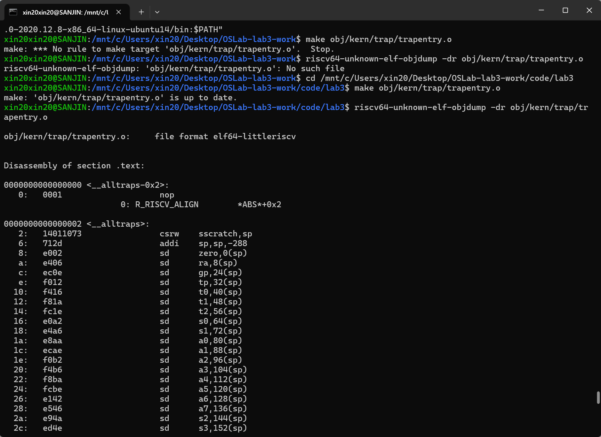
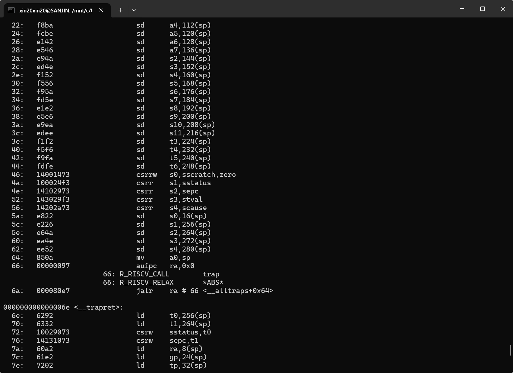
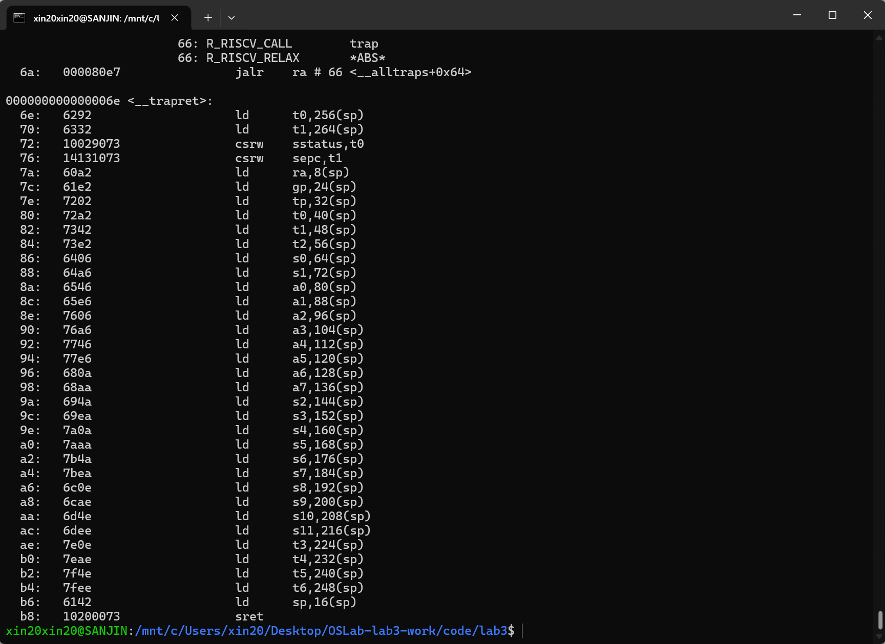
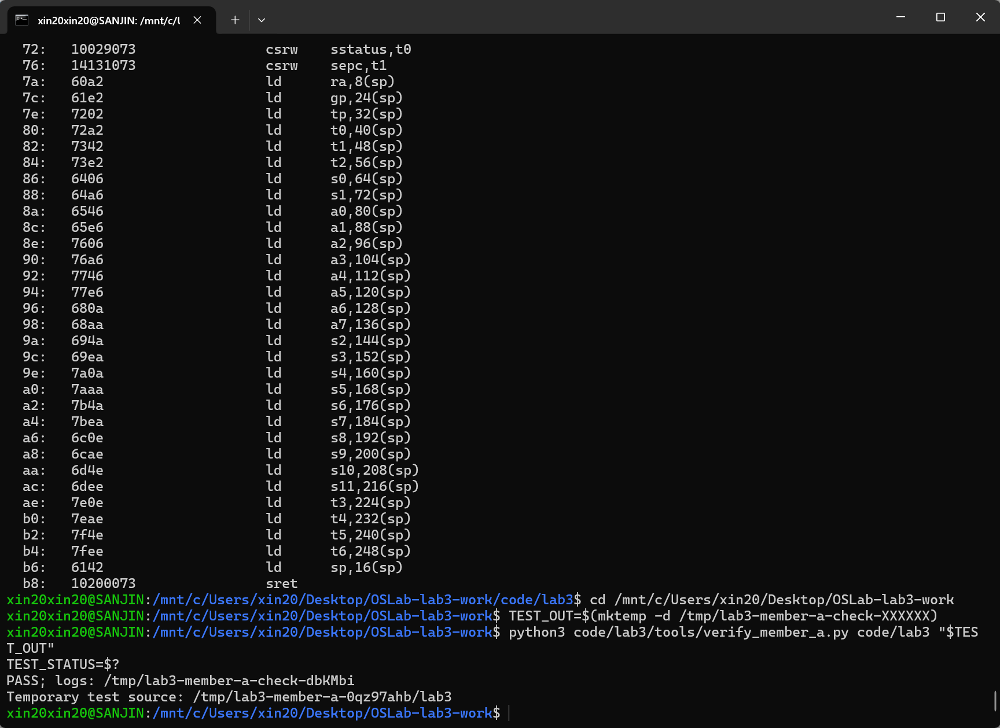
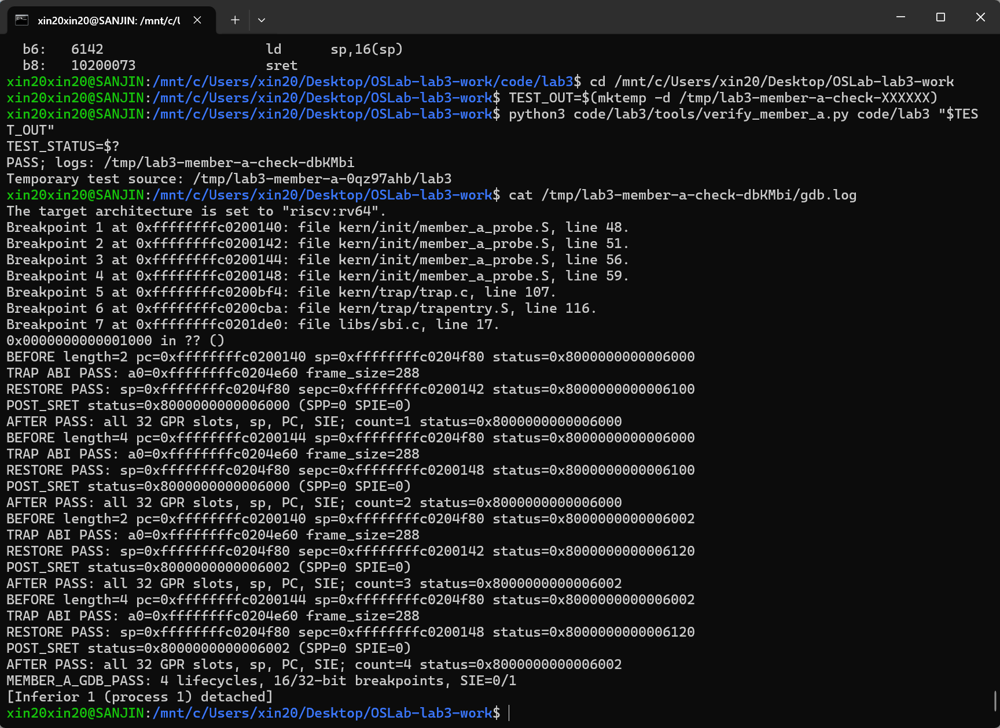
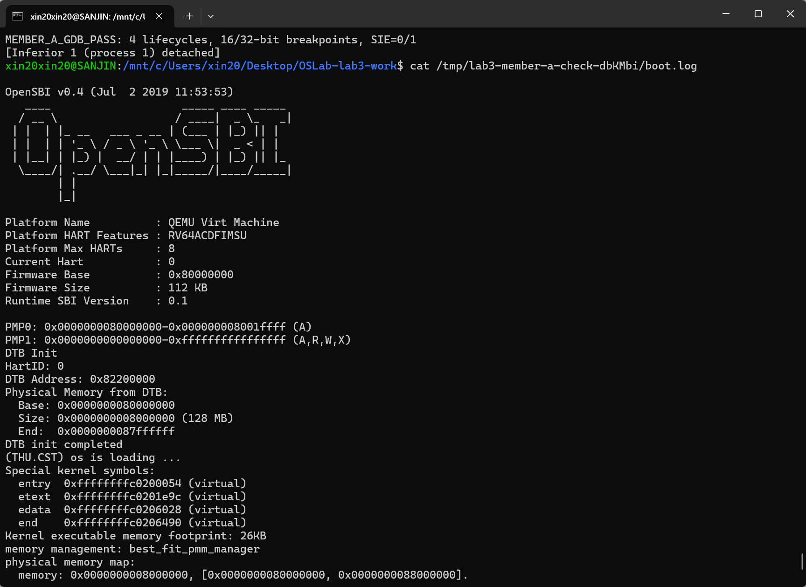
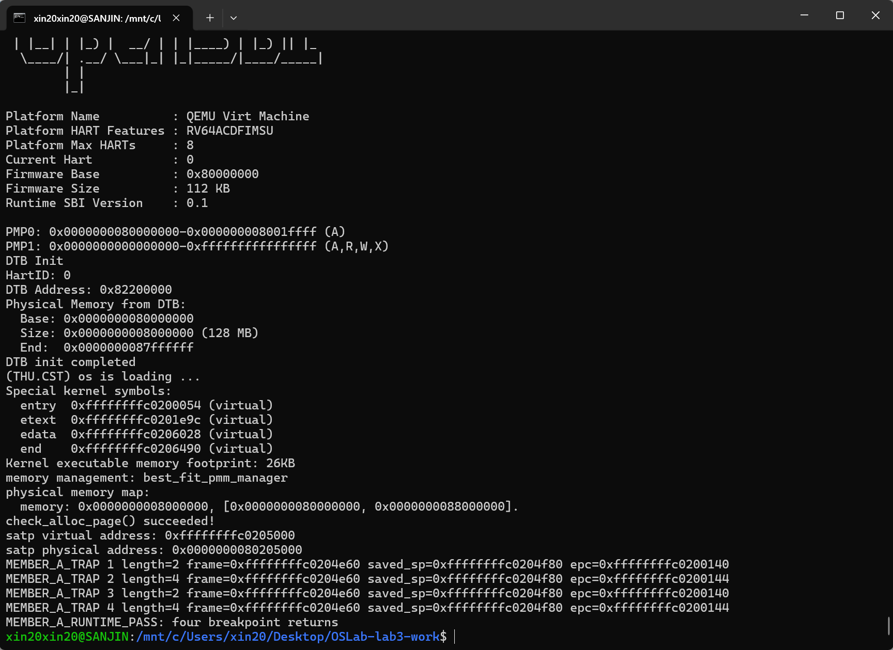
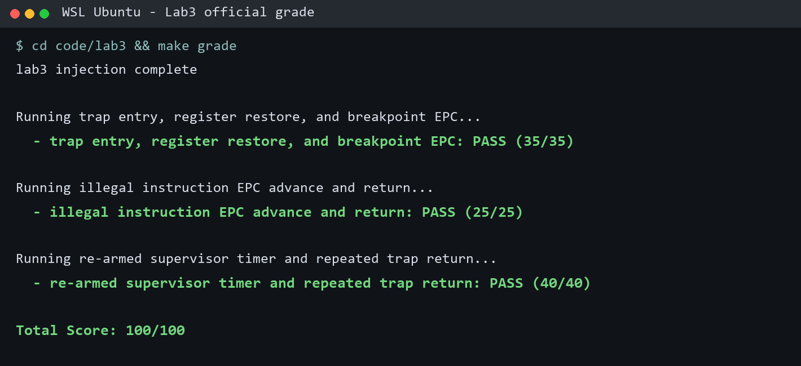

# 操作系统实验报告

## 实验基本信息

| 项目 | 内容 |
| --- | --- |
| **实验名称** | Lab 3：中断与异常处理 |
| **小组成员** | 2411061-牛雨萱、2410721-何熹淳、2414166-滕鑫 |
| **记录日期** | 2026-10-27 |

### 小组分工

**练习/模块分工：**

| 成员 | 负责的练习/模块 | 当前状态 |
| --- | --- | --- |
| 2414166-滕鑫 | 模块一：Trap 上下文恢复与入口；现场布局、ABI 与 CSR 核对 | 已实现，独立验证通过 |
| 2410721-何熹淳 | 模块二：中断分类、时钟计数、输出与关机 | 已实现，课程测试通过 |
| 2411061-牛雨萱 | 模块二：非法指令与断点异常；集成测试 | 由全组继续整合 |

**实验报告分工：**

| 成员 | 负责的报告部分 |
| --- | --- |
| 2414166-滕鑫 | 报告骨架、模块一章节、spec/prompt、现场恢复调试与测试证据 |
| 2410721-何熹淳 | 中断和时钟章节、真实提示词与调试记录、测试结果 |
| 2411061-牛雨萱 | 异常处理章节、真实提示词与调试记录、合并后的完整验收与报告整合 |

***

## 一、实验目的

1. 理解 RISC-V 中 Trap、中断和异常的关系，以及硬件与内核在处理过程中的分工。
2. 理解 Trap frame 的内存布局，掌握通用寄存器、栈指针与返回 CSR 的保存和恢复。
3. 建立汇编入口到 C 语言处理函数的调用关系，遵守参数传递和栈对齐约定。
4. 通过断点、非法指令异常和时钟中断验证完整处理流程，并用课程评分脚本进行集成验收。
5. 通过 spec、prompt、代码检查和实际调试，验证 AI 生成实现是否满足框架约束。

***

## 二、实验环境

| 项目 | 本次实际环境 |
| --- | --- |
| 宿主环境 | Windows，Ubuntu WSL |
| 交叉编译器 | riscv64-unknown-elf-gcc，SiFive GCC 10.2.0 |
| 调试器 | riscv64-unknown-elf-gdb，SiFive GDB 10.1 |
| 模拟器 | QEMU 4.1.1，virt 平台 |
| 构建工具 | GNU Make 4.4.1 |
| 固件与内存 | 基础启动日志显示 OpenSBI v0.4、128 MB 内存 |
| 成员 A 开发分支 | lab3-member-a，基于已推送的公共 lab3 起始版本 |

**AI 工具使用情况：**

| 成员 | AI 编程工具 | 底层模型 | 备注 |
| --- | --- | --- | --- |
| 2414166-滕鑫 | Codex桌面应用 | GPT6 | 模块一实现、独立测试和报告整理 |
| 2410721-何熹淳 | Codex 桌面应用 | GPT-6 | 中断与时钟实现、测试和报告整理 |
| 成员 C | 待本人补充 | 待本人补充 | 同上 |

***

## 三、实验整体逻辑分析

### 3.1 本章节的逻辑主线

Lab2 提供物理内存管理和启动页表。Lab3 在这一基础上，为内核增加保存现场、进入处理函数并返回原执行流的能力。

```text
硬件记录 Trap 原因与返回位置
    → stvec 指向 __alltraps
    → SAVE_ALL 在当前内核栈保存现场
    → a0 = 当前 Trap frame 地址
    → trap(tf) → trap_dispatch(tf)
    → interrupt_handler / exception_handler
    → __trapret → RESTORE_ALL → sret
    → 恢复原执行流
```

模块一负责现场与调用边界；模块二负责具体事件。异常处理函数可以修改 `tf->epc`，模块一使用修改后的值恢复 `sepc`，而不自行判断异常指令长度。

### 3.2 功能的逐步实现

1. **准备内存依赖。** 迁移 Lab2 的 `page_init()` 和 Best-Fit，使用 Lab3 的 `PHYSICAL_MEMORY_OFFSET`，保留内存操作的中断保护。
2. **修复启动过渡映射。** 保留高地址内核映射，并迁移开启分页期间的恒等映射，保留 Lab3 的精确栈地址初始化。
3. **建立 Trap 入口与返回闭环。** 对照 `SAVE_ALL` 和 `trapframe` 实现 `RESTORE_ALL`、`__alltraps`。
4. **实现具体处理。** 在中断分支中完成分类、时钟重设、计数输出和自动关机；异常分支根据指令长度更新 `epc`。
5. **集成验收。** 合并后运行课程测试，验证连续中断与各种异常返回，最终为 100/100。

***

## 四、实验内容与实现


### 功能模块：**【功能模块一：Trap 上下文恢复与入口】**

**负责人：** 2414166-滕鑫

#### 模块功能描述

**需要实现/修改的功能：**

```asm
# kern/trap/trapentry.S
.macro RESTORE_ALL
    # 从当前 Trap frame 恢复返回状态
.endm

__alltraps:
    # SAVE_ALL 后将现场传给 trap()
```

**功能说明：**

- 上游由硬件保存返回 PC、原因及状态，跳转到 `stvec` 指定的汇编入口。
- 已有 `SAVE_ALL` 将通用寄存器和关键 CSR 放到当前内核栈上。
- 本模块将现场地址传入 C 函数，处理完毕后恢复并返回。
- 当前实现针对框架的内核 S 态路径，不扩展用户栈切换、浮点或向量现场保存。

#### Trap frame 布局与关键约束

| 保存内容 | 字节偏移 | 恢复/使用方式 |
| --- | --- | --- |
| x0～x31 | 0～248，每项 8 字节 | x0 恒零；恢复 x1、x3～x31；最后恢复 x2 |
| 原 sp（x2 槽位） | 16 | 不是当前现场基址，而是进入前的栈指针 |
| status / sstatus | 256 | 恢复返回特权级和中断相关状态 |
| epc / sepc | 264 | 使用处理函数处理后的返回地址 |
| badvaddr / 异常附加信息 | 272 | 诊断与处理依据，不机械写回 |
| cause / scause | 280 | 分发与诊断依据，不机械写回 |

整个现场为 288 字节。`SAVE_ALL` 先借助 `sscratch` 保存原 sp，再分配现场，随后将原 sp 写入偏移 16。288 是 16 的整数倍，因此原栈对齐时，传入 C 函数的栈仍满足 ABI 对齐。

#### Spec 的设计

**前置条件：** `sp` 指向有效 Trap frame，布局与已有 `SAVE_ALL` 一致，C 层处理函数遵守 ABI。

**后置条件：** `sstatus`、`sepc` 和可写 GPR 恢复到现场所描述的状态，`sp` 等于保存的原值，随后能够执行 `sret`。

**不变量：** 不修改 `SAVE_ALL`、`trapframe` 或 `trap()` 接口；不自行递增 epc，不强制 SPP=0；恢复 sp 前所有现场读取都基于同一地址。

完整规格和提示词汇总见 [prompt.md](prompt.md)。

#### 最终提示词

```text
[PROMPT]
完成 kern/trap/trapentry.S 中 RESTORE_ALL 和 __alltraps 的待填部分。

[RELY]
SAVE_ALL、trapframe、REGBYTES、LOAD/STORE 和 trap() 已提供。
RV64 现场为 36 个 8 字节槽位，x2 槽位保存 Trap 前的 sp。

[GUARANTEE]
不修改保存逻辑、结构体、模块二和评分脚本；保留任务注释和学号。
临时寄存器使用后恢复原值，最后恢复 sp，不自行调整 epc 或 SPP。

[SPECIFICATION]
先恢复 sstatus/sepc，再恢复 GPR；SAVE_ALL 后通过 a0 传入现场，
调用 trap()，返回后进入 __trapret，恢复并执行 sret。
核对现场布局、栈对齐、CSR 和调用约定，并提供实际验证证据。
```

#### 实现思路与正确性分析

`RESTORE_ALL` 用 `t0/t1` 加载偏移 256/264 的数据，写入 `sstatus/sepc`。之后恢复 `x1`、`x3`～`x31`，包括刚刚使用的临时寄存器，最后加载偏移 16 恢复 `sp`。如果过早恢复 sp，后续加载将基于原栈而不是 Trap frame，因此顺序是正确性的关键。

`__alltraps` 在 `SAVE_ALL` 后执行 `mv a0, sp` 和 `call trap`。调用修改的是当前 ra，原 ra 已保存在现场中。C 函数返回后顺序进入 `__trapret`，现场恢复将原 ra 还原。

返回到哪里由 `tf->epc` 决定，返回特权级来自保存状态。

#### 实现迭代过程

##### 第一次实现与验证工具迭代

**起始状态：** `SAVE_ALL` 和 `trapframe` 已有，两个模块一占位未实现；模块二仍为空缺。

**实施过程：** 核对布局 → 实现恢复及调用 → 编译汇编目标 → 创建隔离副本和异常测试替身 → 用 GDB 比较四次 Trap 的现场与返回状态。

**遇到的问题及处理：**

| 实际问题 | 原因与定位 | 处理与结果 |
| --- | --- | --- |
| GDB 对 `$sp & 15` 报类型错误 | 指针类型不能直接按该表达式位运算 | 转为 `unsigned long` 后检查栈对齐 |
| 直接入口断点未按预期命中 | 当前 QEMU/GDB 组合的触发指令继续执行路径没有可靠停在该断点 | 改在 `*trap` 精确入口核对 SAVE_ALL 后的完整现场，明确观测位置 |
| 预期 sret 后 SPIE=1，但实测为 0 | QEMU 4.1.1 的实现显式清零 SPIE | 核对该版本官方源码，记录差异，保持内核实现不变 |


**最终结果：** 汇编目标编译成功；四次隔离 Trap 往返通过；正式源码只有 `trapentry.S` 的模块一逻辑变化，两处学号为 2414166。

详细记录见 [evidence/member-a/debug-record.md](evidence/member-a/debug-record.md)。

### 功能模块：**【功能模块二：中断与时钟处理】**

**负责人：** 2410721-何熹淳

#### 模块功能描述

需要实现 `interrupt_handler(struct trapframe *tf)`：分类中断，持续设置时钟事件，每次增加 ticks，按规定输出并达到条件后关机，对其他分支提示或兜底。

`scause` 的最高位是中断标志，低位才是 cause code。实现先根据 `__riscv_xlen` 清除最高位，再用 `switch` 区分软件中断、时钟中断和外部中断，并覆盖 U/S/H/M 四种来源。未知编号会输出编号和完整 Trap frame，便于定位现场。

Supervisor Timer 分支按以下顺序处理：

1. 调用 `clock_set_next_event()` 设置下一次时钟事件；
2. 将全局变量 `ticks` 加一；
3. 每累计 `TICK_NUM`（100）次调用 `print_ticks()`；
4. 用独立变量统计打印次数，输出十次后调用 `sbi_shutdown()`。

OpenSBI 提供的是一次性定时事件，所以每次时钟中断都必须重新设置下一次事件。若只增加 `ticks` 而不重设，系统只会收到第一次中断，无法形成持续时钟。中断处理不修改 `epc`，`sret` 后继续执行被打断位置。

#### 最终提示词与实现迭代过程

最终提示词按 `[PROMPT]`、`[RELY]`、`[GUARANTEE]`、`[SPECIFICATION]` 四段组织，完整内容见 [prompt.md](prompt.md)。规格中明确了真实中断计数、一次性定时器重设、未知中断输出以及不得修改 `epc` 等约束。

实际调试中主要处理了两个问题：一是 `scause` 同时包含类型位和编号，直接匹配完整值会导致分支识别错误，因此先屏蔽最高位；二是时钟只触发一次，定位到 SBI 定时事件需要每次重新设置。修正后持续时钟测试能够到达 200 ticks，并保持多次 Trap 返回时寄存器现场不被破坏。

### 功能模块：**【功能模块二：异常处理】**

**负责人：** 成员 C，姓名待确认。

#### 模块功能描述

需要实现 `exception_handler(struct trapframe *tf)`：处理非法指令和断点异常，输出规定信息，根据对应指令长度更新 `tf->epc`，其他异常使用框架兜底输出。

#### 最终提示词与实现迭代过程

**待成员 C 补充真实过程。** 模块一测试副本中的最小断点处理函数仅用于隔离验证，不能当作本模块正式成果。

***

## 五、测试与验证

### 5.1 公共起始版本的基础验证

独立副本临时跳过 Trap/时钟初始化，增加空处理函数使其能够构建；内存初始化与原有 Best-Fit 自检完成后关机。正式源码不含这些替身。

| 验证项 | 实际证据 | 可以得出的结论 |
| --- | --- | --- |
| 编译、链接 | 成功生成内核与镜像 | 基础内存依赖与当前框架兼容 |
| DTB | 128 MB | 正常读取内存信息 |
| 分配器 | best_fit_pmm_manager | 已接入迁移后的实现 |
| 内存自检 | check_alloc_page() succeeded! | 原有分配器自检通过 |
| 结束 | BASELINE_MEMORY_SMOKE_PASS，正常关机 | 基础验证执行完成 |


### 5.2 模块一 的 Trap 现场恢复验证

**复现命令：** 在 WSL 中从本仓库根目录运行。

```bash
export PATH="/opt/riscv/riscv64-unknown-elf-toolchain-10.2.0-2020.12.8-x86_64-linux-ubuntu14/bin:$PATH"
make -C code/lab3 obj/kern/trap/trapentry.o
python3 code/lab3/tools/verify_member_a.py code/lab3 /tmp/member-a-validation
cat /tmp/member-a-validation/gdb.log
cat /tmp/member-a-validation/boot.log
```

脚本只在独立 `/tmp` 副本中添加测试替身。探针先保护自身调用者的 callee-saved 寄存器与 ra，再触发断点，避免测试本身违反 ABI。脚本要求正式模块二仍为占位；合并 B/C 后应转入完整集成验证。

#### 5.2.1 汇编目标文件与反汇编检查

 在 WSL 中进入 `code/lab3` 后执行以下命令，检查模块一目标文件：

```bash
make obj/kern/trap/trapentry.o
riscv64-unknown-elf-objdump -dr obj/kern/trap/trapentry.o
```

图 5-1 显示目标文件已存在，Make 判断其为最新版本（`is up to date`），并成功输出反汇编；这次命令没有重新编译。截图顶部保留了此前在仓库根目录执行命令造成的路径错误，进入 `code/lab3` 后已解决。反汇编显示分配 288 字节现场，并按槽位保存寄存器。



图 5-2 显示原 sp 与 CSR 信息的保存位置、`mv a0,sp` 传参，以及 `R_RISCV_CALL trap` 调用重定位。目标文件尚未链接，`auipc/jalr` 配合重定位记录是正常的调用表示。



图 5-3 显示先恢复 `sstatus/sepc`，再恢复通用寄存器，最后执行 `ld sp,16(sp)` 和 `sret`。上述截图证明目标文件的布局和指令顺序符合设计，动态正确性由后续 QEMU/GDB 检查验证。



#### 5.2.2 隔离验证执行结果

重新执行独立验证脚本，使用 `mktemp -d /tmp/lab3-member-a-check-XXXXXX` 创建结果目录。本次截图中的结果目录为 `/tmp/lab3-member-a-check-dbKMbi`，测试源码副本为 `/tmp/lab3-member-a-0qz97ahb/lab3`。脚本完成后输出 `PASS; logs: ...`，表示编译、GDB 断言、运行结果检查和正常关机均已通过。




**测试覆盖：**

| 测试类别 | 实际检查 | 结果 |
| --- | --- | --- |
| 指令长度与使能组合 | 16/32 位断点分别在 SIE=0/1 下触发 | 四次通过 |
| 参数与布局 | a0=现场地址；原 sp-当前 sp=288；16 字节对齐 | 通过 |
| 保存完整性 | x0～x31 槽位和四个 CSR 槽位与观测值一致 | 通过 |
| 恢复完整性 | sret 前、返回后比较所有 GPR；原 sp 不漂移 | 通过 |
| 控制流 | 返回地址分别越过 2/4 字节，SIE 恢复原值 | 通过 |

**关键实测数据：**

| 项目 | 数值 |
| --- | --- |
| Trap 前及返回后的 sp | 0xffffffffc0204f80 |
| Trap frame 地址 | 0xffffffffc0204e60 |
| 差值 | 0x120，即 288 字节 |
| 16 位断点返回 | 0xffffffffc0200140 → 0xffffffffc0200142 |
| 32 位断点返回 | 0xffffffffc0200144 → 0xffffffffc0200148 |

最终日志分别包含：

```text
MEMBER_A_GDB_PASS: 4 lifecycles, 16/32-bit breakpoints, SIE=0/1
MEMBER_A_RUNTIME_PASS: four breakpoint returns
```


#### 5.2.3 GDB 现场恢复与内核运行截图

图 5-5 展示四次完整往返：16/32 位断点分别在 SIE=0/1 下触发。每次均经过 `TRAP ABI PASS`、`RESTORE PASS`、`AFTER PASS`，最后输出 `MEMBER_A_GDB_PASS`。观测位置为保存现场后的 `trap()` 精确入口、`sret` 前及返回位置，检查内容包括现场槽位、参数、栈对齐、CSR、通用寄存器和返回 PC。



图 5-6 记录本次测试的 OpenSBI、QEMU Virt 平台及 128 MB 内存启动信息，用于说明实际运行环境。



图 5-7 显示内存自检通过，四条 `MEMBER_A_TRAP` 记录依次出现，最终输出 `MEMBER_A_RUNTIME_PASS: four breakpoint returns`。结合 GDB 检查，可确认模块一在本次四种组合下完成现场保存、恢复和返回。




### 5.3 模块二与完整集成验收

```bash
cd code/lab3
make clean
make
make grade
```

课程脚本实际测试结果：

| 测试项 | 结果 |
| --- | --- |
| Trap entry、寄存器恢复、断点 EPC | PASS（35/35） |
| 非法指令 EPC 前移与返回 | PASS（25/25） |
| Supervisor Timer 重设与重复 Trap 返回 | PASS（40/40） |
| 总分 | **100/100** |

持续时钟测试还检查了 `Supervisor software interrupt`、未知中断编号 15、`100 ticks` 以及 `ticks=200`。测试摘要见 [evidence/lab3_grade.log](evidence/lab3_grade.log)，截图如下。



***

## 六、实验总结与收获

### 对操作系统的理解

1. 本实验重要知识点及其与 OS 原理的对应关系：

| 本实验知识点 | OS 原理知识点 | 含义、关系与差异 |
| --- | --- | --- |
| Trap frame 与 SAVE_ALL/RESTORE_ALL | 中断现场保护 | 硬件保存部分控制状态，软件保存 GPR；共同恢复被打断执行流 |
| a0 参数与栈对齐 | ABI 和内核入口 | Trap 进入不是普通函数调用，但调用 C 函数时仍遵守 ABI |
| sepc、tf->epc | 异常返回与恢复执行 | 处理模块决定返回地址，底层负责恢复，不混淆事件处理和现场管理 |
| sstatus、SPP、SIE、SPIE | 特权级与中断屏蔽 | 区分 Trap 前、处理期间和返回后的状态，且注意模拟器版本差异 |
| sscratch 与保存的 sp | 栈与上下文 | 当前栈指针是现场基址，保存的栈指针是返回目标 |
| local_intr_save/restore | 临界区保护 | 恢复原中断状态，不应无条件打开中断；不等价于完整多核互斥 |
| trap_dispatch | 机制与策略分离 | 入口统一保存与恢复，具体中断和异常由不同处理函数负责 |

2. OS 原理中重要但当前实现未覆盖的内容：

- 进程调度与进程间上下文切换：当前回到原执行流，没有选择其他进程。
- 用户栈/内核栈切换和完整系统调用：当前验证为内核态 Trap。
- 嵌套中断优先级、多核同步与可抢占内核。
- 浮点/向量扩展现场，以及缺页异常恢复与页面置换。

### AI 协作开发的经验

1. 先核对保存布局再生成恢复逻辑，避免模型凭经验假设另一套现场结构。
2. 把输入、输出和不变量写入 spec，尤其是 sp 恢复顺序、不得改 SAVE_ALL 和不得自行调整 epc。
3. 将代码实现与验证工具问题分开定位。GDB 表达式错误不是内核错误；模拟器行为需要查明版本和实现。
4. 以真实寄存器比较验证正确性，不能仅凭编译成功或看到一条打印判定上下文完整。
5. 先用模块一隔离测试确认现场恢复，再用课程集成测试验证模块间配合；局部测试和最终验收的结论分开记录。

***

报告正文以本文件为唯一维护入口；提示词在 [prompt.md](prompt.md)，日志与调试记录在 `evidence/`。当前代码、报告、提示词和测试图片均已放入 `lab3` 分支规定目录。
