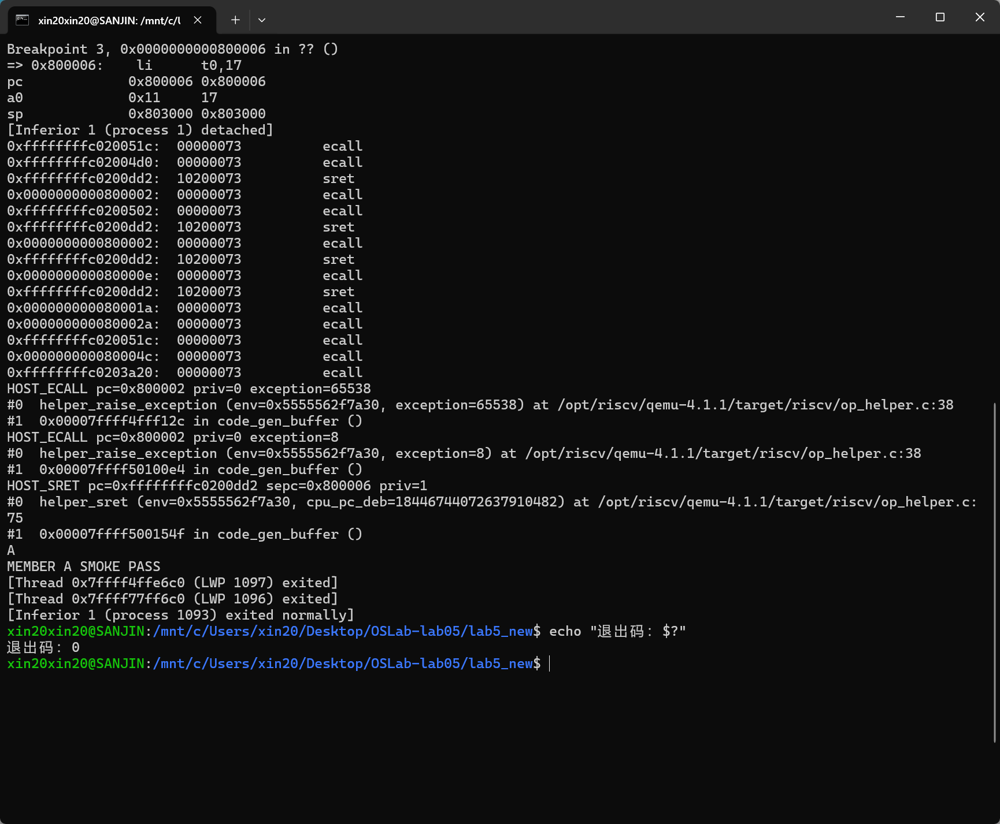

# 操作系统实验报告

## 实验基本信息

| 项目 | 内容 |
| --- | --- |
| **实验名称** | Lab 5：用户程序 |
| **小组成员** | 2411061-牛雨萱、2410721-何熹淳、2414166-滕鑫 |
| **记录日期** | 2026-11-24 |
| **报告状态** | 小组汇总稿。滕鑫的独立验证通过，模块二、三、四待补写，完整构建和课程评分等待联调。 |

### 小组分工

**练习/模块分工：**

| 成员 | 负责的练习/模块 | 当前状态 |
| --- | --- | --- |
| 2414166-滕鑫 | 功能模块一、Lab2/Lab3/Lab4 的相关前置整合、双重 GDB、COW Challenge | 模块一与双重 GDB 已通过独立验证，COW 核心已验证，私有 fork 接入待联调 |
| 2410721-何熹淳 | 具体模块待认领 | 待填写 |
| 2411061-牛雨萱 | 具体模块待认领 | 待填写 |

**实验报告分工：**

| 成员 | 负责的报告部分 |
| --- | --- |
| 2414166-滕鑫 | 整体框架、前置整合、模块一规格与实现、双重 GDB、COW 设计和独立测试 |
| 2410721-何熹淳 | 待确认模块后填写对应的规格、实现、迭代过程和验证结果 |
| 2411061-牛雨萱 | 待确认模块后填写对应的规格、实现、迭代过程和验证结果 |

***

## 一、实验目的

1. 理解 ucore 如何创建、装载并运行第一个用户进程。
2. 掌握异常入口、系统调用分发和返回用户态的执行过程。
3. 理解 fork、exec、wait、exit 和相关进程控制的协作。
4. 通过双重 GDB 观察特权级切换与 QEMU 指令翻译，并通过 Challenge 理解写时复制。

***

## 二、实验环境

| 项目 | 本次实际环境 |
| --- | --- |
| 宿主环境 | Windows、Ubuntu WSL |
| 交叉编译器 | riscv64-unknown-elf-gcc，SiFive GCC 10.2.0 |
| 模拟器 | QEMU 4.1.1，virt 平台，宿主侧使用带调试信息的构建 |
| 固件与内存 | OpenSBI v0.4，128 MiB，单 hart |
| 实验代码 | 仓库根目录下的 `code/lab5/` |

**AI 工具使用情况：**

| 成员 | AI 编程工具 | 备注 |
| --- | --- | --- |
| 2414166-滕鑫 | Codex | 代码实现、前置代码迁移、QEMU 双重 GDB 与 COW 独立验证 |
| 2410721-何熹淳 | 待填 | 待填写实际采用的工具和使用环节 |
| 2411061-牛雨萱 | 待填 | 待填写实际采用的工具和使用环节 |

***

## 三、实验整体逻辑分析

### 3.1 本章节的逻辑主线

Lab04 启动并调度内核线程，Lab05 先补齐异常入口与返回，再由 `init_main` 启动 `user_main`，将构建进镜像的 ELF 段映射到进程地址空间。第一次进入 U 态和后续系统调用返回共用 `__trapret`。用户进程运行后，`fork` 复制现场和地址空间，`exit` 释放自身用户空间并进入僵尸态，父进程通过 `wait` 取得退出码并回收剩余资源。`yield` 和 `kill` 分别驱动重新调度和退出。Challenge 让私有 `fork` 的可写页推迟复制到首次写入。

用户进程的主线如下。

~~~text
proc_init → init_main → user_main → kernel_execve → load_icode → sret
          → 用户程序 → ecall → syscall → fork / exec / wait / exit → sret
~~~

预加载分两步。构建时独立用户 ELF 被作为二进制附加到内核镜像，启动后镜像已经在物理内存。进程运行前，`load_icode` 才根据 ELF 段创建用户映射与栈。通用操作系统通常运行文件系统中的可执行文件，并可按需建立映射。本实验把程序嵌入镜像，因而当前阶段即可测试进程机制。

### 3.2 功能的逐步实现

1. 迁移 Lab2 的物理内存管理、Lab3 的 Trap、Lab4 的页表与进程调度前置逻辑。
2. 建立 U 态系统调用入口，恢复寄存器并返回正确的特权级。
3. 创建首个用户进程，加载 ELF 并经异常返回进入用户态。
4. 完成进程复制以及等待、退出、让出 CPU 和终止进程。
5. 运行课程评分和独立调试，接入 COW 并回归普通 fork。

***

## 四、实验内容与实现

### 前置工作：Lab2/Lab3/Lab4 代码整合

**负责人：** 2414166-滕鑫。

以下文件路径均相对于 `code/lab5/`：

| 文件 | 改动 |
| --- | --- |
| `kern/mm/pmm.c` | 迁移物理页初始化和页映射操作，补充分配失败回滚，保留 TLB fence 的编译器屏障 |
| `kern/mm/default_pmm.c` | 迁移 Best-Fit 分配器，适配 Lab05 的 `free_area` 和 `default_pmm_manager` 声明 |
| `kern/trap/trapentry.S` | 补全 Trap 到 C 函数的入口，扩展 `RESTORE_ALL`，保留 `forkrets` |
| `kern/trap/trap.c` | 重设时钟事件并分发用户系统调用和写缺页异常 |
| `../../report/evidence/verify-member-a.sh` | 在临时副本构建调试内核，保留 QEMU 与两侧 GDB 的验证记录 |

`page_init()` 保留原有 2411061 标记，Best-Fit 和页表操作保留 2414166 标记。Lab05 的模块一改动标为 `lab5 function1 2414166`。

### 功能模块：**【功能模块一：用户态系统调用功能（设计提示词借助 AI 完成）】**

**负责人：** 2414166-滕鑫。

#### 模块功能描述

需要在 `code/lab5/kern/trap/` 和 `code/lab5/kern/syscall/syscall.c` 中补全：

```c
static void exception_handler(struct trapframe *tf);
void syscall(void);
static int sys_exit(uint64_t arg[]);
static int sys_fork(uint64_t arg[]);
static int sys_wait(uint64_t arg[]);
static int sys_exec(uint64_t arg[]);
static int sys_yield(uint64_t arg[]);
static int sys_kill(uint64_t arg[]);
static int sys_getpid(uint64_t arg[]);
static int sys_putc(uint64_t arg[]);
static int sys_pgdir(uint64_t arg[]);
```

同时完成汇编入口与 `RESTORE_ALL`，并让 `sys_pgdir` 调用 `print_pgdir()`。系统调用入口负责分发，进程操作由对应模块的 `do_*` 实现。

#### Spec 的设计

规定 TrapFrame 的先决状态、系统调用编号及参数位置、成功与失败时的返回值，以及 U 态和 S 态的栈恢复规则。用户 `ecall` 的返回地址必须前移，COW 写缺页成功后则重试原指令。

#### 最终提示词

```text
[PROMPT]
任务：修改 kern/trap/trap.c、trapentry.S、kern/syscall/syscall.c、
user/libs/syscall.[ch]，打通 U 态 ecall 到内核分发及 sret。适配 Lab2/Lab4
的页表与物理内存前置代码，并补齐 kern/mm/pmm.c 的用户页表显示。
操作要求：直接修改实际项目文件，保留模板的 lab5 标注，将本人所负责
位置的 YOUR CODE 改为 2414166。模块二、三、四通过既有 do_* 接口交接。
输出要求：提供可交叉编译的代码和可复核的运行证据，区分临时验证与全组评分。

[RELY]
struct trapframe 的 gpr、status、epc、tval、cause，struct proc_struct 的
tf、pid、mm、flags、need_resched，sscratch、SSTATUS_SPP、CAUSE_USER_ECALL。
libs/unistd.h 的 SYS_* 编号，do_exit、do_fork、do_wait、do_execve、
do_yield、do_kill 的 proc.h 接口，user_mem_check、cputchar、get_pte。

[GUARANTEE]
static void interrupt_handler(struct trapframe *tf);
static void exception_handler(struct trapframe *tf);
void syscall(void);
static int sys_exit(uint64_t arg[]);
static int sys_fork(uint64_t arg[]);
static int sys_wait(uint64_t arg[]);
static int sys_exec(uint64_t arg[]);
static int sys_yield(uint64_t arg[]);
static int sys_kill(uint64_t arg[]);
static int sys_getpid(uint64_t arg[]);
static int sys_putc(uint64_t arg[]);
static int sys_pgdir(uint64_t arg[]);
void print_pgdir(void);
汇编交付 RESTORE_ALL 和 __alltraps 到 trap 的调用路径。

[SPECIFICATION]
exception_handler
Pre-Condition: trap 已保存现场，当前进程的 tf 指向本次现场。
Post-Condition: U 态 ecall 分发一次，保存的返回地址移到下一条指令。
Case 1: 用户触发其他不可恢复异常，终止当前用户进程。
Case 2: 内核触发不可恢复异常，输出现场并停止。
Requirements: COW 写缺页修复后重试原指令。

interrupt_handler / RESTORE_ALL
Pre-Condition: 进入中断时寄存器已保存在内核栈的 36 个字宽槽位。
Post-Condition: 时钟中断重新安排下一次时钟事件。恢复路径恢复 CSR 和通用寄存器。
Case 1: 返回 U 态，预先保存下次进入所需的内核栈指针，最后恢复用户 sp。
Case 2: 返回 S 态，sscratch 保持零，恢复原内核 sp。

syscall / sys_*
Pre-Condition: 当前进程的 trapframe 完整，a0 是调用号，a1 至 a5 为实参。
Post-Condition: 有效调用分发一次，结果经 a0 返回。非法编号或空槽返回 -E_INVAL。
Case 1: exit、fork、yield、kill 转交对应 do_*，fork 使用当前用户 sp 和现场。
Case 2: wait 的退出码指针可空，非空时须可写。exec 的名称和 ELF 范围须可读。
Case 3: getpid 返回当前 PID，putc 输出一字符，pgdir 显示当前用户映射。
Requirements: 不截断调用号，不读取未提供的可变参数，返回值宽度与 C 接口一致。

print_pgdir
Pre-Condition: 可从 current 取得用户地址空间。
Post-Condition: 输出已映射用户页的虚拟地址与权限。没有地址空间时直接返回。
```

#### 实现思路与正确性分析

- `SAVE_ALL` 用 `sscratch` 区分用户栈与内核栈，保存通用寄存器与 CSR，`__alltraps` 把现场地址交给 C。处理期间 `sscratch=0`。恢复时按保存的 `SPP` 决定下次用户 Trap 所需的内核栈地址。先恢复 CSR 及其余寄存器，最后恢复 `sp` 后执行 `sret`。
- `exception_handler` 对用户 `ecall` 将返回地址前移 4 字节。分发从 trapframe 读完整 64 位调用号，检查范围及空槽后再查表。用户封装将参数放入 `a1` 至 `a5`，处理结果写回保存的 `a0`。进入 C 函数后实时寄存器可以被编译器用于传参，实际用户参数要看 trapframe。
- `sys_exit/fork/wait/exec/yield/kill` 通过 `do_*` 交给进程模块。等待的非空退出码指针须可写，执行新 ELF 前须校验名称和 ELF 缓冲区。 `sys_getpid` 读取 PID，`sys_putc` 向内核控制台输出，`sys_pgdir` 显示当前用户页的虚拟地址和权限。
- `interrupt_handler` 重新设置下一次时钟事件并标记重新调度。对不可恢复的用户异常终止当前进程，内核异常则打印现场并停机。页表与 Best-Fit 前置代码从已有 Lab04 实现迁移。

#### 实现迭代过程

先依据模板确认寄存器、栈布局和模块边界，再为每个接口写前置条件、后置条件和错误案例。以下是本轮真实排查摘要。

| 情景 | 验证与处理 |
| --- | --- |
| 模板用户调用封装读了未传入的可变参数，还用 64 位 store 写入 32 位返回变量 | 对照调用约定改成固定参数和显式寄存器约束，由 C 转换返回值 |
| 初次迁移 Lab04 页管理代码时，正则误抓了 `get_pte` 内的旧标记，导致定义重叠。Lab05 头文件还声明了外部 `free_area` | 用首轮交叉编译的重定义和可见性诊断定位，分别迁移映射函数与回滚逻辑，按 Lab05 声明定义 `free_area` |
| 用户 COW 测试找不到 `assert.h` | 对照课程已有测试，改用 `ulib.h` 内的用户态断言，再重新编译 |
| 默认 QEMU 能运行但无法按源码下断点 | 先测符号，再在本机定位带符号的同版本构建，完成实际双重 GDB |

### 功能模块：**【功能模块二：创建加载第一个用户进程功能（设计提示词借助 AI 完成）】**

**负责人：** 待认领。

#### 模块功能描述

任务范围为 `alloc_proc`、`kernel_thread`、`init_main`、`user_main`、`kernel_execve`、`do_execve`、`load_icode` 和 `do_wait`。实际设计由模块负责人补写。

#### Spec、最终提示词与实现思路

> 待模块负责人填写各接口的前置条件、后置条件、典型分支与设计理由，并把四段式提示词填入 [小组提示词与规格记录](prompt.md)。

#### 实现迭代过程

> 待模块负责人填写实际 AI 交互、生成代码中遇到的问题、修复方式和对应证据。

### 功能模块：**【功能模块三：复制用户进程功能（设计提示词借助 AI 完成）】**

**负责人：** 待认领。

#### 模块功能描述

任务范围为 `do_fork`、`copy_mm`、`dup_mmap` 和 `copy_range`。实际设计由模块负责人补写。

#### Spec、最终提示词与实现思路

> 待模块负责人填写各接口的前置条件、后置条件、典型分支与设计理由，并把四段式提示词填入 [小组提示词与规格记录](prompt.md)。

#### 实现迭代过程

> 待模块负责人填写实际 AI 交互、生成代码中遇到的问题、修复方式和对应证据。

### 功能模块：**【功能模块四：其余系统调用功能（设计提示词借助 AI 完成）】**

**负责人：** 待认领。

#### 模块功能描述

任务范围为 `do_exit`、`do_yield` 和 `do_kill`。实际设计由模块负责人补写。

#### Spec、最终提示词与实现思路

> 待模块负责人填写各接口的前置条件、后置条件、典型分支与设计理由，并把四段式提示词填入 [小组提示词与规格记录](prompt.md)。

#### 实现迭代过程

> 待模块负责人填写实际 AI 交互、生成代码中遇到的问题、修复方式和对应证据。

### 扩展练习：Challenge——写时复制（COW）

**负责人：** 2414166-滕鑫。

#### 1. 页面共享与状态转换

`cow_copy_range` 在单 hart 的中断保护区中为子映射增加引用，原来可写的页先在子页表建立只读 COW 映射，再将父页表降权并使旧 TLB 条目失效。标记使用 Sv39 的软件保留位。原来只读的页可以共享，保持只读且没有 COW 标记。

| 当前状态 | 事件 | 后续状态 |
| --- | --- | --- |
| 私有可写 | 私有 fork | 父、子只读 COW，物理页引用增加 |
| 真正只读 | fork 或写入 | fork 后仍只读。写入拒绝 |
| 只读 COW，引用大于 1 | 有权限的写缺页或内核写回 | 写入方获得独立可写页。旧页仍供其他进程使用 |
| 只读 COW，引用为 1 | 有权限的写缺页或内核写回 | 原映射恢复写权限，保留原物理页 |
| 共享映射 | exit、exec 或失败的子进程清理 | 放弃一个映射引用。最后一个引用释放后归还物理页 |
| 只读 COW | 分配失败 | 原映射继续保持只读，返回错误。用户故障由退出路径处理 |

#### 2. 写缺页处理与权限保护

`cow_resolve_write` 要求 VMA 允许写、PTE 是有效用户映射且有 COW 标记。陷阱修复后不修改 `epc`，使原写指令重试。 `copy_to_user` 和等待退出码预检也检查受影响的每一页。经典 Dirty COW 体现了写授权、页身份和映射变化不同步的风险。本实现限定于单 hart，通过原 VMA 权限和 PTE 标记双重检查，并把引用计数及映射变更放在同一受保护路径。多 hart 还需要页表同步和跨核 TLB 失效。本实验以正常功能和只读保护回归为验证范围。

#### 3. 私有 fork 接入与失败清理

接入位置在 `dup_mmap` 中为新地址空间建立对应 VMA 后的私有复制分支。基础分支保留 `copy_range`，Challenge 分支改用 `cow_copy_range(to->pgdir, from->pgdir, start, end)`。若中途失败，调用方按已有 VMA 销毁未发布子进程的地址空间。父映射已降权的页可在下次写入时通过单引用路径恢复。 `CLONE_VM` 在共享整个 `mm` 的路径保持原语义，`do_wait` 写回退出码时使用 `copy_to_user`。

***

## 五、测试与验证

### 5.1 模块一独立验证的方法和结果

从仓库根目录在 WSL 中配置工具链和带符号的 QEMU 后运行脚本。脚本把课程源码复制到临时目录，为独立验证补充最小进程环境。

| 检查 | 实际结果 |
| --- | --- |
| Best-Fit、页表、SLOB、VMA 自检 | 通过 |
| 用户态 getpid 和 putc | 通过 |
| 未实现或越界的调用号 | 返回 `-E_INVAL` |
| ecall 到 sret 和用户栈恢复 | 双重 GDB 观测通过 |
| COW 分裂、原只读页保护和解除映射 | 独立断言通过 |
| 完整 Lab05 构建、COW 用户程序与课程评分 | 待联调，见 5.3 |

实际输出包含：

```text
HOST_ECALL pc=0x800002 priv=0 exception=8
HOST_SRET pc=0xffffffffc0200dd2 sepc=0x800006 priv=1
MEMBER A SMOKE PASS
退出码：0
```

证据：[客户机 GDB 日志](evidence/member-a-guest-gdb.log)、[宿主 GDB 与 QEMU 日志](evidence/member-a-host-gdb.log)、[验证脚本](evidence/verify-member-a.sh)。

#### 5.1.1 验证命令与启动环境

```bash
export PATH="/opt/riscv/riscv64-unknown-elf-toolchain-10.2.0-2020.12.8-x86_64-linux-ubuntu14/bin:$PATH"
export QEMU_DEBUG=/opt/riscv/qemu-4.1.1/riscv64-softmmu/qemu-system-riscv64
bash report/evidence/verify-member-a.sh
```

QEMU 运行在 virt 平台，使用 OpenSBI v0.4 和 128 MiB 内存。脚本开头会打印临时目录，便于核对原始输出。

#### 5.1.2 系统调用功能、前置依赖与双重 GDB 验证

在临时内核中，宿主 GDB 启动带调试信息的 QEMU 4.1.1 并保留两个条件断点。客户机 GDB 从 U 态 `getpid` 追到内核 `syscall`，再在下一条用户指令处停住。临时内核仅用于隔离验证模块一和 COW，不作为组员模块或课程评分结果。原始记录见 [客户机 GDB](evidence/member-a-guest-gdb.log)、[宿主 GDB](evidence/member-a-host-gdb.log)，可用 [验证脚本](evidence/verify-member-a.sh) 复查。

| 观测点 | 实际值 |
| --- | --- |
| 用户 `ecall` 前 | PC `0x800002`，`a0=18`（`SYS_getpid`），`sp=0x803000` |
| 宿主进入异常 helper | `priv=0`，真实 `ecall` 的异常号为 8 |
| 内核 `syscall` | 切换到内核栈，保存的 `cause=8`，框架已将 `epc` 更新为 `0x800006` |
| 宿主进入 `helper_sret` | `priv=1`，`sepc=0x800006` |
| 返回用户态 | PC `0x800006`，`a0=17`（测试 PID），`sp=0x803000` |


图 5-1　客户机 GDB 记录了 `getpid` 执行 `ecall`、进入内核 `syscall`，并返回到下一条用户指令的过程。

QEMU 的 `trans_ecall` 在翻译块中生成异常 helper 并结束翻译块，实际执行时 `helper_raise_exception` 设置异常编号并退出 CPU 执行循环。随后 `riscv_cpu_do_interrupt` 按原特权级确定 ecall 原因，再按委托位更新 `scause`、`sepc`、`sstatus`，选择 S 态入口。返回时 `trans_sret` 生成 helper 调用，`helper_sret` 检查特权、读取 `sepc`、按照 `SPP/SPIE` 恢复模式与中断状态，并把返回地址交回后续执行。宿主回溯里的 `code_gen_buffer` 是实际执行的 TCG 产物。Lab02 的双重 GDB 更关注访存时触发的 TLB 查询和页表遍历；这两次都需要区分翻译块产生的代码与执行中调用的软件 helper。

实际排查中，`/usr/local/bin` 的 QEMU 可启动但没有符号。检查 `nm` 后，在本机保留的 QEMU 4.1.1 构建目录找到了带调试信息的可执行文件，改由宿主 GDB 启动它。宿主断点在同一 PC 还先抓到一次编号 65538 的调试事件。根据源码和随后出现的编号 8，使用后者与客户机的 `scause` 对齐。正常调试已装入的课程用户 ELF 时，可在客户机 GDB 执行 `add-symbol-file obj/__user_exit.out`。这次的临时指令片段由夹具放在已知虚拟地址，因此直接按 PC 下断点。

#### 5.1.3 独立验证完成结果

独立 QEMU 冒烟覆盖了实际用户写缺页、共享页分裂、旧页内容隔离、单引用恢复原页权限、原只读页拒绝升级、解除映射后引用减少。正常用户态测试 `user/cowtest.c` 还覆盖子进程先写、父进程先写以及 `waitpid` 回写，待整组进程模块接入后运行。



图 5-2　宿主 GDB 捕获了 `HOST_ECALL`（异常号 8）和 `HOST_SRET`。独立测试输出 `MEMBER A SMOKE PASS`，脚本退出码为 0。

### 5.2 功能模块二：首个用户进程创建及装载验证

> 待负责人填写目标文件编译、首次进入 U 态、ELF 装载、exec/wait 结果和截图。

### 5.3 功能模块三与完整集成验收

> 模块三的普通 fork、父子返回值、地址空间隔离和失败清理结果由负责人补写。模块四的测试记录同样在对应小节填写。

#### 5.3.1 完整编译与链接

```bash
cd code/lab5
make
```

复查时编译已进入内核链接，仍缺 `proc_init`、`cpu_idle`、`schedule` 和若干 `do_*` 定义。联调后在此补正式构建截图与镜像生成结果。

#### 5.3.2 QEMU 启动与用户程序运行

```bash
make qemu
```

> 待补正式内核的启动信息、首个用户程序输出和退出回收结果。独立验证的启动结果见 5.1。

#### 5.3.3 原有课程评分

```bash
make grade
```

| 评分项 | 实际结果 | 覆盖范围 |
| --- | --- | --- |
| 课程用例 | 待测 | 以实际评分脚本输出逐项填写 |
| 总分 | 待填 | 完整实验的课程评分 |

#### 5.3.4 命令行警告与提示的说明

| 输出 | 原因及本次影响 | 是否可以消除 |
| --- | --- | --- |
| `undefined reference to proc_init` 等 | 当前工作树的进程模块仍待接入，完整镜像未生成 | 按小组分工合入缺失实现后重新构建 |
| `No symbol` 或 `nm: ... no symbols` | 默认安装的 QEMU 缺少宿主 GDB 所需符号 | 已换用同版本的带调试信息构建 |
| `HOST_ECALL ... exception=65538` | 客户机断点触发的调试事件 | 记录实际 ecall 时使用随后出现的 `exception=8` |
| 其他编译提示 | 待联调时填写实际输出与影响 | 待填写 |

### 5.4 功能模块四：进程控制验证

> 待负责人填写 exit、yield、kill 与 wait 的实际输出、退出码、异常分支和证据。

### 5.5 Challenge 端到端验证

> 待普通 fork 和 COW 接入后补充 `cowtest` 输出及截图。COW 核心的独立断言结果见 5.1.3。

***

## 六、实验总结与收获

### 对操作系统的理解

| 实验知识点 | 对应 OS 原理 | 联系与差异 |
| --- | --- | --- |
| `ecall`、TrapFrame 和 `sret` | 系统调用、特权级隔离 | 硬件先保存部分 CSR，双栈和通用寄存器由软件维护。课程 ABI 的调用号在 `a0`，常见 Linux RISC-V ABI 则在 `a7`。 |
| `fork`、`exec`、`exit`、`wait` | 进程与资源生命周期 | 退出者可释放用户映像，待父进程收取退出码后再回收内核栈和 PCB。实际实现细节待负责人补充。 |
| COW、页引用和 TLB 失效 | 虚拟内存保护、延迟复制和翻译缓存一致性 | VMA 表示逻辑权限，PTE 表示硬件当前权限，降权后需使旧翻译失效。 |

OS 原理中重要但本实验未覆盖的内容包括按需调页、页面置换、多核页表同步及远端 TLB 失效、文件系统中的可执行文件加载，以及通用权限和信号模型。

> 待其他成员各自补充模块与 OS 原理的关系及实验未覆盖的知识点。

### AI 协作开发的经验

1. 先对照工程函数声明、TrapFrame 布局和用户调用约定写规格，再生成实现。
2. 用交叉编译诊断迁移时的声明和头文件冲突，按真实接口修正后复编。
3. 同时记录客户机寄存器和宿主 QEMU helper，区分调试事件、真实 ecall 与 sret。
4. 独立验证和完整评分分别记录，保留复现命令、实际结果和未覆盖范围。

> 待其他成员补充各自的 AI 辅助过程、提示词修改和人工复核经验。
